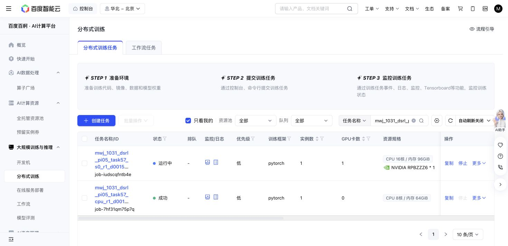

# Task57 DSRL due check — 2026-10-31 14:36 Shanghai

Baige `job-iudscqfntb4e` remains Running at the original source `d001556780c78893cb7ad0310ec46e5d817e5698` and grant `48acb746…`. No job, case, hyperparameter, checkpoint or resource contract changed.

The first read at14:36:29 showed160/160 training successes,2,364 replay chunks,37,420 SAC updates and30,207 all-in simulator actions. The saved verification snapshot at2026-10-31T14:38:37.295896+08:00 contains170/170 training successes,2501 replay chunks,40160 updates and32740 actions. All latest optimizer metrics are finite. No failure/recovery episode has appeared.

| Query panel | Actual optimizer updates | Success | Primitives | Settling | Primitive delta vs native | Paired shorter / equal / longer |
| --- | ---: | ---: | ---: | ---: | ---: | ---: |
| initial_native-000000 | 0 | 10/10 | 1451 | 100 | 0 | 0 / 10 / 0 |
| learned-010000 | 10220 | 10/10 | 1407 | 100 | -44 | 7 / 1 / 2 |
| learned-020000 | 20240 | 10/10 | 1378 | 100 | -73 | 9 / 0 / 1 |
| learned-030000 | 30200 | 10/10 | 1355 | 100 | -96 | 8 / 2 / 0 |

The same10 query states40..49 have identical recorded stochastic query seeds, nominal state hashes and actual initial-observation hashes across all completed panels. Query weights/replay stay unchanged and query SGD is0. The40k panel was still partial in this snapshot; no complete40k score is asserted here.

The completed-episode physical journals independently sum to the saved32,740-action snapshot:25,614 training,7,116 queries and10 qualification settling actions. These include every settling action. Completed rows have0 uncertain-action charge;10 later live journal rows belong to ongoing work beyond the snapshot. This is a snapshot reconciliation, not a final action/GPU cost.

All four immutable panel recovery hashes match. 210 closed-panel/training trace references exist; three sampled episode trace files and two sampled RPC input/outcome pairs match their SHA256 references. The original snapshot's rotating latest-slot path had advanced by the end of the PFS metadata walk. A separate immediate cursor/read at2026-10-31T14:43:44.208366+08:00 matched the111,027,133-byte full recovery at48,940 updates/201 episodes. This is ordinary two-slot rotation; no recovery corruption or retry is indicated.

One allocation/attempt still reserves the same36,000-second aggregate ceiling. At the snapshot its active elapsed time was1904.3s, which is not a terminal charge. Saved output is2387678684 bytes against64GiB; actions remain below1M. Motor before-SHA remains the qualifiedC565 identity; the final after-SHA is pending normal termination.

Native and all completed learned panels score10/10. The shorter paired episode lengths are descriptive on one small stochastic bank; they do not establish a success-rate gain, adaptation benefit or overall sample-efficiency improvement. Training interactions and compute remain separate costs.

Next owned read:14:56Shanghai. No continuous polling or additional allocation is scheduled.

