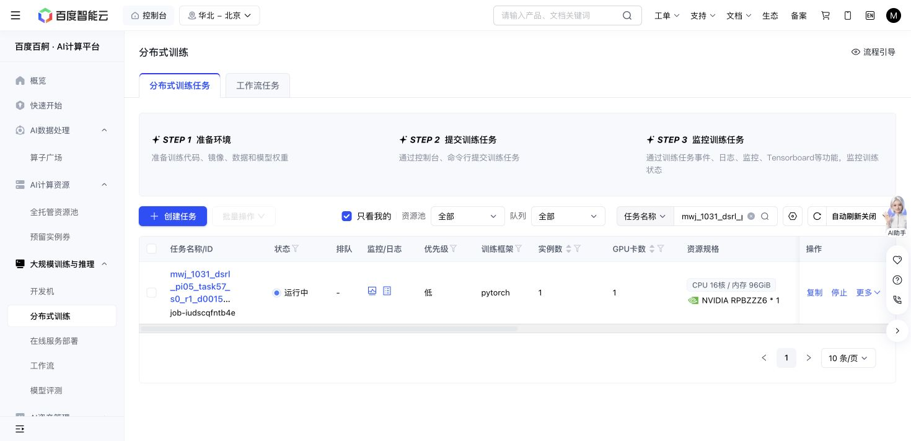

# Task57 DSRL due check — 2026-10-31 15:16 Shanghai

Baige `job-iudscqfntb4e` remains Running. One saved snapshot was read at 2026-10-31T15:19:38.922631+08:00. Source `d001556…`, grant `48acb746…`, the task/state banks and all cumulative limits are unchanged.

Training: 389/389 successes, 5544 replay chunks, 101020 SAC updates. No failed training episode or recovery example is present. Latest losses, entropy and temperature are finite.

| Newly completed threshold | Actual updates | Success | Primitives | Settling |
| ---: | ---: | ---: | ---: | ---: |
| 80000 | 80100 | 10/10 | 1264 | 100 |
| 90000 | 90160 | 10/10 | 1309 | 100 |
| 100000 | 100220 | 10/10 | 1270 | 100 |

Native remains 10/10 with 1,451 primitives plus 100 settling actions. The newest panel uses 1270 primitives, 181 fewer than native on this fixed bank. Its paired cases are 10 shorter, 0 equal and 0 longer. Recorded seeds, nominal states and actual initial-observation hashes match native; query weights/replay are unchanged and query SGD is zero. This is a descriptive trajectory-cost signal with no success headroom, not an overall sample-efficiency or meta-learning result.

The cursor-bound 176890724-byte full recovery matches its SHA on the first read. The newest immutable 100k-threshold recovery, newest completed raw episode, and its actual RPC input/outcome pair also match. The sampled final chunk executed 4 of at most 10 actions. No old checkpoint or journal forest was reread; the previous partial tail was not treated as a verified prefix.

Producer counters report 72601 all-in simulator actions and zero uncertain actions; their sum is internally consistent. Training primitives 52921 and settling 3890 remain separate from query and qualification costs in the JSON. This check does not claim an independent exhaustive journal reconciliation.

Saved storage is 5848491852 bytes against 64GiB. One attempt still reserves the same 36,000 aggregate GPU-seconds; 4365.9 active elapsed seconds is a snapshot, not a final charge. The action ceiling remains 1M. No stop reason, error exit, retry, new allocation, test or source edit occurred.

Next owned check: 15:36 Shanghai. No further polling this turn.

