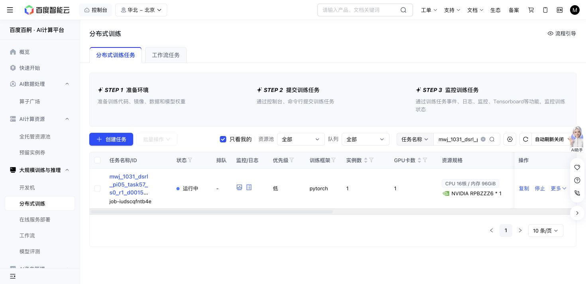

# Task57 DSRL due check — 2026-10-31 15:36 Shanghai

The existing Baige job `job-iudscqfntb4e` is Running. Source, grant, cases and limits are unchanged. No active code, tests, resources or job controls changed.

The single snapshot at 2026-10-31T15:37:00.378646+08:00 records 480/480 training successes, 6,769 replay chunks, 125,520 SAC updates and 87,903 all-in actions. No failed training episode or recovery example is present. Latest optimizer metrics are finite.

| New completed threshold | Actual updates | Success | Primitives | Settling |
| ---: | ---: | ---: | ---: | ---: |
| 110,000 | 110,200 | 10/10 | 1,309 | 100 |
| 120,000 | 120,220 | 10/10 | 1,239 | 100 |

Native remains 10/10, using 1,451 primitives plus 100 settling actions. The newest panel uses 212 fewer primitives; recorded query seeds, nominal states and actual initial-observation hashes match. Query parameters/replay are unchanged with zero query SGD. This continues the previously reported descriptive cost signal on a ceiling bank; no new success, sample-efficiency or meta-learning claim is made.

The stable 207,880,437-byte full recovery and newest 201,175,880-byte immutable milestone match their saved hashes. The newest completed raw trace and its actual RPC input/outcome pair match. The sampled final chunk executes 3 of at most 10 actions. No old journal or checkpoint prefix was replayed, and the prior partial tail was not reused as a verified prefix.

Producer cost counters sum internally to 87,903 and report zero uncertain actions. This is not an exhaustive independent journal reconciliation. Storage is 7,197,275,690 bytes against 64GiB. One attempt still reserves 36,000 GPU-seconds; 5407.4 active elapsed seconds is not a final charge. The action ceiling stays 1M. No exit or stop reason is present.

Next owned check: 15:56 Shanghai. No further polling this turn.

