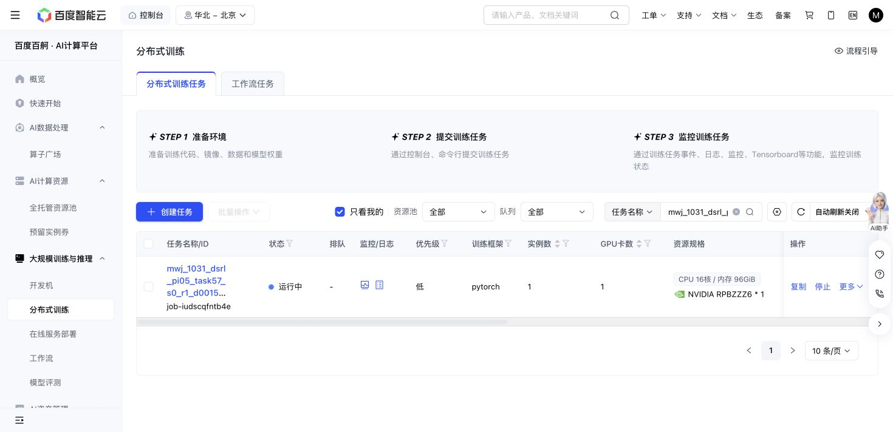

# Task57 DSRL due check — 2026-10-31 15:56 Shanghai

The existing Baige job `job-iudscqfntb4e` remains Running. Source, grant, recipe, cases, checkpoint target and cumulative caps are unchanged. No tests, new allocation, job control, active-code edit or journal traversal occurred.

At 2026-10-31T15:57:24.125981+08:00: 576/576 training successes, 8,056 replay chunks, 151,260 updates, 105,161 all-in simulator actions. Losses are finite; no training failure or recovery example has appeared.

| New threshold | Actual updates | Success | Primitives | Settling |
| ---: | ---: | ---: | ---: | ---: |
| 130,000 | 130,060 | 10/10 | 1,273 | 100 |
| 140,000 | 140,020 | 10/10 | 1,257 | 100 |
| 150,000 | 150,200 | 10/10 | 1,258 | 100 |

Native remains 10/10 with 1,451 primitives plus 100 settling actions. The newest complete panel preserves the paired query seeds, nominal-state hashes and actual initial-observation hashes. Query parameters/replay stay unchanged with zero query SGD. Similar healthy progress continues the existing descriptive cost signal; it adds no success, sample-efficiency or meta-learning claim.

The 240,439,438-byte latest full recovery and 239,098,534-byte newest immutable milestone match their saved hashes. The newest completed raw trace and actual RPC input/outcome pair also match. Producer cost counters sum internally with zero uncertain actions; this is not an exhaustive independent journal audit and does not reuse the prior partial tail as a verified prefix.

Saved storage is 8,956,026,253 bytes against 64GiB. One attempt still reserves 36,000 aggregate GPU-seconds; 6631.1 active elapsed seconds is a snapshot, not a final charge. The action cap remains 1M. No error exit or stop reason is present.

The receipt binds the reader to immutable Git commit `f75b46b55479637959c8e6e280f334e49d8bf14f`, blob `d1391d0abf95f64dbef007028722f2d0e7f18092`, plus its SHA256. The common working path may change in later checks; historical reader bytes remain recoverable through that Git reference.

Next owned check: 16:16 Shanghai. No further polling this turn.

