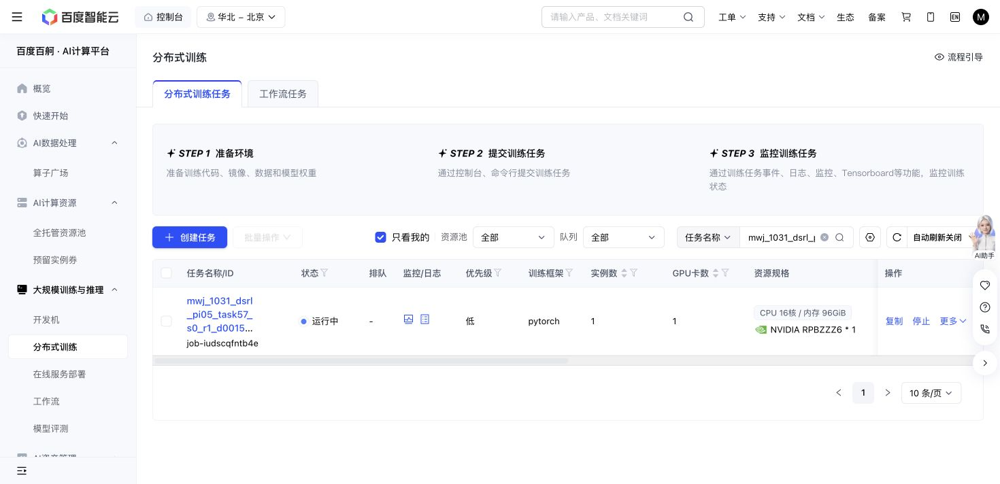

# Task57 DSRL due check — 2026-10-31 16:36 Shanghai

The existing Baige job `job-iudscqfntb4e` is Running. The source, grant, cases, recipe, final checkpoint target and cumulative limits are unchanged. This light check uses no journal traversal, test, source edit, allocation or job control.

At 2026-10-31T16:40:32.986525+08:00: 769/770 training successes, 10,680 replay chunks, 203,740 updates and 138,870 all-in actions. Latest losses are finite. The only failure remains the previously bound episode576/state16 timeout; no new failure, retry or exit is present.

| New threshold | Actual updates | Success | Primitives | Settling |
| ---: | ---: | ---: | ---: | ---: |
| 180,000 | 180,120 | 10/10 | 1,286 | 100 |
| 190,000 | 190,020 | 10/10 | 1,290 | 100 |
| 200,000 | 200,320 | 10/10 | 1,261 | 100 |

Native remains 10/10 with 1,451 primitives plus 100 settling actions. Newest paired seeds, nominal states and actual initial-observation hashes match; query weights/replay are unchanged with zero SGD. Similar progress adds no new success, overall sample-efficiency or meta-learning claim.

The latest 306,818,735-byte full recovery, newest 302,492,203-byte immutable milestone, newest raw episode and its actual RPC input/outcome pair match their hashes. Producer cumulative counters sum internally with zero uncertain actions. No exhaustive independent journal reconciliation is claimed and the earlier partial tail is not reused as verified.

Storage is 12,453,556,744 bytes against 64GiB. One attempt still reserves 36,000 aggregate GPU-seconds; 9220.0 active elapsed seconds is not a final charge. The action ceiling remains 1M.

The reader is bound to Git commit `f75b46b55479637959c8e6e280f334e49d8bf14f`, blob `d1391d0abf95f64dbef007028722f2d0e7f18092`; next-check argument `2026-10-31T16:56:00+08:00`.

Next owned check: 16:56 Shanghai. No further DSRL polling this turn.

