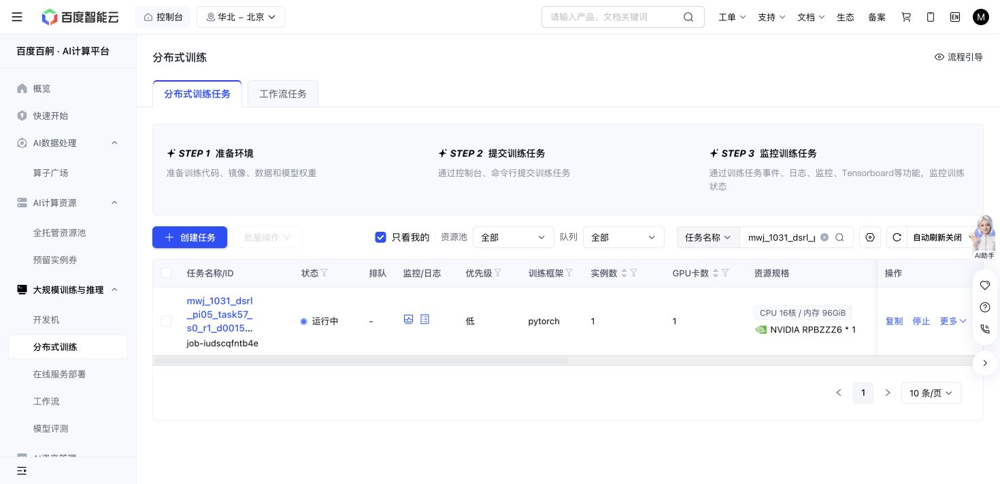

# Task57 DSRL due check — 2026-10-31 16:56 Shanghai

The original Baige job `job-iudscqfntb4e` remains Running. Source `d001556…`, grant `48acb746…`, recipe, cases, 500k target and cumulative caps are unchanged. No test, new job, source edit, job control or journal scan occurred.

At 2026-10-31T17:01:13.704459+08:00: 860/861 training successes, 11,892 replay chunks, 227,980 updates and 153,976 all-in actions. Losses are finite. The only failure is the previously bound episode576/state16 timeout; no new failure, exit or retry is present.

| Newly completed threshold | Actual updates | Success | Primitives | Settling |
| ---: | ---: | ---: | ---: | ---: |
| 210,000 | 210,160 | 10/10 | 1,269 | 100 |
| 220,000 | 220,040 | 10/10 | 1,243 | 100 |

Native remains 10/10 with 1,451 primitives plus 100 settling actions. Newest paired query seeds, nominal states and actual initial-observation hashes match. Query parameters/replay are unchanged with zero query SGD. Similar healthy cost progress adds no success, overall sample-efficiency or meta-learning claim.

The 337,481,603-byte stable full recovery and 327,437,341-byte newest immutable milestone match their saved hashes. One newest completed raw episode and its actual RPC input/outcome pair match. Producer cost counters sum internally with zero uncertain actions; no exhaustive independent journal reconciliation or reuse of the old partial tail is claimed.

Storage is 14,047,500,884 bytes against 64GiB. One attempt still reserves 36,000 aggregate GPU-seconds; 10460.7 active elapsed seconds is not a final charge. The action cap remains 1M.

Reader: immutable Git commit `f75b46b55479637959c8e6e280f334e49d8bf14f`, blob `d1391d0abf95f64dbef007028722f2d0e7f18092`, next-check argument `2026-10-31T17:16:00+08:00`.

Next owned check: 17:16 Shanghai. No further polling this turn.

