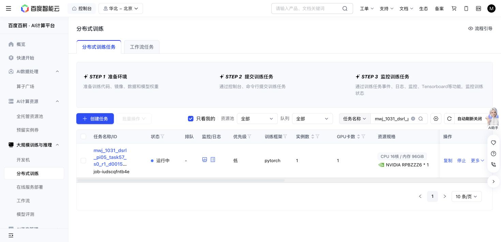

# Task57 DSRL due check — 2026-10-31 17:16 Shanghai

The original Baige job `job-iudscqfntb4e` is Running. All code, grant, case, recipe and cumulative limits are unchanged. No tests, new jobs, source edits, controls or journal traversal occurred.

At 2026-10-31T17:17:54.291577+08:00: 929/930 training successes, 12,808 replay chunks, 246,300 updates, 166,033 all-in actions. Losses are finite. The same sole episode576/state16 timeout remains; no new failure, exit or retry is present.

| New threshold | Actual updates | Success | Primitives | Settling |
| ---: | ---: | ---: | ---: | ---: |
| 230,000 | 230,100 | 10/10 | 1,246 | 100 |
| 240,000 | 240,200 | 10/10 | 1,256 | 100 |

Native remains 10/10 with 1,451 primitives plus 100 settling actions. Newest query seeds, nominal states and actual initial-observation hashes match; query weights/replay remain unchanged with zero SGD. Similar descriptive cost progress adds no success, overall sample-efficiency or meta-learning claim.

The latest full recovery, newest immutable milestone, newest completed raw trace and its actual RPC input/outcome pair match their hashes. Producer counters sum internally with zero uncertain actions. This is a light check, not an independent full journal audit; no old partial prefix was reused.

Storage is 15,500,270,098 bytes against 64GiB. One attempt still reserves 36,000 GPU-seconds; 11461.3 active elapsed seconds is not a terminal charge. The action ceiling remains 1M.

Reader: Git `f75b46b55479637959c8e6e280f334e49d8bf14f`, blob `d1391d0abf95f64dbef007028722f2d0e7f18092`; next-check argument `2026-10-31T17:36:00+08:00`.

Next owned check: 17:36 Shanghai. No further task57 polling this turn.

