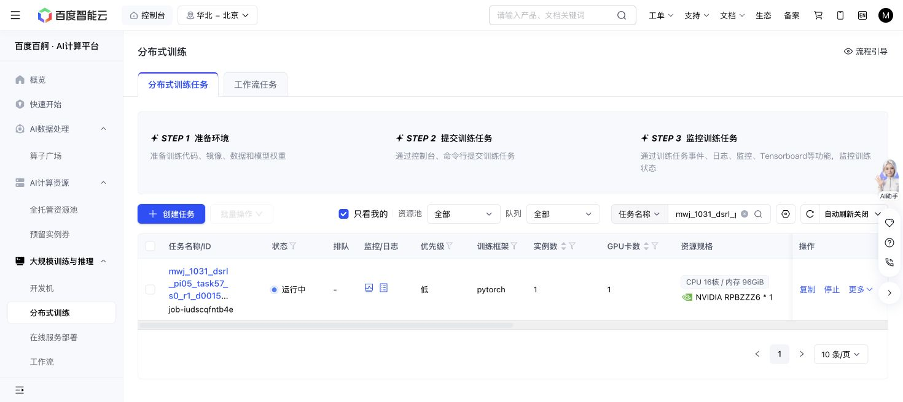

# Task57 DSRL due check — 2026-10-31 17:36 Shanghai

The original Baige job `job-iudscqfntb4e` is Running. All code, grant, cases, recipe and cumulative limits are unchanged. No tests, new jobs, source edits, controls or journal traversal occurred.

At 2026-10-31T17:36:17.553719+08:00: 1,001/1,002 training successes, 13,760 replay chunks, 265,340 updates, 178,445 all-in actions. Losses are finite. The same sole episode576/state16 timeout remains; no new failure, exit or retry is present.

| New threshold | Actual updates | Success | Primitives | Settling |
| ---: | ---: | ---: | ---: | ---: |
| 250,000 | 250,260 | 10/10 | 1,242 | 100 |
| 260,000 | 260,000 | 10/10 | 1,217 | 100 |

Native remains10/10 with1,451 primitives plus100 settling actions. Newest query seeds, nominal states and actual initial-observation hashes match; query weights/replay remain unchanged with zero SGD. Similar descriptive length progress establishes no success, overall sample-efficiency or meta-learning benefit.

The stable latest full recovery, newest immutable milestone, newest completed raw trace and its actual RPC input/outcome pair match their hashes. Producer counters sum internally with zero uncertain actions. This is a light check, not an independent full journal audit; no old partial prefix was reused. Only15 current RPC metadata rows were read.

Storage is17,022,467,857 bytes against64GiB. One attempt still reserves36,000 GPU-seconds; 12564.6 active elapsed seconds is not a terminal charge. The action ceiling remains1M.

Reader: Git `f75b46b55479637959c8e6e280f334e49d8bf14f`, blob `d1391d0abf95f64dbef007028722f2d0e7f18092`; next-check argument `2026-10-31T17:56:00+08:00`.

Next owned check:17:56 Shanghai.

