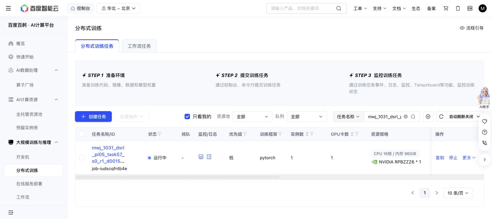

# Task57 DSRL due check — 2026-10-31 17:56 Shanghai

Baige `job-iudscqfntb4e` remains Running with the original code, grant, recipe and cumulative caps. At 2026-10-31T17:56:35.282949+08:00:1,081/1,082 training successes,14,808 replay chunks,286,300 optimizer updates and191,843 all-in actions. Losses are finite; the sole historical episode576/state16 timeout remains, with no new failure or retry.

The newly complete panels at270,040 and280,260 updates both score10/10, using1,224 and1,232 primitives respectively, each plus100 settling actions. Initial native remains10/10 at1,451+100. Newest query seeds, nominal states and actual initial observations match. This is descriptive trajectory length, not a success or overall sample-efficiency gain.

Stable latest full recovery, newest immutable milestone, latest raw and actual RPC input/outcome checks pass. Producer counters sum internally with zero uncertain actions. No journal forest, old partial prefix, tests, new jobs or controls were used. Active elapsed13,782.3 seconds is not a terminal charge;36,000 remains reserved. Storage18,657,218,531 bytes remains below64GiB; action ceiling1M.

Immutable reader: Gitf75b46b55479637959c8e6e280f334e49d8bf14f/blobd1391d0abf95f64dbef007028722f2d0e7f18092. Next owned check18:16 Shanghai.

