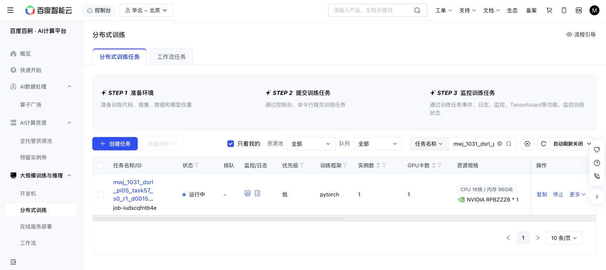

# Task57 DSRL due check — 2026-10-31 18:16 Shanghai

The original Baige job remains Running with unchanged source/grant/recipe/cases and caps. At18:16:32:1157/1158 training successes,15811 replay chunks,306360 optimizer updates,204806 all-in actions and20316868668 output bytes. Losses remain finite; the same sole episode576/state16 timeout remains, without retry.

Newly completed290200 and300240 panels both score10/10, using1256 and1241 primitives respectively, each plus100 settling actions. Initial native remains10/10 at1451+100. Query seed/nominal/actual initial-observation identities match. Latest full recovery, newest immutable milestone and one newest raw/RPC sample match their hashes; no full journal traversal or old partial-prefix reuse occurred. This does not establish success, overall sample-efficiency or meta-learning gain.

One attempt and original36000GPU-second hold remain; storage is below64GiB and actions below1M. Immutable readerf75b46b5/blobd1391d0a; next argument/check18:36 Shanghai. No source changes, tests, new jobs or controls occurred.

