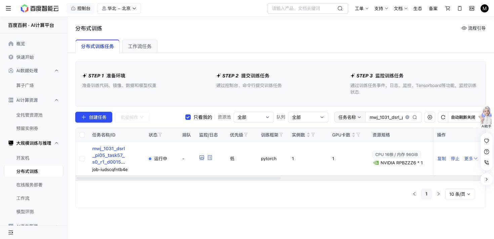

# Task57 DSRL due check — 2026-10-31 18:36 Shanghai

Read at18:39:49: the original Baige job remains Running with unchanged source/grant/recipe/cases and caps.1245/1246 training successes,16966 replay chunks,329460 optimizer updates,219348 all-in actions and22125601678 output bytes. Losses remain finite; the same sole episode576/state16 timeout remains, without retry.

New310200/320100 panels each score10/10, using1225/1262 primitives plus100 settling actions. Initial native remains10/10 at1451+100. Query seed/nominal/actual initial-observation identities match. Latest full recovery, newest immutable milestone and one newest raw/RPC sample match hashes. No action-journal forest, old partial-prefix reuse, tests, new jobs or controls. This remains descriptive trajectory length rather than success, overall sample-efficiency or meta-learning gain.

The one original36000GPU-second hold remains; storage below64GiB and actions below1M. Immutable readerf75b46b5/blobd1391d0a; next argument/check18:56 Shanghai.

