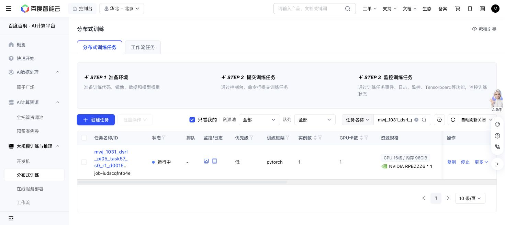

# Task57 DSRL due check — 2026-10-31 18:56 Shanghai

The original Baige job remains Running. At18:56:15:1302/1303 training successes,17718 replay rows,344500 optimizer updates,229756 all-in actions and23720927203 output bytes. Finite losses, same sole episode576/state16 timeout, no retry, unchanged source/grant/recipe/cases and caps.

New330220/340080 panels each score10/10 at1252/1251 primitives plus100 settling actions; initial native remains10/10 at1451+100. Exact query seed/nominal/initial-observation pairing holds. Latest full recovery, newest milestone and one newest raw/RPC sample hash checks pass; no journal forest or old partial-prefix reuse. This remains descriptive trajectory length rather than success, overall sample-efficiency or meta-learning gain.

One original36000GPU-second hold remains; active17362.3 seconds is not final charge. Storage below64GiB, actions below1M. Next owned check19:16 Shanghai; immutable readerf75b46b5/blobd1391d0a.

