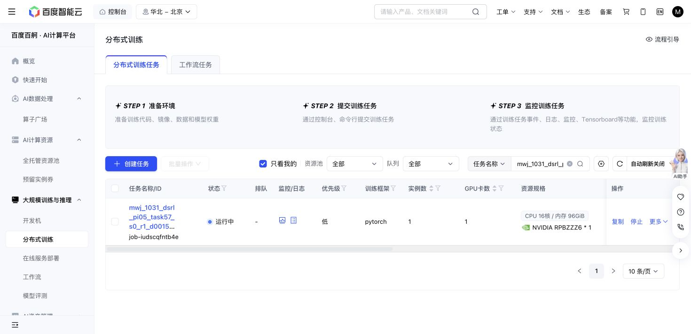

# Task57 DSRL due check — 2026-10-31 19:16 Shanghai

The original Baige job `job-iudscqfntb4e` remains Running. At 19:17:43, it has 1,377/1,378 training successes, 18,706 replay rows, 364,260 optimizer updates, 242,506 all-in actions and 25,520,481,109 output bytes. Losses are finite; the only failure remains episode 576/state 16, with no retry. Source, grant, recipe, states and caps are unchanged.

New 350,040/360,020-update panels each score 10/10 at 1,226/1,230 primitives plus 100 settling actions. Initial native remains 10/10 at 1,451+100. Actual query seed, nominal state and initial-observation hashes match. Latest full recovery, newest immutable milestone and the newest raw/RPC sample hashes pass; query parameters/replay remain unchanged. This is descriptive trajectory length on a ceiling success panel, without a success, total sample-efficiency or meta-learning claim.

The original 36,000 GPU-second hold remains; active elapsed 18,650.4 seconds is not a final charge. Actions and storage remain below 1M/64GiB. No journal forest or old partial-prefix reuse occurred. Next owned check is 19:36 Shanghai; immutable reader `f75b46b5`, blob `d1391d0a`, records the explicit next-check argument.

