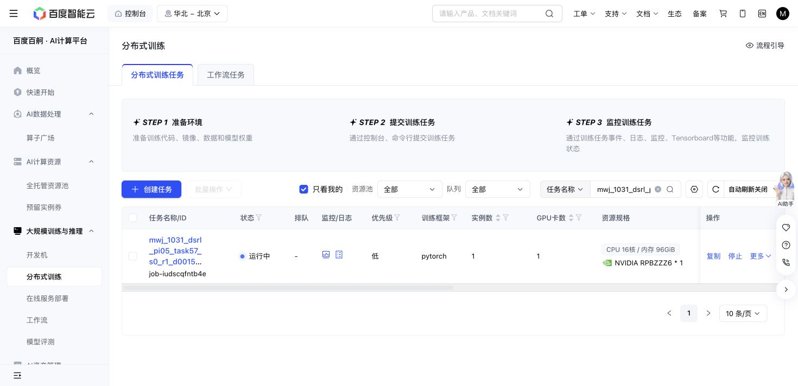

# Task57 DSRL due check — 2026-10-31 19:36 Shanghai

The original Baige job `job-iudscqfntb4e` remains Running. At 19:36:14 it has 1,436/1,438 training successes, 19,526 replay rows, 380,660 optimizer updates, 253,620 all-in actions and 27,262,976,429 output bytes. Losses are finite. A second training timeout occurred at episode 1,404/state 4 (371,940 updates); episode 576/state 16 remains the other failure. No retry or change to source, grant, recipe, cases or caps occurred.

New 370,080/380,120-update panels each score 10/10, at 1,271/1,248 primitives plus 100 settling actions. Initial native remains 10/10 at 1,451+100. Query seeds, nominal states and actual initial-observation hashes match. Stable latest full recovery, newest immutable milestone, and one newest raw/RPC sample hashes pass; query parameters/replay remain unchanged. These are descriptive lengths on a ceiling success bank, without a success, total sample-efficiency or meta-learning claim.

The single original 36,000 GPU-second hold remains; active elapsed 19,761.3 seconds is not a final charge. Actions/storage remain below 1M/64GiB. No journal forest or old partial-prefix reuse occurred. Next owned check is 19:56 Shanghai; immutable reader `f75b46b5`, blob `d1391d0a`, records the explicit next-check argument.

