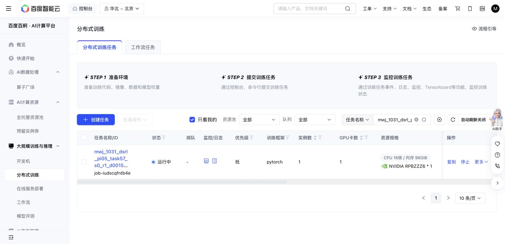

# Task57 DSRL due check — 2026-10-31 20:16 Shanghai

Baige job `job-iudscqfntb4e` remains Running. At20:16:50 it has1,573/1,575 training successes,21,329 replay rows,416,720 optimizer updates,276,486 all-in actions and30,366,553,657 output bytes. Losses are finite; the same two recorded training timeouts remain. Source, grant, fixed500k endpoint, final-native control, cases and caps are unchanged.

The400,160/410,020-update panels each score10/10 at1,358/1,232 primitives plus100 settling actions. The earlier390,0809/10 panel remains part of the complete curve; no checkpoint or favorable outcomes were selected. Initial native remains10/10 at1,451+100. Query seeds, nominal states and actual initial-observation hashes match. These are separate fixed-checkpoint panels, not repeated trials establishing reliability or overall sample efficiency.

Stable latest full recovery, newest immutable milestone and one newest raw/RPC sample hashes pass; query parameters/replay remain unchanged. No journal forest or old partial-prefix reuse occurred. One original36,000GPU-second hold remains; active22,197.5seconds is not a final charge. Actions/storage remain below1M/64GiB. Next owned check20:36 Shanghai; immutable reader`f75b46b5`, blob`d1391d0a`, records the explicit next-check argument. ClosedA1/data jobs were not polled.

