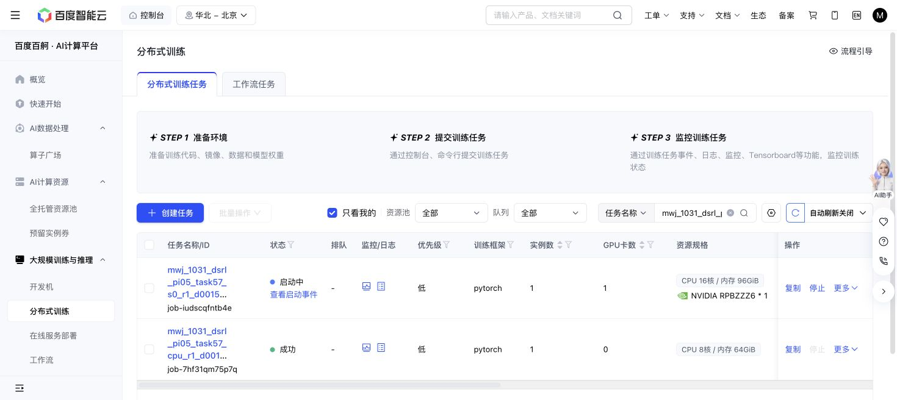

# Frozen pi0.5 task57 DSRL launch — 2026-10-31

The actual CPU allocation job-7hf31qm75p7q passed all16 new-profile tests
at source `d001556780c78893cb7ad0310ec46e5d817e5698`: clock/grant/admission,
whole-episode updates, all40 training states, disjoint queries and interrupted
query/checkpoint recovery. It exposed0 GPUs before masking and8CPU/64GiB.
It consumed80 conservative CPU-worker seconds and no model/simulator/SGD work.

The GPU run `dsrl-pi05-task57-20261031-s0-r1` was submitted once as
Baige job-iudscqfntb4e at14:06:36Shanghai. It requests1GPU/16CPU/96GiB/8GiB
shared memory,599minutes, no automatic retry. All startup/probe/failure/retry
and cleanup time shares the same36000-second ceiling; all settling/training/
query/uncertain simulator actions share1M. The grant is separate from the
runtime directory, and both source/worktree and original motor are pinned.

This is ordinary SAC steering of the entirely frozen official OpenPI40
pi0.5, with the existing published PixelSAC recipe. Training cycles physical
states0..39; fixed before/after/10k-update query panels use40..49 without
query replay insertion. Native PPO is queued. Initial launch does not establish
performance or even completed robot/update qualification; advancing actual
artifacts will be recorded separately.

