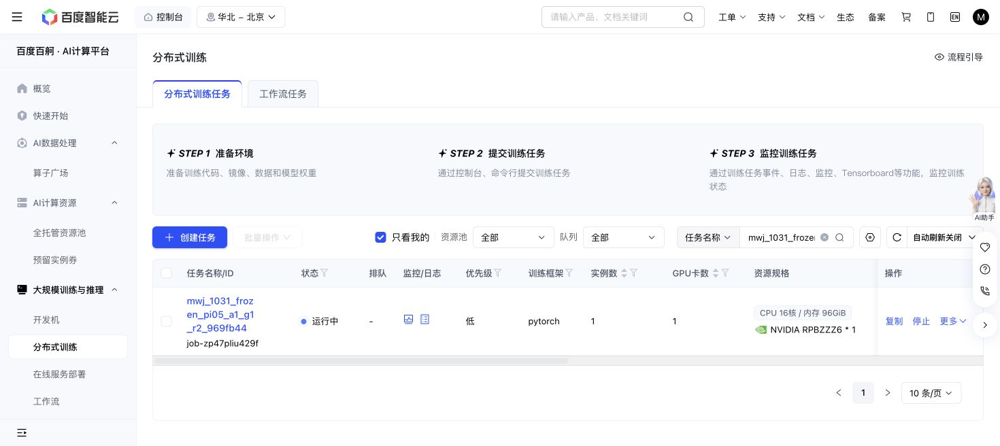

# A1 successor actual advancement — 2026-10-31

Baige `job-zp47pliu429f`, exact969fb44c, resumed the immutable16 native episodes/175 chunks and retried only the original pending search. The real saved-original-input re-encoding reproduces original public features, prefix mask and all18 KV cache layers exactly with the original actual official instruction. Strict initial seed/raw/text/features equality holds before steering.

Native/zero learned-KV/fixed-KV/action decoded outputs match exactly (max native parity error0). Real suffix adapter gradient norm0.00363427, no motor gradients; frozen motor before/after721a7ed… unchanged. The first planned search episode supplies the complete real episode gate—no extra qualification episode or native-bank rerun.

At18:57:58 four new searches are complete (three noise and the first KV candidate), all400-action timeouts. New executed actions1600; canonical total6955 with zero pending/uncertain at the snapshot. This partial panel cannot establish reachability failure, arm ranking or source admission. The original632GPU-seconds plus active6480 reservation share the unchanged28800phase/7200A1 ceilings. All raw refs, sampler/RNG recovery and canonical journal remain preserved.

Next owned A1 check19:18; task57 next19:16. No teacher/source job admitted.

