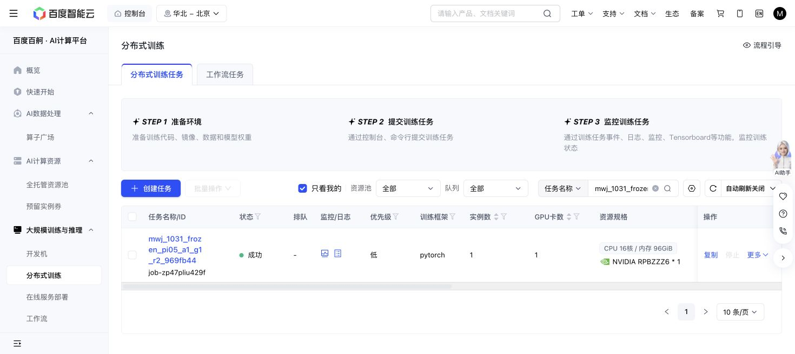

# A1 repaired fixed four-coefficient search — 2026-10-31 19:18 Shanghai

Baige job `job-zp47pliu429f` completed with exit 0 on source `969fb44c503fac409373abc88ce5687b71195068`. All 51 episodes required by the conditional plan are complete: the preserved 16 native development episodes, 27 search episodes on phone cases 1/2/3, and eight confirmations on case 3. No missing or unexpected episode, pending action, or uncertain action remains.

No arm meets the predeclared strict rescue rule (selection-rule SHA `87c8af53bcea7ee09ea55f11380b4a310d94e6ff2fc01e6f7b648b39299086b5`). Cases 1/2 have no search successes. On case 3, noise succeeds in 1/3 search candidates, KV in 2/3, and action in 1/3. Confirmation is noise 1/2, KV 1/2, action 0/2, against matched native 1/2. Thus all three arms have zero confirmed-rescue cases; no arm or teacher is admitted. This is an inconclusive restricted fixed four-dimensional probe, not a negative result for the full learned reactive KV/action classes or completion of the end-to-end goal.

Every search/confirmation reset retains its original development observation, public feature, instruction, and actual scene-seed hashes. Confirmation branches share motor seeds. All 51 manifest hashes and action/chunk counts match their episode summaries. A newest raw decision/native-output/current-and-next-frame sample passes file hashes and ZIP CRC checks; motor RNG states are present. The final full recovery is stable at SHA `39776d2e5a6cbb78a57c57c7a45695d670ea2d782fa915d238ee44250113aa11`. No checkpoint/model was loaded during this saved-data read. Exit 0 also passes the executable's terminal full-motor fingerprint guard; the frozen motor remains `721a7ed12c70d36e08882b02d8afee709286f6f27e72482570d7ac7451c0ae41`.

R2 costs 1,138 conservative GPU-seconds and 12,236 new actions. Including R1 once gives 1,770 GPU-seconds and 17,591 actions, independently equal to the sum of complete episode lengths. The shared action snapshot is hash-bound, without replaying its whole event journal. Saved output size is 241,450,300 bytes. The phase has 27,030 GPU-seconds and 282,409 actions remaining; A1 has 5,430 GPU-seconds and 12,409 actions remaining. Shared CPU cost remains 331/1,800 worker-seconds. These remainders do not authorize a different grid. R1/R2 stay immutable; there is no further live A1 polling or automatic source launch.

