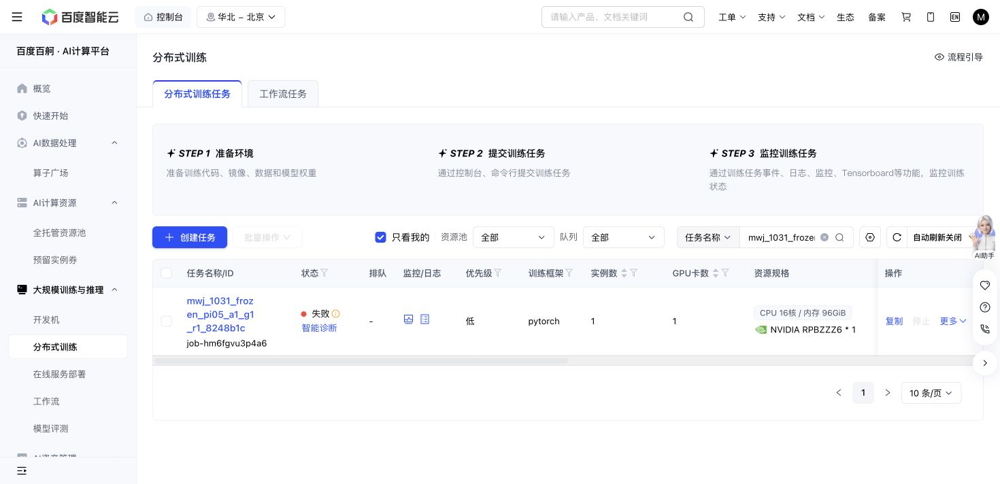

# A1 terminal reset-pairing failure — 2026-10-31

Baige `job-hm6fgvu3p4a6` ended exit1 at the first search reset, after16 complete native development episodes. Phone stand scored1/8; object stand3/8. Those16 receipts independently sum to5355 executed controller actions, matching the saved canonical snapshot with zero pending/uncertain charge. No search or confirmation action executed.

The paired reset had the same actual/requested seed310310997 and bitwise-identical saved main RGB, both wrist RGBs and14D proprioception. Both305KB NPZ file hashes were independently verified and their physical NPY member bytes compared. The official sampled instruction changed from “Carry the thin metallic phone to the flat base phonestand.” to “Carry the lightweight phone to the light brown phone holder.” Frozen features changed accordingly. The guard correctly rejected a changed VLA input; this is not evidence of physics or pixel drift. The separate OIDN log messages are preserved and not assigned as this failure's cause.

The live native/zero-residual parity, real suffix-gradient and first complete episode gates passed. Initial motor before/after hashes match721a7ed…. The exception occurs before the normal final hash block, so no independently recomputed terminal tensor hash is claimed. Full recovery104609bytes/SHA`bc33e51a23c0f63c01d7bc066467d5a990f727a0b4c0618beb6bea7125a07fb6`, raw resets, episode references and all original outputs remain intact.

The phase clock closes at632GPU-seconds, leaving28168 of28800; A1 has6568 of7200 remaining. No retry has been launched. CPU usage remains244/1800. The pre-review selection rule87c8… cannot rank arms without any completed search/confirmation evidence. This is an operational failure, not a negative method result or source admission. The next repair should preserve the guard and explicitly restore the actual original official instruction for paired cases.

