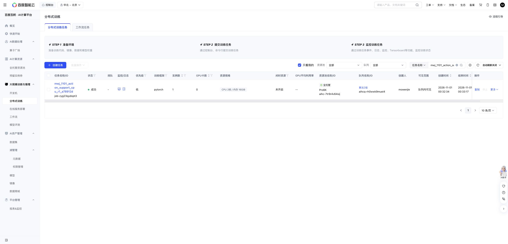

# Captured action support, 2026-11-01

Actual Baige CPU job `job-zyg23qydopt3` completed exit0 on exact source `a78912decfc1e54ca33ac573d33220c988a3c44a`: **13/13 focused tests passed**, followed by the saved-array inspection. Pre-mask GPU count was0, CUDA uninitialized, cgroup quota2CPU/16GiB. Inclusive charge **73 CPU-worker-seconds** brings the shared phase to **1,203/1,800**, leaving **597**. No new robot actions, model forwards, fitting or GPU time were used. The separate parent allocation attestor imported Torch only to verify GPU visibility; the inspector itself forbids Torch/model/simulator imports.

The four known successful TRAIN00–03 replays contain **896 submitted plan slots** and **772 native-valid action slots**. Each last call submits32 targets but executes1, so the124 unexecuted submitted targets remain part of full-plan imitation labels and are excluded from the separate native-valid accounting diagnostic.

| Submitted-plan coordinatewise MSE floor | Actual ±0.05rad arms / zero gripper delta | Explicit ±2rad counterfactual / zero gripper delta |
| --- | ---: | ---: |
| Twelve arm coordinates (rad²) | 0.002774980 | 0 |
| Two raw normalized gripper coordinates | 0.048083291 | 0.048083291 |
| All fourteen raw coordinates, as defined by this loss | 0.009247596 | 0.006869042 |

Both raw gripper coordinates differ from the recorded successful targets at the audit's1e-6 threshold for all896 submitted slots. Their magnitudes differ substantially: left squared-error sum86.163102 versus right0.002155. The small right-channel differences should not be read as evidence of a major gripper-control failure.

The actual head therefore cannot exactly imitate these recorded successful full plans relative to their captured native base proposals. The2rad hypothetical interval removes the recorded arm-support floor, while zero gripper correction retains the gripper floor. This is a coordinatewise geometric bound: shared network parameters, rounded-value gaps and optimization can make an actual fit worse. Other bounded plans may succeed; this does not establish task impossibility or attainable robot performance.

The bounded head was never fitted in the ended experiment. The expert replay replaces commands without this arm bound, so this finding does **not** explain the failed04 replay. No producer, gripper clamp, sealed interface, TRAIN/VAL split or bank-admission criterion was changed. The four outcome-known successes remain a development support diagnostic, not a reduced fitting bank.

Exact [receipt](ACTION-SUPPORT-CPU-RECEIPT.json), [full report](action-support-cpu-evidence/inspection/report.json), [actual JUnit](action-support-cpu-evidence/action-support.junit.xml), [resource proof](action-support-cpu-evidence/zero-gpu-attestation.json) and [inclusive clock](action-support-cpu-evidence/cpu-worker-clock.json) are retained. All10 copied files match remote hashes; the inspector bound101 existing input files.

