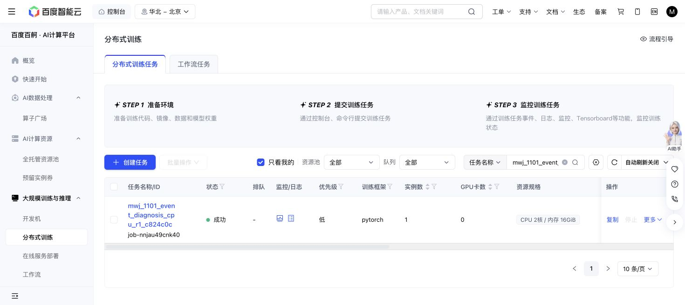

# Saved event replay diagnosis, 2026-11-01

Baige `job-nnjau49cnk40` completed successfully on exact source `c824c0c0a00eec05526e5c43562461bfa7000c0e`. All **15 focused tests passed**. Actual pre-mask attestation records zero GPUs, uninitialized CUDA, 2 CPU cores and 16 GiB memory. The single inclusive CPU charge is **77 seconds**: the phase has now used **1,055/1,800 CPU-worker-seconds**, leaving **745**. This inspection used no model forward, checkpoint deserialization, simulator or robot action. A Torch import was used only for allocation attestation.

| Closed development episode | Success | Actual actions | Canonical chunks |
| --- | ---: | ---: | ---: |
| Original fixed-H32 phone02 control | No | 400 | 13 |
| Event-aligned phone02 | Yes | 193 | 7 |
| Event-aligned phone04 | No | 400 | 13 |

The inspector verified all **33 chunks** against the original full proposed expert targets, submitted prefixes, native valid-action masks and recorded captured-native noise arrays. For aligned02, the successful last call submitted 32 commands but executed only one; the remaining 31 were unexecuted. The full plan remains relevant to native planning. A valid mask or a source index is not a measured physical waypoint trajectory.

Both phone02 resets have exactly matching recorded actor poses and named measured joint coordinates. For all three episodes, reset seeds, instructions and initial public drive-target state match the bound source references; recorded object/stand variants, acting arm and camera calibration also match. These checks do not establish complete source/native physical equivalence: the source HDF5 state is a **drive target**, and source measured qpos, actor worldposes and synchronized dense physics timestamps are unavailable.

The six saved panels were produced inside this CPU job. I inspected the three final panels and phone04 reset panel. The failed phone04 terminal shows the phone lying on the table in front of the stand. The fixed02 and aligned02 terminal head-camera views differ. Source/native endpoints are explicitly **unsynchronized**, so these images do not identify why the grasp or placement diverged. Rendering and wrist-image differences are descriptive evidence, not a causal diagnosis.

The inspection retained all original 12 demonstrations and the original unrun phone05–11 suffix. No cache, KV fit or action-head fit exists. This receipt authorizes no filtering, gate relaxation, refit or retry. The separate predeclared unrun-suffix proposal remains separate from this audit.

Exact evidence: [receipt](EVENT-DIAGNOSIS-CPU-RECEIPT.json), [full inspector report](event-diagnosis-cpu-evidence/inspection/report.json), [per-chunk CSV](event-diagnosis-cpu-evidence/inspection/native-phase-summary.csv), [actual JUnit](event-diagnosis-cpu-evidence/event-diagnosis.junit.xml), [allocation attestation](event-diagnosis-cpu-evidence/zero-gpu-attestation.json) and [inclusive clock](event-diagnosis-cpu-evidence/cpu-worker-clock.json). All 17 copied producer files match independently collected remote byte hashes. The report binds 186 input files / 31,475,274 bytes; those raw inputs remain unchanged on PFS.

