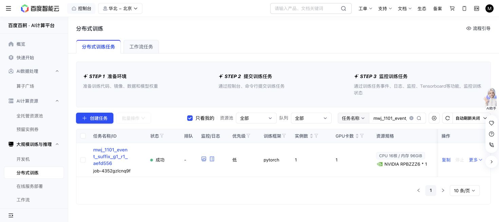

# Original unrun05–11 suffix, 2026-11-01

Baige `job-4352gzlcnq9f`, exact source `aefd5563b128cb7ea8e017d4664e1df0ba22a160`, completed exit0. It attempted the seven original previously unrun phone05–11 cases once each: **7/7 succeeded**, each using193 actual actions. There was no04 retry, cache or fitting.

The new action total is **1,351**, bringing the unchanged canonical campaign to **21,522 actual = charged actions**, pending0/uncertain0,1430 events and tip `ed0d9cc4160e4d3ad120a9ec51218982d6bd72a8f9ba2143b02e86264eaae779`. The inclusive GPU charge is **318 seconds**; cumulative original-phase GPU use is2,652 seconds. This leaves4,548 GPU-seconds and8,478 actions under the original A1 limits. No other grant was used.

The original full12 bank now has11 successes and the preserved phone04 failure; its all12 gate remains **false**. This is complete diagnostic coverage, not source/student-bank admission. The fixed8TRAIN/4VAL split and all original data remain intact.

The first05 real episode carried the original live checks: exact zero/native decoded parity, real KV gradient0.0152458, zero motor gradients, repeated prefix/cache identity and full frozen-motor hash `721a7ed1…` before/after qualification. The final full motor hash is the same. Full closed-control/global-RNG recovery is retained at `event-suffix-r1/experiment/recovery.pt`,270,181 bytes, SHA `5c0829d3e5ca00427bc589449053c536855b165b5ffd686d6fe26c65985cb883`.

The terminal audit independently checked seven manifest references and49 complete chunk-metadata hashes, episode closure, absence of budget truncation and the1,351-action sum. Two endpoint raw decision/native-array files were byte-checked without deserialization. Old-prefix campaign costs and the whole journal tip are bound saved producer snapshots; no full old journal replay or numerical mask replay was performed. Recovery bytes were hashed, not deserialized. Renderer OIDN messages occurred without a Python/integrity failure.

Exact [terminal receipt](EVENT-SUFFIX-TERMINAL-RECEIPT.json), [raw metadata proof](EVENT-SUFFIX-TERMINAL-RAW-PROOF.json), [due00:44 snapshot](EVENT-SUFFIX-CHECK-0044.json) and [saved producer result](event-suffix-terminal-evidence/experiment/result.json) are retained. No further live monitoring of this ended job is needed.

