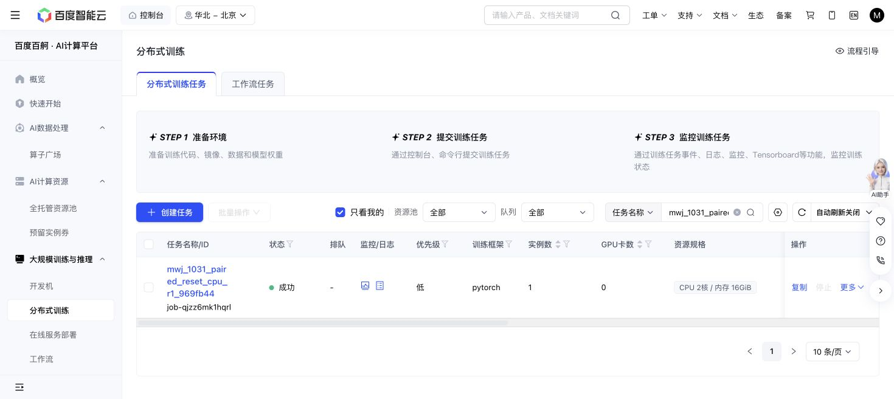

# Paired reset successor CPU gate — 2026-10-31

Actual Baige job `job-qjzz6mk1hqrl` passed108/108 focused tests in10.26s and the pure migration validation on the real104KB R1 recovery, all actual JSON/NPZ/evidence and prospective successor proof. Exact tested source969fb44c; actual0GPU2CPU16GiB with CUDA uninitialized.

The dry-run returns only the original pending phone01/noise0 case with the actual original official instruction. Canonical journal count352 and snapshot SHA66c3d709… remain unchanged; no CampaignBudget was constructed or registered on the real ledger, and no VLA/simulator/physical actions ran.

87CPU-worker-seconds are charged. Shared phase331/1800, remaining1469. R1632GPU-seconds and5355actions stay counted exactly once; the successor still needs actualGPU probe/prefix-repeat/parity/gradient gates before its first steering command. ParentGRANTb088/header and all old artifacts remain unchanged.

