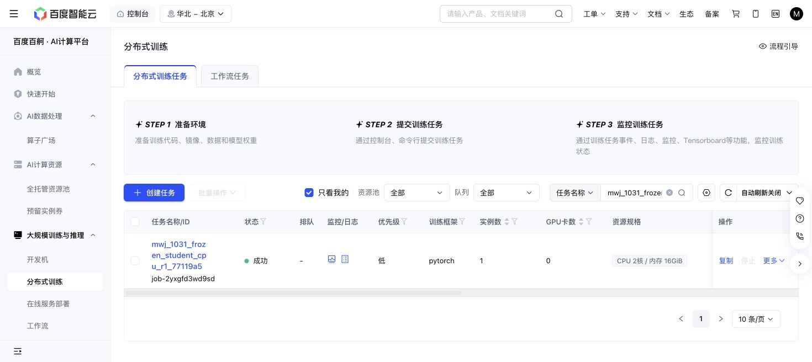

# Student component CPU qualification — 2026-10-31

Baige `job-2yxgfd3wd9sd` passed29/29 focused tests in12.42s, exit0, on exact clean source77119a5e. Only `test_steering_history.py` and `test_vla_history.py` ran. Actual allocation attests0GPU before masking, CUDA uninitialized,2CPU/16GiB and retained Python3.11/Torch2.11. Tiny synthetic optimizer fixtures are included; no real VLA weights, simulator, robot actions or scientific training were used.

The86CPU-worker-second charge brings the shared phase to244/1800, leaving1556. This qualifies the student component only. Source77119 includes the earlier edbe sink and8248 driver; later AAD seed/receipt guards are absent. No collector suite reran, no integrated pipeline PASS is claimed, and no source/readout GPU job was launched.

A1 and task57 remain immutable, with next owned reads18:14 and18:16 Shanghai respectively.

