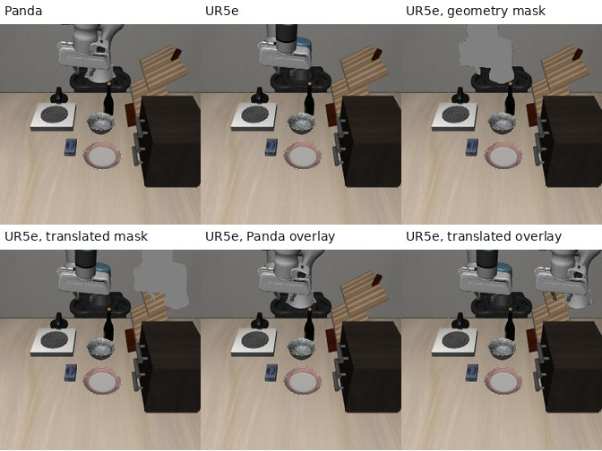

# The visible arm changes frozen SmolVLA proposals at a matched tool pose

Across all ten LIBERO-Goal tasks, replacing the visible Panda arm with a matched UR5e changed the frozen motor's 50-step translation proposal. Pasting the visible Panda cutout back onto the target reduced the mean RMS difference from 0.05392 to 0.03040 in unnormalized policy command units. All ten tasks improved. The mean paired reduction was 0.02352 (95% task-bootstrap interval 0.01658–0.03072). The checkpoint ran on CPU, with zero GPU-hours. This experiment measures forward-pass consistency on native simulator renders. Task success and physical execution remain unmeasured.

## Which appearance adapter preserves the source action?

Each score below compares a full chunk with the untouched Panda proposal for the same task, tool state, camera, prompt and diffusion noise. Lower scores indicate closer agreement. The last column measures the immediately executable translation command.

| External view fed to the motor | Translation RMS over 50 steps, mean [95% interval] | First-step translation RMS |
| --- | --- | ---: |
| Panda identity replay | 0.00000 [0.00000, 0.00000] | 0.00000 |
| UR5e native image, including changes outside the arm | 0.05959 [0.03967, 0.08129] | 0.02960 |
| UR5e, change restricted to the visible arms and a one-pixel band | 0.05392 [0.03702, 0.07166] | 0.03058 |
| UR5e with aligned Panda cutout | 0.03040 [0.01738, 0.04411] | 0.01660 |
| UR5e with same Panda cutout translated off the arm | 0.08128 [0.06888, 0.09450] | 0.04743 |
| UR5e with its own arm masked gray | 0.09406 [0.06470, 0.12560] | 0.06436 |
| UR5e with same gray mask translated off the arm | 0.06150 [0.04410, 0.07965] | 0.03342 |
| Panda, independent noise draw | 0.03124 [0.02743, 0.03547] | 0.05925 |

Gray masking both arms made the two masked proposals closer (0.02128 versus 0.05345 with both sham masks, paired reduction 0.03216 [0.01759, 0.04601]). Yet masking the nominal Panda alone moved it 0.09499 away from its original proposal. Masking the target alone worsened agreement with that original proposal on 10/10 tasks. Evaluating against the untouched source reveals this loss of fidelity.

The aligned cutout reduced whole-chunk rotation RMS from 0.00646 to 0.00407 and gripper RMS from 0.22522 to 0.16426. These groups have different scales. For a frozen motor, the translation results favor testing a pose-conditioned renderer of source-arm appearance that retains task pixels. They establish the value of an aligned source reference on these inputs. A deployable adapter would need to produce its source cutout from available calibration and kinematics, then demonstrate native reward under target dynamics.

## Experimental support and privileges

- **Task pairs.** All ten LIBERO-Goal BDDL tasks, one seeded reset/pose and one shared noise draw per task. Starting at each native Panda reset, we applied independent uniform joint perturbations of up to 0.12 rad, then used bounded IK for the UR5e. The 22 non-arm scene and mount body poses matched within numerical tolerance. The maximum tool pose errors were 1.39e-15 m and 9.52e-16 rad. Neither robot contacted a scene object at the tested instants. Both arms carried the same PandaGripper and used the same finger positions. The arm swap includes the different link configurations required to achieve the common pose.
- **Input isolation.** We verified both cameras' world poses and field of view. The motor received the identical Panda wrist image, numeric state and prompt in every paired condition. The primary target image uses its native external render inside the union of both visible arm/gripper silhouettes, dilated by one pixel, and source pixels everywhere else. On average, 5.12% of external-image pixels changed. This removed changes on another 0.28% of the image outside the silhouettes' boundary band. A fresh independent native render reproduced every saved image, mask and state field for all ten tasks.
- **Adapter inputs.** Zero training examples, target demonstrations, action labels, interactions or weight updates. The gray mask requires the current robot's MuJoCo visible-geometry segmentation (mean image coverage 6.08% Panda and 6.77% UR5e). The aligned cutout additionally requires matched per-query Panda RGB and source visibility at the correct task-space posture, camera and lighting. It pastes only source-foreground pixels. Target-only protrusions remain visible. The cutout restores an average of 70.26% of the changed pixels by construction. Its score measures how much proposal drift remains with that privilege. Building the *evaluation pairs* also requires the full source frame and both visibility masks to enforce background equality.
- **Shams and nominal identity.** Each sham rigidly translates the exact same silhouette and fill or RGB cutout without clipping. Both translated masks have zero overlap with either arm. This matches edited support size and shape. Pixel colors underneath the edit differ across locations. Applying the aligned source cutout to the source is pixel-identical. Duplicate nominal forwards and separately loaded motor forwards on rerendered nominal observations reproduced all 350 output entries on every task.
- **Motor.** `lerobot/smolvla_libero@a24f1f380461b665158d52acd140152c79e8b36d`, strictly loaded from the SHA-256 verified 906,712,520-byte checkpoint. All 450,046,176 parameters were frozen and every module was in eval mode. Official LeRobot LIBERO observation processing and checkpoint pre/postprocessors ran on CPU in float32. Each proposal had shape (1, 50, 7), with nonzero temporal standard deviation in all seven channels on every nominal task. Each paired call used the identical (1, 50, 32) input noise and ten flow steps.
- **Uncertainty.** Percentile bootstrap over whole, equally weighted task rows. Each task contributes a single pose and a single noise seed, so the intervals describe variation among these task–pose pairs. All tasks share a tabletop setting, one source arm/gripper combination, one target arm and one checkpoint. The data contain no test of contact-rich mid-episode behavior, changed grippers or rollout success.

The earlier camera study changed the view passed to a yaw reader. Here the view coordinates stay fixed and the changed external RGB goes directly to the frozen motor. [Prior camera result](../../symmeta-camera-command-20261123-r1/RESULT.md)

[Reproduction](REPRODUCE.md) · [Task-level scores](scores.csv) · [Task-bootstrap intervals](summary.json) · [Native pairing checks](render.json) · [Motor and noise receipts](motor.json)
