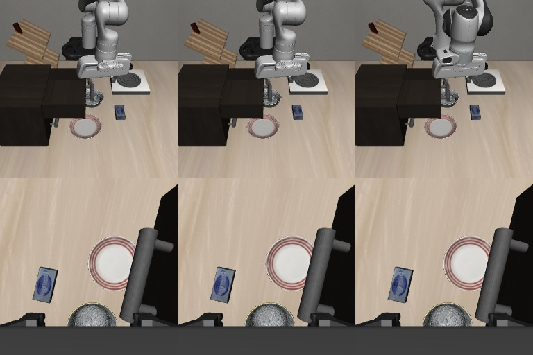

# Panda morphology changes the external camera input on both Kinova drawer trajectories

**Ten of ten paired camera exposures qualify for a frozen-policy comparison.** On two Baige CPU cores, the independently rendered Kinova matched all 20 original 256 × 256 camera frames byte for byte. Substituting the Panda arm changed 2,301–10,263 external pixels and zero wrist pixels. The stock OpenPI conversion retained 1,946–8,244 changed external pixels at 224 × 224. Target proprioception, prompt and wrist input were identical across conditions. This establishes that the intervention reaches the policy input. Its effect on π₀.₅ actions and native outcomes awaits the parent’s GPU run. This is a privileged morphology control in the tradition of Mirage. [Plan](PLAN.md) · [Mirage](https://robot-mirage.github.io/) · [Parent command and CPU reproduction](HANDOFF.md)

| Kinova start | Native control | Drawer opening in exposure, mm¹ | Changed external pixels at 256 | Changed external pixels at 224 |
|---|---:|---:|---:|---:|
| 14 | 0 | 0.0 | 2,432 | 2,075 |
| 14 | 30 | −0.03 | 6,811 | 5,418 |
| 14 | 45 | 36.9 | 6,357 | 5,047 |
| 14 | 60 | 145.6 | 6,939 | 5,488 |
| 14 | 90 | 150.9 | 6,094 | 4,832 |
| 15 | 0 | 0.0 | 2,301 | 1,946 |
| 15 | 30 | 0.0 | 6,850 | 5,414 |
| 15 | 45 | 0.0 | 8,010 | 6,483 |
| 15 | 60 | 0.0 | 8,539 | 6,948 |
| 15 | 90 | 0.0 | 10,263 | 8,244 |

¹ Negative of the top drawer’s signed slide coordinate. The small negative opening at control 30 is preserved from the simulator. The two starts were selected from completed failures. The ranges describe these ten exposures, with five dependent measurements per trajectory. [Start 14, every frame and bounded IK solution](evidence/cpu01/layout-14.json) · [Start 15](evidence/cpu01/layout-15.json) · [Lossless frames and digests](evidence/cpu01/SHA256SUMS)

At control 60 on start 14, the drawer was open 146 mm. The image columns below are untouched Kinova, independently rendered Kinova and the Panda substitution. The rows show the external and wrist cameras. The JPEG is for inspection. All pixel comparisons used the original uint8 arrays.

## Geometry, sensor timing and visibility

The renderer copied eight named task joints, three model-level fixture poses and both signed finger slides from the target exposure. Across the ten frames, all 15 checked task-body world poses and both finger coordinates matched exactly. Bounded IK used the physical grip-site transform, checked MuJoCo contacts and found an admissible Panda pose on every frame. The inherited native pose tolerances are 1 mm and 0.01 rad, derived from 2% of one full-scale OSC component. Measured maximum TCP position and rotation errors were 5.94 × 10⁻¹⁶ m and 1.51 × 10⁻¹⁵ rad. The smallest Panda joint-limit margin was 0.635 rad. The shared gripper’s largest body-position discrepancy was 7.66 × 10⁻¹⁶ m. The render solver continued from the previous admitted posture, with fixed fallback seeds. The pictured elbow is one admissible Panda configuration for each TCP. The physical Kinova state matched byte for byte before and after sibling rendering. The Panda arm ran FK for rendering only. [Renderer](source_view.py) · [Per-exposure measurements](evidence/cpu01/layout-14.json)

We captured both native camera calls and matched each RGB buffer to the observation returned by the target. On all ten exposures their camera, tool and mesh transforms reconstructed from the pre-integration coordinates of the sampled substep. The renderer locks the target camera world transforms, field of view and scene extent. The native target-on-target render reproduced both original frames. With the arm hidden, the two independently compiled scenes produced identical RGB **and depth** in both cameras on all ten exposures. This checks the rendered fixture, movable objects, gripper, background and camera registration together. [Acquisition](qualify.py) · [Two-core runtime](evidence/cpu01/runtime.json)

MuJoCo depth-tested each opaque Panda mesh against the synchronized scene and physical tool. We used full-scene RGB only on the union of the two depth-visible arm masks. For each external frame, 29–695 projected Panda pixels disappeared behind foreground geometry, and 275–1,558 previously visible Kinova pixels were uncovered. Zero visible Panda pixels were behind the clean scene in the depth readback. Zero pixels changed outside the mask union. Hard segmentation limits the silhouette to the renderer’s per-pixel IDs and preserves the original cast shadows outside that union. Neither arm occupied any wrist-camera pixels in these exposures, so a separate wrist intervention would duplicate the untouched input. [Visibility and readbacks for start 15](evidence/cpu01/layout-15.json)

## What is paired

Only historical **target** commands were used to reach the selected frames. Released row, BDDL, scene and perturbation plan matched. Historical GPU and replayed CPU settled-state fingerprints differed. Through control 90, maximum CPU-to-recorded TCP deviation was 0.000015 mm on 14 and 0.139 mm on 15. Finger-coordinate maxima were 0.000004 and 0.0693 mm, and chunk-boundary hand-angle maxima were 2.78 × 10⁻⁸ and 0.000770 rad. All 90 native rewards on each prefix matched the archived target rewards. The images compared here all come from the same CPU exposure. No historical action differences enter the policy comparison. [Recorded target tapes and measured errors](evidence/cpu01/) · [Earlier drawer mechanism](../frozen-vla-reachability-20261123-r1/RESULT.md)

Starts 16 and 17 are held out from the frame qualification. They also appear in the separate tracking-feedback study, so the score launcher runs its own untouched and render controls. It feeds only the two standard images, the public Kinova state and the native instruction into the frozen motor. Object IDs, masks, depth, future actions, rewards and all source trajectories are excluded from motor inputs. Native rollouts use the target’s fresh feedback. The two-start score can report rescues and losses on this task. It cannot estimate transfer across tasks. [Registered seeds and interpretation](PLAN.md) · [Same-job inference and scoring](motor.py)

## Live transport on the two score starts

On two CPU cores we sent six fixed bounded controls through each of the three production branches on layouts 16 and 17. Both layouts reset successfully and had distinct physical-state fingerprints. On the four policy boundaries (controls 0 and 5 on each start), raw and target-render motor inputs matched exactly. The Panda branch preserved the prompt, noise, target state and wrist image on every boundary. It changed 2,233 and 2,216 native external pixels on start 16 and 2,662 and 2,579 on start 17. Each branch received the same controls and returned the same native rewards within its layout. These are CPU interface checks. The first transport attempt exposed a reset keyword mismatch; the corrected production launcher is pinned to `2b59cff7e173ee8064905256b98a1dd3fd0f79d5`. No scheduler submission or GPU allocation was made by this workstream. [Transport summary](evidence/cpu03/summary.json) · [Start 16 render readbacks](evidence/cpu03/views-16-panda.jsonl) · [Start 17 render readbacks](evidence/cpu03/views-17-panda.jsonl) · [First transport error](evidence/cpu02-failed-reset.log)
