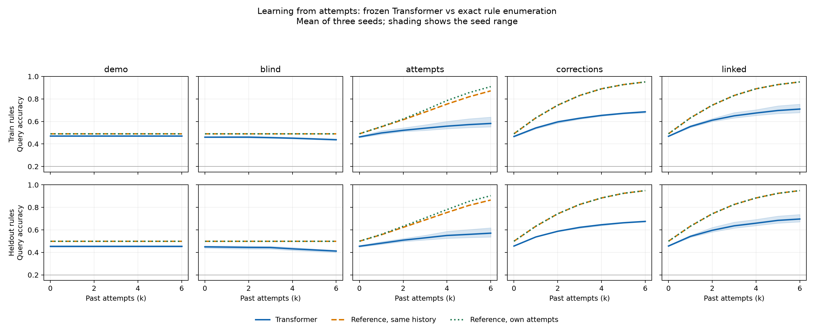

# Learning histories: fifteen-fit readout

Three seeds per condition, K=6, 20,000 updates, 8,192 evaluation sessions per split and seed.

The enumeration reference uses a uniform prior over all 126 rules. Because each evaluation split samples a subset, it is not the split-specific Bayes optimum. Its own attempts are greedy, not information-optimal exploration.

| Condition | Held-out k=0 | Held-out k=6 | Reference on own history, k=6 | Reference own attempts, k=6 |
| --- | ---: | ---: | ---: | ---: |
| demo | 45.49% | 45.49% | 49.90% | 49.90% |
| blind | 44.91% | 41.14% | 49.90% | 49.90% |
| attempts | 45.44% | 57.05% | 86.50% | 90.34% |
| corrections | 45.62% | 67.51% | 94.89% | 94.89% |
| linked | 45.65% | 69.62% | 94.89% | 94.89% |

Values are means across seeds. Full curves, seed variation and the predeclared decision checks are in `summary.json`.
This synthetic exploration does not establish adaptation on robot tasks.

## Interpretation

The attempts learner improves from 45.44% to 57.05% on held-out rules as the
history grows from zero to six attempts. Its k=6 seed accuracies are 61.82%,
53.64% and 55.70% (sample standard deviation 4.25 percentage points). The
enumeration reference on the same learner histories reaches 86.50%, a 29.45
point mean gap. On training rules the corresponding numbers are 58.19% and
87.17%, a 28.98 point gap. Every seed fails the predeclared within-five-point
held-out screen and exceeds a ten-point training-rule gap at some k. The model
uses some history information but does not approach the reference in this fit.

Blind histories reduce held-out accuracy to 41.14%, versus 45.49% for demo-only.
Full corrections reach 67.51%; adding linked attempts reaches 69.62%, with
substantial seed variation. Full corrections already determine the correct
object, so that difference cannot establish extra task information from linkage.

The immediate recommendation is to diagnose the toy learner and evaluate the
same frozen model on the same histories with real versus masked/shuffled
feedback. The grid itself does not contain that causal intervention. Training
actor choices depend on rewards and can carry indirect information; the
full-family reference prior differs from each split's sampling prior; held-out
rules also differ in arity mix. See [scientific review](SCIENCE-REVIEW.md).

A substantial LIBERO-Gen campaign is not the next step supported by these
results. After resolving the learning deficit, a small Spatial Combination
pilot with a qualified motor, an ambiguous initial demonstration and a hidden
rule preserved across fresh scenes is a sensible physical bridge. No LIBERO
work was launched.

## Execution and validation

- Baige job `job-tar8hons981r`, 15 distinct RTX 4090 allocations, all 15 fits
  completed 20,000 updates, final result files and exit-code-zero receipts.
- Immutable training commit: `50508c86ed24902b500dad6ae314a597df2b9d59`.
- Scheduler succeeded at November 11, 2026, 13:35:58 Shanghai; duration 29m27s.
  Total scheduler duration × GPU count, including both qualification attempts,
  is 7.424 GPU-hours; submission-to-end conservative bound is 7.620 GPU-hours.
- Resumption qualification was bitwise exact for model, optimizer, scheduler,
  RNG and results. Evaluation chunking preserved all choices (maximum logit
  deviation below 6.86e-7).
- All results use 8,192 sessions per split and seed. Seeds share their scenes
  across conditions. Curves are frozen evaluation, not optimizer learning curves.
- Readout ran on Linux using `readout.py` from commit `60b8598b`. Its plotting
  environment is separate from the immutable training environment.
- Resumable checkpoints remain under
  `/mowenjie/fluffy-bassoon-2/outputs/learning-histories-20261111-r1/grid01/`
  in `<condition>-s<seed>/<condition>.pt`. Raw metrics, probes and clock receipts
  are retained here; checkpoint tensors are not committed to Git.

