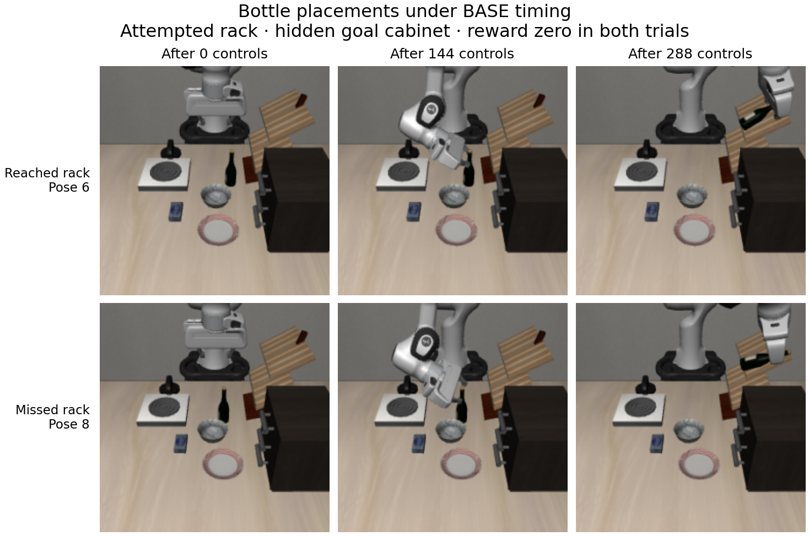

# Can motion explain which correction to make after zero reward?

A simple retry rule reached the attainable ceiling in a six-pose-pair bottle replay. It repeated the attempted destination after positive reward, switched after zero, and used a bowl-fitted estimate of command delay to choose the retry cadence. It achieved **31/48 native successes overall and 17/32 after zero**. A reader trained to recognize completed placements from gripper motion scored 28/48. The two failure types occurred in the data, but knowing which type occurred offered no additional recoverable success over the simple rule on this panel.

## What was measured

Each trial had a hidden cabinet or rack goal independent of the robot's first target. We paired the same timing across a paced first attempt and a different query pose. On the query, the robot could choose either destination and either cadence after a common 24-control paced opening for that destination. We verified identical opening actions and public states between cadences, matching initial physics and camera inputs across query actions, and all native outcomes for all 300 controls per branch. We reversed the roles of the original recorded poses to obtain all four query choices. These previously inspected development branches give 48 assignments from 24 bottle practice tapes and six pose-pair blocks. They are dependent counterfactual evaluations. [Design](PLAN.md) · [Full replay](replay.json)

| Policy or upper bound | All assignments / 48 | Zero reward / 32 | Completed the wrong placement / 16 | First attempt missed both destinations / 16 |
| --- | ---: | ---: | ---: | ---: |
| Fitted reward, attempted target and lag | 28.5 | 15 | 7 | 8 |
| Public motion estimate of placement completion | 28 | 14.5 | 7 | 7.5 |
| Same rule given true placement completion | 24.5 | 11 | 7 | 4 |
| Repeat or switch with the previously fitted cadence rule | **31** | **17** | **9** | **8** |
| Best action given the tape and observed reward, in hindsight | 31 | 17 | 9 | 8 |
| Best action also given the hidden goal and future outcomes | 34 | 20 | 9 | 11 |

The first three rows use the same bowl-fitted estimates of query success and average over tied actions. On a miss, the completion-aware rule kept both goals equally probable and relied on those estimates. Both cadences tied on the normal-timing bowl fitting examples for each destination. On bottles, returning to five-control replanning after the opening made 5/6 normal rack placements, versus 1/6 for continued pacing. Both scored 0/6 on delayed rack placements. After a rack miss, the bowl table favored the alternative destination over the cabinet on normal timing and tied across destinations on delayed timing. Switching to the cabinet already recovered all eight cabinet assignments following these misses. Feeding the rule true completion could therefore redirect a retry to a less reachable rack. The public motion classifier used peak upward movement during closure, preserved all 16 completed placements in its bottle predictions, and recognized only one of eight misses. Rotating the motion evidence among like-target and like-timing tapes also scored 28/48. [Frozen fit](frozen.json) · [Assignment-level scores](replay.json)

The fourth policy is an additional comparison selected after the initial readout. Its cadence cutoff of eight controls and both cadence choices were already fitted on bowls before the original bottle collection. We reused that component and balanced the first targets. The two destination choices after reward are the same repeat/switch rule used in the earlier studies. The ceiling lets an evaluator see all four query branches and their possible outcomes under both goals, but requires the same action whenever the physical support tape and observed reward are identical. For each tape that missed both destinations, the same zero was observed under either hidden goal. Even an evaluator with all four query branches could earn at most eight successes on those sixteen assignments. The simple rule attained that bound. [Prior bowl policy and per-assignment decisions](baseline.json) · [Ceiling calculation](diagnosis.json)

## What physically failed

All eight misses occurred on rack attempts. We replayed the archived commands for all 24 bottle supports on Baige CPU and verified the original reset fingerprint, all 7,200 public proprioceptive states and both native predicate sequences exactly. Seven of the eight rack misses registered bilateral gripper contact with the bottle. On those seven, its maximum rise while in contact ranged from 8.4 to 34.1 cm. The eighth had no bilateral grasp at the sampled control boundaries, although the bottle also moved upward. Grasping and lifting the object could still end in a failed placement. The contact record does not identify the cause of the final placement failure. [Contact audit](contacts.jsonl) · [Replay implementation](contact.py)

The frames show the first matched pair in the archive with the same timing and attempted target, where both attempts recorded bilateral grasp and exactly one reached the rack. Both cases have the cabinet as the hidden goal in the illustration. In the upper trial the zero reveals the cabinet preference. In the lower trial both possible preferences would have yielded zero.

## ICML decision

Keep this pair as a check on the information available to the learner. For the next fitting study, use a known requested destination and qualify a correction to the transport or release phase on delayed rack placements. First measure whether the new action can recover placements on starts where both existing cadences fail. Then build matched zero-reward cases where different corrections succeed, compare a public-history reader with the frozen lag and reward rule at the same native control budget, and freeze the comparison before transfer. A useful benchmark needs a measured retry that changes the outcome when the earlier attempt reveals something actionable.

This run used Baige CPU and zero additional GPU-hours. The original VLA trajectories came from the [bowl](../libero-bowl-decisions-20261118-r1/RESULT.md) and [bottle](../libero-first-attempt-20261119-r1/RESULT.md) studies. The reader and physical audit used commit `2ee42313`, the ceiling and figure used `7d258b57`, and the prior-rule replay used `ee29603a`. The official eight-task split remains reserved.
