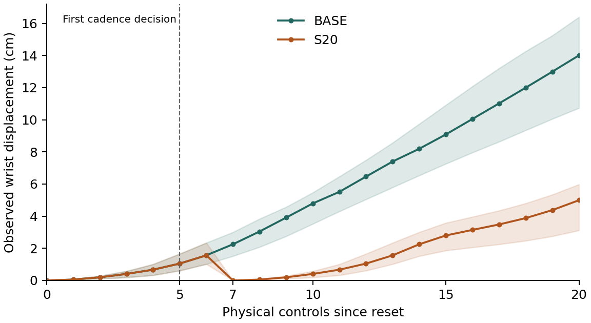

# How much earlier does a previous attempt reveal motor timing?

In LIBERO-Pro2 BASE and S20, the camera, robot state, prompt and first motor proposal were identical at reset on every archived timing pair. The first cadence decision occurs after five controls. Across all 32 paired fitting and development starts, issued commands, wrist positions, gripper positions and rewards matched exactly across the four candidate cadences through that decision. Comparing BASE with S20 within each cadence, wrist and gripper observations agreed through control six and first differed at seven. On S20, the seventh wrist observation equaled the reset position exactly. On BASE, it never did.

The release appends the current observation to a queue and begins returning the delayed element when the queue is long enough. This produces a startup cue that would need independent qualification on a physical robot. The plot shows median displacement and the middle half of the 16 development task/pose pairs under default execution. [Pinned simulator implementation](https://github.com/LIBERO-Pro-Team/LIBERO-Pro2.0/blob/e5500c690c1498eca1b7050350654964190cdf70/simulator-source/libero/libero/envs/nonphysical_perturbations.py) · [Five-control and cross-regime checks](paired-evidence.json)

## What the archived comparison establishes

The fitting and development panels each contain eight distinct tasks with two support/query pose pairs under each timing. Using only the first five controls of either attempt, a timing-supervised wrist-travel classifier recovered 16/32 development timing labels and earned 18/32 native successes, equal to fixed default. The older 80-control support lag rule scored 21/32. The new analysis explains when its information first became available. A supplementary stump fitted directly on seven-control support motion and native query returns selected pacing when the wrist returned toward reset and default otherwise. Its fitting score was 17/32 versus 16/32 fixed. The new stump was fitted during the fresh run after seeing the archived timing cue. [Prefix readout](prefix-readout.json) · [Earlier trained reader](../libero-decision-pretraining-20261119-r1/RESULT.md)

In hindsight, a separate but timing-blind mode for each development task/pose pair could score 22/32, exactly the ceiling with timing and all four outcomes revealed. A single fixed mode per task in hindsight scored 21/32. This concerns what the measured actions could achieve. Discovering those choices on new tasks still requires data. On fitting poses, knowing timing raised the analogous task/pose ceiling from 18/32 to 19/32. [Paired native outcomes](paired-evidence.json)

## Fresh live comparison

One new pose pair per development task (support 6, query 7), crossed with both timings. Every policy saw the same task prompt and received the same native query horizon, reset and first π0.5 proposal. A prior-based policy made its decision at reset. The two reactive policies read the seventh wrist displacement and made their decision after ten controls. One used all ten commands from the initial proposal. The other ran two five-control inference chunks. For each physically divergent continuation, the worker re-executed and verified the exact ten-control public prefix, then used live π0.5 observations. A reactive policy shared a fixed branch only when both issued the same commands under the same schedule for the entire query. [Registered comparison](PLAN.md) · [Worker](live.py)

| Live query policy | BASE / 8 | S20 / 8 | Total / 16 |
| --- | ---: | ---: | ---: |
| Fixed default | 8 | 1 | 9 |
| Fixed paced | 5 | 3 | 8 |
| Choose at reset from previous attempt | 8 | 3 | 11 |
| Ten proposal controls, then choose from current motion | 8 | 3 | 11 |
| Two five-control chunks, then choose from current motion | 8 | 2 | 10 |

The prior-based and ten-first policies succeeded on exactly the same eleven queries. The latter can operate without a practice attempt. Their accumulated query controls were 3,657 and 3,640 respectively, counting each failed query at its native horizon. Both identified all sixteen timing settings. Relative to fixed default, prior timing recovered delayed LIBERO-10 task 3 and Goal 1 and lost no placement. Choosing the default-first opening lost the delayed drawer opening (Goal 0). The other five delayed cases failed under every tested schedule. The outcome-supervised fit chose the same threshold (0.557045) and the same actions on all fresh examples, and reached 21/32 using support on the earlier development panel. This is a small mechanism experiment with one fresh pose pair per task and two timings. [Verified live outcomes](live-result.json) · [Reward-supervised fit](outcome-rule.json) · [Independent scoring](outcome-eval.json)

**Paper decision.** Keep S20 as a diagnostic for timing inference and include the ten-control reactive baseline in any claim about value from previous trials. It costs no additional physical controls to make that opening, and the frozen model already outputs all ten commands. A robust ICML headline needs a task where a prior attempt supplies information that an effective current-only policy cannot obtain in time, plus a motor choice that actually rescues a failure. A hidden user goal with native outcome feedback is a better candidate for that information requirement; evaluate it against a fitted reward decoder and charge the practice attempts.

Baige development RTX 4090, worker `live01` at `f4c12db8`. All 64 episodes finished with exit zero. The monitor recomputed success from each physical action/reward archive and checked branch reuse against the actual selected mode. Total timed device use including startup and the GPU probe was 626 seconds (0.174 GPU-hours). This study used the project's fitting and development tasks. The official test tasks remain reserved. [Worker receipt](worker-exit.txt)
