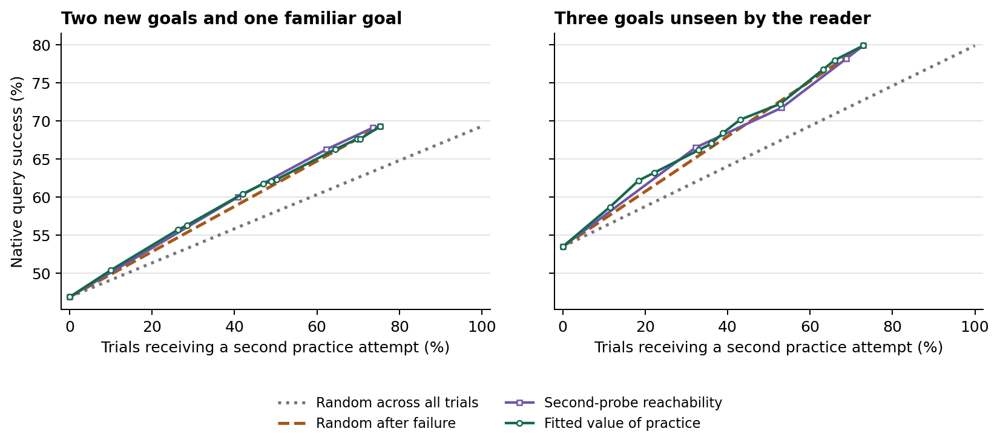

# Two rewards transfer to three new goals

On drawer opening, bowl-to-stove placement and plate pushing, the trained history reader reached **230/288 native query successes (79.9%)**. Masking its reward bits reduced this to **96/288 (33.3%)**. A source-fitted three-entry table also reached **230/288**, tying the reader on every pose. The table could skip 78 of 288 second practices after a first success and retain the full score. A randomized schedule at the same expected practice cost reached 209.4/288 (72.7%). The mechanism that transferred here was using sparse feedback to eliminate candidate goals and stop practicing once a goal was identified.

| Prospective policy | Mean practice attempts | Native query successes / 288 |
| --- | ---: | ---: |
| One practice, fitted decoder | 1.00 | 154 |
| Two practices, reader with reward bits masked | 2.00 | 96 |
| Two practices, reader with another goal's rewards | 2.00 | 16 |
| Two practices, Bayesian decoder | 2.00 | 226 |
| Two practices, learned reader | 2.00 | 230 |
| Two practices, fitted reward table | 2.00 | 230 |
| Fitted table, stop on first positive reward | 1.73 | 230 |
| Fitted table, spend the same expected number of attempts at random | 1.73 | 209.4 |

The three individual reader fits scored 230, 230 and 228. The ensemble and fitted table each selected the assigned goal on 252/288 queries. Ranking by query reachability alone reached 96 native successes. Across **every distinct reset order**, the reader, reward table and stopping policy again tied at 9,660/12,096 (79.9%). This reweights the same eight pose IDs. [Primary readout](primary.json) · [Reset-order sensitivity](pose-orders-primary.json) · [Stopping across reset orders](stopping-all-poses.json)

## What limits performance?

Knowing the hidden goal and every query branch outcome buys at most four successes beyond the fitted table (234/288). An oracle that knows the pose, order and branch outcomes but must choose the same action for hidden assignments with identical observed reward histories can reach 232/288. With one reward that upper bound is 170/288. All three named motors succeeded on 8/8 BASE poses. In the cabinet layout the drawer instruction succeeded on 0/8, the bowl on 8/8 and the plate on 7/8. No second probe can fix an unavailable query action. The four reachable queries lost by the reward table all involved pushing the plate. [Information bounds](bounds.json) · [Native outcomes by goal](primary.json) · [Motor outcomes by layout](stopping-all-poses.json)

When practice was available for only half of the 210 unsuccessful first attempts, allocating at random yielded 192 expected query successes. Ranking by source-estimated value yielded 193.5, and using second-probe reachability alone yielded 194.5. Across the entire optional-budget curve, the fitted ranker gained 2.05 successes over random allocation on average, and reachability gained 0.59. The order of the two informed policies depends on the budget. This small panel gives little basis for choosing a learned practice allocator over the simple controls. [Allocation curves](value.json) · [Stopping results](stopping.json)

## Experiment and scope

We fitted a shared 24-unit action-value network on 64 simulator branches spanning four goal identities, four layouts and four initial poses. An example had two practice attempts and a query on a third pose. The reader knew which candidates it had tried, their native reward bits and estimated reachability from public reset images and frozen motor proposals. It received no goal identifier or privileged state. The motor received the selected candidate's full instruction throughout each attempt. The reward-masked arm kept the same probe identities and pre-action reachability. The donor arm received rewards for a different hidden goal on the exact same physical attempts.

The prospective panel used the middle drawer, bowl on stove, and plate push. The three were unseen by the reader. The released motor's pretraining is a separate source of exposure. The Goal 4 anchor fixed the reset bank. Its 16 branches were excluded from the three-action menu. For each of eight poses and two layouts, six probe orders and three hidden goals gave 288 scored assignments from 64 physical rollouts, including the anchors. Every branch started from the same camera and physics state as its alternatives. Each practice and query ran for 300 controls. Success meant the native predicate fired at least once. The primary pairing cycled through three distinct poses within layout. Scores from all reset orders are a sensitivity check on that pairing. These counters reuse trajectories and do not constitute independent trials.

The fitted table chose the first probed goal for rewards 10, the second for 01, and the untried goal for 00. Its fallback for an unseen pattern used the source marginal. The Bayesian comparator used a uniform goal prior, smoothed empirical reachability and a source-estimated off-target hit rate. The predeclared reader averages predictions over training seeds 11, 29 and 47. Fractions in the policy comparisons are expected scores under tied choices or randomized schedules.

The 64 fitting and 96 mixed-panel branches came from the earlier scene experiment. On the mixed panel the reader and table tied at 798/1,152, and stopping saved 284 second attempts. The prospective panel used 64 newly executed simulator branches. Baige development RTX 4090 worker `transfer01` ran commit `1a99840b`; the allocation check passed and collection took 941 seconds including startup (0.261 GPU-hours). The CPU readout at `bbda67a3` exactly reproduced the frozen cyclic scores before changing the reset ordering. The panel used project training and development goals and kept the official test IDs reserved. [Registered design](PLAN.md) · [Source-fitted table](fitted-table.json) · [Mixed-panel result](mixed.json) · [Worker exit](exit.txt)
