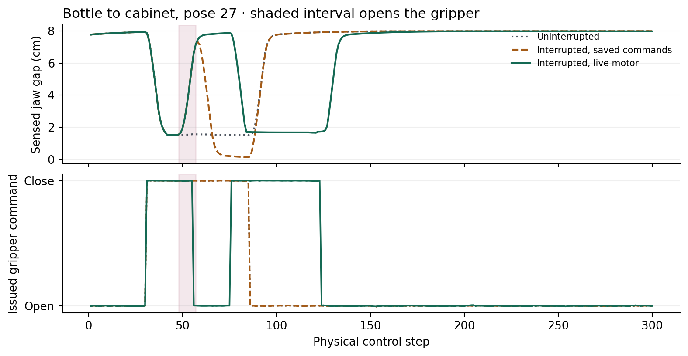

# What can a robot learn from an interrupted practice attempt?

A predictor fitted only on bowl trials transferred to live bottle placements under a ten-control gripper interruption. It selected a destination that reached the hidden goal on **72/96** retries, versus **62/96** for a fitted two-reward lookup table and **65.5/96** when the same reader received execution data sampled independently from the two branches at each identical start. The last comparison keeps the original rewards, intended goals, reset poses and control budget. Four of six query poses contributed to the 6.5-success gain over the donor and two tied. Each of these policies reused the same twelve measured query branches.

## How the interruption changes the interpretation of zero

Practice 1 tries one named destination. Practice 2 tries the other on a different pose. A hidden goal persists across both attempts and a query on a third pose. The simulator returns a single bit for whether the robot reached the assigned hidden goal during each practice. If the robot actually completed one placement but earned zero, the other destination is supported. A failed grasp or placement can produce zero for either goal.

On one branch the motor executes normally. On the paired branch the evaluator opens the gripper for ten controls after bilateral grasp and 3 cm of object rise. Each attempt has an independent interrupted or normal assignment. The learner observes its intended commands, wrist and gripper sensors, and the two rewards. Evaluator flags, contact and object state are excluded. The compact predictor estimates physical completion by kernel-weighted retrieval from six public motion features fitted on bowls. The one-feature rule uses the largest increase in measured jaw separation over ten controls of intended closure. Both use source-fitted completion estimates to infer the hidden destination. The direct table fits a destination to each probe order and reward pattern using native source query outcomes.

The first stage reran 76 archived practice tapes on CPU under both assignments. Every sham reproduced the saved public proprioception and both native predicates on all 300 controls. Paired branches matched through the fork. The reader fitted on 32 bowl tapes, each executed normally and with the fault, spanning four poses and two destination instructions. Evaluation used four other bowl poses and six archived bottle practice poses. The live test then used six further bottle poses and original five-control replanning, with twelve new query episodes using a separate noise draw. The motor could respond to the interruption during practice. All assignments stayed in the denominator, including untriggered faults. [Plan](PLAN.md) · [CPU branch records](branches.jsonl)

## Native query success after two zero rewards

| Practice panel | Assignments with two zeros | Fitted reward table | Intended commands | Jaw-opening rule | Learned motion reader | Same-start donor | True completion |
| --- | ---: | ---: | ---: | ---: | ---: | ---: | ---: |
| New bowl poses, saved commands | 512 | 256 | 282 | 306 | **341** | 274.5 | 348 |
| Archived bottle poses, saved commands | 60 | 24 | 28 | **33** | 29 | 26 | 36 |
| New bottle poses, saved commands | 48 | 24 | 20 | 27 | **31** | 21.5 | 31.5 |
| Same new bottle poses, live motor | 36 | 12 | 17 | 15 | **22** | 15.5 | 24.5 |

The reader beat the donor after two zeros in all four panels. On new bowls it also beat the 312/512 hindsight upper bound for a policy that knows the support starts, intended command tapes, query pose and reward bits but must treat the normal and interrupted executions alike. A policy allowed to distinguish the executed branches could reach 360/512. On live bottles the corresponding bounds were 22 and 25/36. The reader reached the first bound. On the archived bottle poses the simple jaw rule beat the multifeature reader by four successes. Keeping this comparator matters for any claim about learned transfer. [Bowl and archived bottle readout](replay.json) · [Paired new bottle results](closed.json)

## What closed-loop recovery changed

On the twelve new bottle practices the custom fault triggered eleven times and bilateral contact was lost within the forced-opening interval on all eleven. Uninterrupted practice completed 11/12 placements. Under the fault, saved commands completed 1/12, on the untriggered attempt. Live replanning completed 4/12, recovering three cabinets from the same starts and pre-fault commands. The reader's native query score was 69/96 using saved-command practices and 72/96 using live practices. The reward-table score stayed at 62/96. Its inference budget and query actions were identical. The zero-reward subsets differ in size because live recovery changes the observed rewards.

The illustration is the first recovered placement by pose order. After the forced opening, the live motor issued another close command and reached the cabinet. All new-bottle reader successes in the custom-fault panel still satisfied the native predicate at the final query control. Imposing the interruption only during practice keeps information acquisition distinct from the motor's ability to execute the query. [Selected trace](trace-case.json)

## Transfer to the released D18 object drop

The secondary test replaced the forced opening with the release’s Goal 2 D18 object displacement. The release runtime logged a physical move of the wine bottle on all twelve starts, at controls 49–146. We compared the event payloads and all pre-event physical states for the saved-command and reactive branches. Live replanning began at the first five-control boundary after the verified event. The identical nominal approach removes differences in how the motor reached the bottle.

| D18 practice | Completed practice placements / 12 | Query assignments | Reward table | Intended commands | Jaw rule | Learned motion reader | Same-start donor |
| --- | ---: | ---: | ---: | ---: | ---: | ---: | ---: |
| Saved commands after the drop | 0 | 96 | 60 | 58 | 58 | 64 | 58.5 |
| Replan after the drop | 4 | 96 | 60 | 72 | 66 | **73** | 69.5 |
| Replan after the drop, two-zero subset | — | 36 | 8 | 20 | 14 | **21** | 17.5 |

The bowl-trained reader selected the hidden destination on 89/96 assignments with post-drop replanning. The twelve independent query branches could achieve native success on at most 80/96 assignments, even with the hidden goal known. A hindsight policy allowed to specialize to the initial conditions and observed rewards could reach 74/96; allowing it to distinguish the exact executed tapes raised this to 76/96. The observed reader exceeded the trained reward table by 13, the reassigned-context control by 3.5, and issued commands alone by one. A reactive motor's later commands already encode some information about its observations. On this small panel, a claim about the value of sensed motion beyond issued actions is correspondingly limited. [Verified D18 events and saved-command outcomes](drop.json) · [Reactive D18 results](released-live.json)

The D18 mechanism comes from the pinned release. The hidden-goal assignment, two alternative practice instructions in the same Goal 2 world, repeated poses and follow-up query are custom. The six bottle query poses and twelve physical query branches are the units behind each 96-assignment replay. All four intervention assignments, both prompt orders and both hidden goals contribute; fractional donor scores are expectations under sampling the normal or interrupted history independently of the actual branch. These panels reuse trials and establish development evidence for two bottle destinations. They supply no official four-suite or held-out benchmark score.

## ICML decision and execution record

Use this experiment as the paper's controlled test of how much weight to give a zero reward after a failed physical attempt. Show the matched and reassigned history comparison at fixed query compute, and carry the commanded-action-only reader and jaw rule into any broader test. On held-out tasks, distinguish identifying the destination from selecting a new execution strategy. This reader selects an instruction for an unchanged motor and reuses a fixed query cadence. The central unresolved question is whether a completion model trained across task families improves native success beyond the strongest public-history baseline on tasks and event families held out together.

Baige development RTX 4090 collection used 587 seconds for the 36 custom closed-loop episodes. The first D18 worker stopped after 126 seconds because independently generated commands differed before the event. Its replacement executed 12 D18 recoveries in 199 seconds with the verified common prefix. Total measured GPU use was 912 seconds (0.253 GPU-hours). The original and matched CPU workers ran 152 and 24 simulator branches, plus 12 D18 saved-command branches. An early CPU readout encountered an incomplete archive; the completed archive was rescored. All reported comparisons use completed artifacts. The live custom worker ran commit `22da2850`, the D18 recovery worker `fccdc747`. The earlier three-goal and matched-zero studies plus this experiment used 3,013 measured GPU-seconds (0.837 GPU-hours). The official test partition remains reserved. [Custom worker exit](closed-exit.txt) · [D18 worker exit](released-exit.txt)
