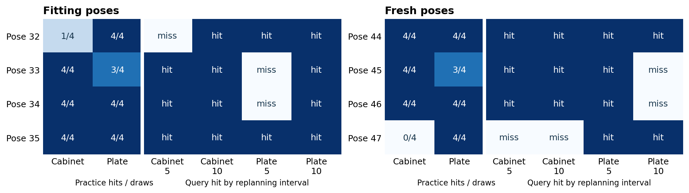

# Which correction follows the same two failures?

One fitting example required opposite actions from identical starting observations and identical reward histories. The reversal did not recur on the four fresh poses. The frozen reader selected the correct destination on **256/256 fresh assignments**, but substituting another execution from the identical start preserved all 256 action choices. The experiment establishes a fitting example of the proposed decision and shows why aggregate success alone cannot establish that watching the particular failed attempt mattered.

## A physical reversal on fitting poses

Both trials first attempted the cabinet on pose 32 and then the plate on pose 33. The robot was paid zero twice. At each practice pose the two executions had identical initial physics, RGB, proprioception and instruction. Only the sampled motor noise differed. Every query branch started from the same pose 34. Both practice attempts used five-control replanning.

| What the two practice attempts achieved | Hidden goal consistent with both zeros | Query continuations that reached it |
| --- | --- | --- |
| Missed the cabinet, reached the plate | Cabinet | Switch to cabinet with five- or ten-control replanning |
| Reached the cabinet, missed the plate | Plate | Keep the plate destination and change to ten-control replanning |

This was one of eight prespecified fitting pose/order groups and the only such group among all 48 possible fitting pose/order combinations. A fitted policy could use ten-control replanning for both destinations and cover all successful fitting query cases. The example therefore distinguishes destination choices while demonstrating a physical recovery from the original five-control motion. It gives no evidence that cadence itself must be inferred from history. [Executable witnesses and fixed-cadence comparison](cadence.json)

## Fresh poses

| Evidence used for the retry | Native successes / 256 with fitted query cadence | Successes after two zeros / 40 | Native successes / 256 with original five-control cadence |
| --- | ---: | ---: | ---: |
| Source-fitted reward table | 156 | 32 | 216 |
| Reset image and rewards | 156 | 32 | 216 |
| Issued commands, reset and rewards | 160 | 36 | 224 |
| Both cameras, commands, wrist/gripper history and rewards | 160 | 36 | 224 |
| Same reader given another draw’s history from the same reset | 160 | 36 | 224 |
| Evaluator supplies true practice completion | 160 | 36 | 224 |

The first two score columns use the prespecified source-fitted decisions. The last is a post hoc replay that preserves each selected destination and restores the frozen motor's original five-control cadence. Native success at control 300 matched the any-time scores for every row. The four-success improvement of the full reader over reset-only with the fitted cadence came from one query pose. Only one of eight fresh pose/destination pairs produced both a practice success and a failure across its four draws. The other seven always hit or always missed. The full reader classified 31/32 practice completions correctly, the same count as reset-only. [Fresh decisions](fresh.json) · [Default-cadence replay](fixed-default.json)

A hindsight selector restricted to initial poses, prompted order and reward bits could already earn **224/256**, including **40/40** after two zeros. Letting it inspect the exact practice executions raised neither bound. No fresh group exhibited the strict switch-versus-change reversal, including across all 48 distinct pose/order combinations. On fitting poses, exact execution evidence raised the cyclic hindsight bound from 252 to 253/256. The hindsight comparison measures how much the experiment could reward use of the individual execution, independent of a particular trained reader. [Attainable success by information set](ceilings.json) · [All reset orderings](cadence.json)

The query motor mattered more than the reader in this panel. Ten-control replanning reached both named goals on every fitting pose. On fresh poses it missed two plate placements that five-control replanning completed. Neither cadence could place the bowl on the cabinet on pose 47. The full reader with default cadence reached the complete measured-query ceiling of 224/256, as did the donor-history control.

## Protocol and paper decision

The Baige development RTX 4090 executed 96 simulator episodes, 48 on each split. Fitting used poses 32–35 with prior evidence of variable success. Poses 44–47 were reserved for fresh evaluation. Both splits used the same two bowl goals and S02 plate layout. Each pose supplied two destinations, four independent practice draws per destination, and two fresh query cadences per destination. At reset all twelve episodes matched in physics and public observations. The two cadences shared the first five commands for each query instruction. Native predicates were recorded for every control. The comparison pairs two distinct practice poses and a third query pose, balanced over prompted order, independent practice draws and hidden goal. Each reported split has 256 replay assignments from 48 physical episodes. It is a within-task development study. The official held-out tasks were reserved.

The completion predictor used kernel-weighted neighbors from fitting practice tapes, with bandwidth chosen by leaving out each fitting pose in turn. The query rule combined the resulting completion probabilities with the observed rewards and source-estimated query action values. The donor kept both original rewards and replaced each history with the next noise draw for the identical starting state and destination. Source scoring finished during collection; rescoring it at the end exactly reproduced the original fit. The frozen motor worker at `8e1d3e0e` used 1,160 GPU-seconds (0.322 GPU-hours). The preceding three-goal transfer and this panel used 2,101 GPU-seconds together (0.584 GPU-hours). All readouts ran on Baige CPU. [Design](PLAN.md) · [Source readout](source.json) · [Worker exit](exit.txt)

For the ICML experiment, keep the original motor cadence and the same-reset donor among the primary controls. On fitting tasks, cross an execution interruption independently with attempted destination on identical starts and log whether the interruption actually occurred. Score an unchanged and a corrected continuation on the same fresh query. Select the intervention family on fitting tasks, freeze it and retain every assigned evaluation trial. Replication of a switch-versus-retry reversal on new tasks, together with a native gain that disappears under the same-reset donor, would support a transferable execution-history claim.
