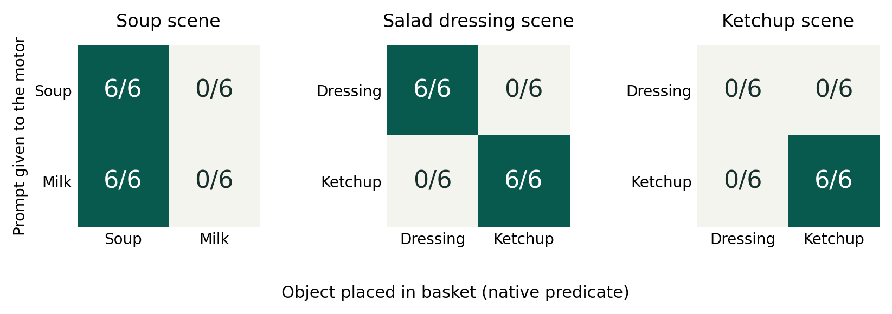

# Can a robot interpret a failed attempt on a new object?

A frozen π0.5 motor received one of two candidate instructions. After two practice attempts on different poses, the reader chose the instruction for a fresh query. The hidden goal stayed fixed within each three-attempt history. The question was whether adding the robot's sensed motion to the commands and rewards helped it choose an instruction that would actually earn reward.

## Design and scoring

The reader learned to estimate whether the motor had carried out its practice instruction using 64 bowl trajectories from four source poses. Its six motion features summarize jaw motion during intended closure and wrist travel. Its command features summarize the issued seven-dimensional actions in ten-control windows. All methods used the same practice attempts, feedback, query actions and frozen motor. The equal-weight joint reader and the commands-only reader chose bandwidth on the source poses. All weights were frozen before collecting Object-suite data.

The simulator used the released instructions, objects, reset banks and placement predicates. Each scene contained both candidate objects. A hidden goal selected which predicate earned reward. The ten-control gripper interruption applied only during practice, after a bilateral grasp and 3 cm lift of either candidate. The hidden-goal and interruption protocol is custom. The task IDs refer to the LIBERO-Object suite. The two reciprocal layouts change the whole scene, including which object is the released task's target. [Design recorded before the corresponding queries](PLAN.md)

Each layout used six poses, 24 practices and 12 fresh query episodes with 300 controls apiece. Both query instructions shared the same reset and policy noise. All 96 cyclic history assignments were saved before the queries in that layout. On six prespecified assignments the motor executed the joint reader's choice first and then the alternative. Each native-success count below reuses the measured outcomes of these twelve queries. Ties receive their expected score. The paired comparisons share physical episodes, including across alternative orders. Pose and layout breakdowns show where an effect changes direction.

## What the original bottle evidence established

Rescoring earlier bottle trials gave the joint reader 73/96 native successes against 67 for commands alone under the custom interruption, and 75/96 against 72 under released D18. On the separate archived open-loop bottle panel the joint reader reached 63/96 against 64 for commands and 69 for the one-feature jaw rule. The prospective Object study tests how far those results travel. [Bottle readouts](prior.json)

## Soup and milk

Both native instructions produced soup placements on all six query poses. The stored prompts were distinct and the first five issued controls differed on all six matched queries. With soup as the hidden goal, either instruction succeeded. With milk as the hidden goal, both failed. Every method therefore earned 48/96 native successes. The joint reader changed 36 choices relative to commands alone. All 36 changes had zero effect on native reward. On the six actually prioritized queries, the joint reader chose the opposite instruction from the hidden goal every time and got reward on the three soup goals.

All 48 histories with two zero rewards had milk as the hidden goal. An evaluator given the actual object placed during practice plus the public rewards could identify the hidden goal on all 96 assignments. Even that information would yield 48/96 native successes on the available query actions. This distinguishes a failure to interpret the evidence from the motor's inability to place milk in these queries. [Native outcomes](soup.json) · [Paired choice changes and order sensitivity](soup-sensitivity.json) · [Practice information and motor coverage](soup-coverage.json)

## Salad dressing and ketchup

In the salad-dressing layout, each instruction placed its own object on all six queries. The interruption fired in all 12 assigned practices. Every one still completed the intended placement within 300 controls. With one practice per instruction, the two rewards identified the hidden goal on all 96 assignments. The reward table, command reader, joint reader and jaw rule all reached 96/96, compared with 48/96 for always choosing salad dressing. This is a case where sparse feedback earns another 48 successes and motion adds none.

In the ketchup layout, the ketchup instruction placed ketchup on 6/6 queries. The dressing instruction placed neither candidate on 6/6. Six of 12 assigned interruptions triggered. Uninterrupted practices completed their own instruction on 6/12, interrupted practices on 5/12. The joint reader reached 48/96 native successes, tying commands alone and always choosing ketchup. The reward table identified the hidden goal on 92/96 assignments versus 66/96 for the joint reader, yet earned only 44/96 native successes. Goal identification and motor coverage answer different questions here. [Dressing-layout scores](anchor2.json) · [Ketchup-layout scores](anchor4.json)

| Physical layout | Joint reader | Commands only | Reward table | Always choose the designated object | Best available instruction per query in hindsight |
| --- | ---: | ---: | ---: | ---: | ---: |
| Soup | 48/96 | 48/96 | 48/96 | 48/96 | 48/96 |
| Salad dressing | 96/96 | 96/96 | 96/96 | 48/96 | 96/96 |
| Ketchup | 48/96 | 48/96 | 44/96 | 48/96 | 48/96 |
| Reciprocal dressing and ketchup layouts | 144/192 | 144/192 | 140/192 | 96/192 | 144/192 |
| All three layouts | 192/288 | 192/288 | 188/288 | 144/288 | 192/288 |

Across all three layouts, adding sensed motion changed 38 of 288 choices relative to commands and earned zero paired wins or losses. The result survived reordering all three distinct poses within each layout. Joint and commands differed on 736, 0 and 128 of the 1,920 assignments per layout, respectively, each time with identical native outcomes. These replays use the same 108 live simulator episodes across 18 layout/pose combinations. Of the 18 prespecified queries executed first under the joint reader, 12 succeeded (3, 6 and 3 by layout). The simulator supplied a separate query draw from the practices, and the alternatives shared that draw. Six resets per layout and one draw per query limit generalization. [Dressing order analysis](anchor2-sensitivity.json) · [Ketchup order analysis](anchor4-sensitivity.json)

The perfect-completion diagnostic gave the evaluator both actual candidate predicates on every practice. It eliminated any hidden goal inconsistent with those predicates and the delivered reward, randomized equally over the remaining goals and issued the corresponding instruction. The frozen readers never received those predicate vectors as inputs. In the ketchup scene, the diagnostic uniquely identified the hidden goal on 88/96 assignments. Randomizing between compatible goals on the remaining eight gave an expected 92 correct instructions and 46 native successes. A fixed ketchup choice earned 48 successes. Knowing which goal was intended can still leave the motor without a successful dressing action. [Dressing coverage](anchor2-coverage.json) · [Ketchup coverage](anchor4-coverage.json)

## Decision for the paper

Use this Object panel to show how to interpret a null effect of motion history. On fitting layouts, measure both quantities that make an informative test possible. Can the frozen motor carry out different retry choices on the same reset? Among histories with identical public rewards, do different retry choices actually succeed? Preserve all preregistered layouts and poses in the final denominator. The original same-object bowl and bottle destination tasks are the better-supported starting point for testing a learned retry decision. Add training variation in *which* object moved before asking a learned reader to transfer from inferring placement completion to inferring object identity. Compare to commands plus rewards, a reward-only table and an explicit completion-aware rule. Score native success first, with the motor ceiling and correct goal choices beside it.

## Execution

Baige development RTX 4090 on Nov 19. Collector `object01` at `61089790` used 488 GPU-seconds, and `reciprocal01` at `93fb3a92` used 867. Both exited successfully, for 0.376 GPU-hours total. Both loaded the same model archive with SHA-256 `1d0ec46350051494672a9d4880b69826e3c736bd86833d22fd4232a0b0164192`. The CPU scorer at `e8da4b29` verified the pre-query choice records against recomputation and checked execution order for the prespecified queries. The perfect-completion diagnostic used `0dbf575f`. The diagnostic using the designated object as a default and the perfect-completion rule were added for interpretation. The primary joint-versus-commands comparison was recorded before collection. The raw tapes, saved choices and model are in the two collector directories under `/mowenjie/fluffy-bassoon-2/outputs/libero-object-history-20261119-r1/`. Official test IDs were reserved.
