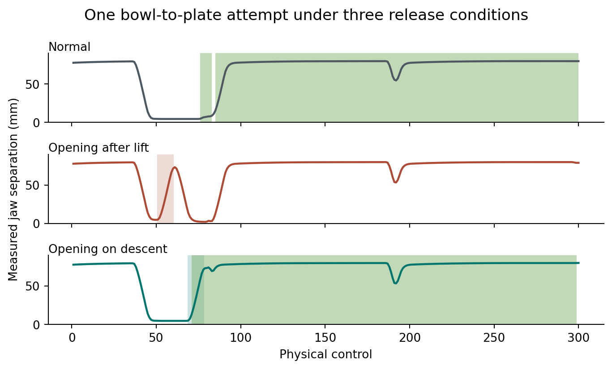

# Learning what a failed placement means for the next attempt

Opening the gripper for ten controls after lift reduced bowl placement success from 9/10 to 2/10 during practice. The same override on descent left 9/10 successful. The structured completion reader reached the best score possible from the executed practice assignments in the early panel. A direct retry-value reader also benefited from sensing the actual execution but did not consistently improve on completion inference.

## Direct supervision versus inferring completion

The direct reader fitted the difference in the two measured native query outcomes. The matched intent reader used the same features, architecture, regularization and training histories to predict which destination was assigned. Both used two rewards, commands and sensed motion relative to each destination. Swapping the two complete candidate records inverted predicted preference on every evaluation row. The 6,144 source rows reuse 64 practices and eight query executions on four source bowl poses. On 2,304 rows both query actions had the same native outcome. Fits used original practice data only and were saved before the evaluation stage. [Plan](PLAN.md) · [Fit and scoring](experiment.py)

| Evaluation | Native assignments | Direct joint | Direct commands | Direct motion | Matched intent joint | Joint completion rule | Reward table |
| --- | ---: | ---: | ---: | ---: | ---: | ---: | ---: |
| Fresh bowl poses | 1,024 | 759 | 656 | 779 | 772 | 786 | 704 |
| Archived bottle commands | 96 | 40 | 40 | 73 | 64 | 63 | 60 |
| Bottle with reactive motor, early opening | 96 | 66 | 57 | 75 | 72 | 73 | 62 |
| Bottle with reactive motor, released D18 | 96 | 71 | 64 | 76 | 74 | 75 | 60 |
| Three Object layouts together | 288 | 192 | 192 | 188 | 192 | 192 | 188 |

These seven retrospective panels had been scored in prior work with other readers. The two reactive bottle conditions share six query poses and twelve native query episodes. On the custom panel the direct joint fit gained two and lost nine against completion inference. On D18 it gained three and lost seven. For the custom bottle panel the three prespecified ridge penalties gave 57, 66 and 74 direct joint successes. Choosing the strongest fit after inspecting a test panel would change the comparison. [All scores, final predicates, paired changes and query-pose breakdowns](scores.json)

On the four source query poses, pointing the motor to the first and second destinations reached those destinations on 3/4 and 2/4 poses. An exploratory refit assigned each training history the average measured utility for its hidden goal across those four poses. This preserved the marginal native rates and removed the dependence caused by using distinct support and query poses from a small pool. Direct joint success rose from 40 to 64 on archived bottles, 66 to 73 on live custom bottles and 71 to 72 on D18. The fitting intervention changes both label variance and its association with support identity. Independent physical query starts per support history would distinguish those effects. [Marginalized-label comparison](marginal.json)

## Changing when the same gripper override occurs

We ran 40 CPU simulator episodes in the Goal 4 BASE layout. Five practice poses and five different query poses used recorded nominal motor commands. The source fitting data used the Goal 8 S02 bowl layout. Both the full unperturbed replay and the approach to each trigger reproduced archived public states and native predicates. Nine early and eight late interventions fired. Each changed observed motion and happened before its goal predicate first held. The motor was commanding closure during all ten early controls and eight to ten of the late controls. The new intervention results use fixed command replay. A live motor could react differently. [Physical-event checks](trace.json)

| Practice alternatives | Assignments | Direct joint | Commands plus rewards | Joint completion | Completion with reassigned motion | Reward table | Best possible with hidden goal known |
| --- | ---: | ---: | ---: | ---: | ---: | ---: | ---: |
| Normal or early opening | 80 | 65 | 56 | 66 | 58 | 56 | 72 |
| Normal or opening on descent | 80 | 71 | 72 | 70 | 70 | 72 | 72 |

The early panel included 36 two-zero assignments. The completion model earned 24/36 versus 16 with independently reassigned same-start motion. The best hindsight rule given starts, prompt order and rewards earned 20/36. Revealing the execution assignments raised that bound to 24/36. In the late panel the reward table reached the motor ceiling. The two panels share all ten uninterrupted practices and all ten query branches. Each reader's choices were saved before the queries were replayed. The nominal query outcomes predated this experiment. [Physical traces and paired scores](timing.json) · [Motion reassignment and information bounds](donor.json)

The colored ten-control bands show the commanded override. Green shading marks when the native plate predicate held. On pose 10 the nominal placement first succeeded at control 76 and the descent opening at 71. The opening after lift prevented placement throughout the 300-control episode. This was the first qualifying case in pose and goal order. [Case selection and controls](trace.json)

## Does detecting any interruption suffice?

A secondary replay used early and late openings as the two practice alternatives. Restricting to cases where both timing rules fired on both practice inputs retained 56 assignments across all five query poses. After two zeros, the joint completion reader reached 15/32 against 13 with reassigned motion and 13 with the one-feature jaw rule. Direct joint also reached 15/32, versus 14 with reassigned motion. Even a rule restricted to starts and rewards could reach 16/32 in hindsight, while access to the execution assignments permitted 20/32. This is the more informative challenge for a phase-sensitive reader. The simple presence of an interruption is constant here, and the current readers recover little additional reward. [Full and trigger-matched comparisons](stage-comparison.json)

For the paper, use the lift-versus-descent pair to test whether an agent can distinguish an execution failure from a successful release. Compare a completion model that knows the order of public wrist and jaw motion to a phase-blind one trained on the same practices. Score both on new interrupted supports and disjoint query poses. Keep direct utility prediction as a baseline and collect enough independent queries per support before interpreting a learned preference as evidence of transfer.

Baige CPU workers finished at pins `24d9c975` (value01), `52e17b4a` (timing01), `d4b4b258` (marginal01), `253c9a54` (donor01), `96eb1bb0` (trace01) and `c3034aca` (stages01). Zero incremental GPU-hours. The fitted bank SHA-256 is `25f1991acc4e787462eedf4ad3f318cdc42c0fb7e1a5218e4076486422f82fc4`. Raw tapes, per-assignment choices and model are under the matching run directory on Baige. The official test tasks remain reserved.
