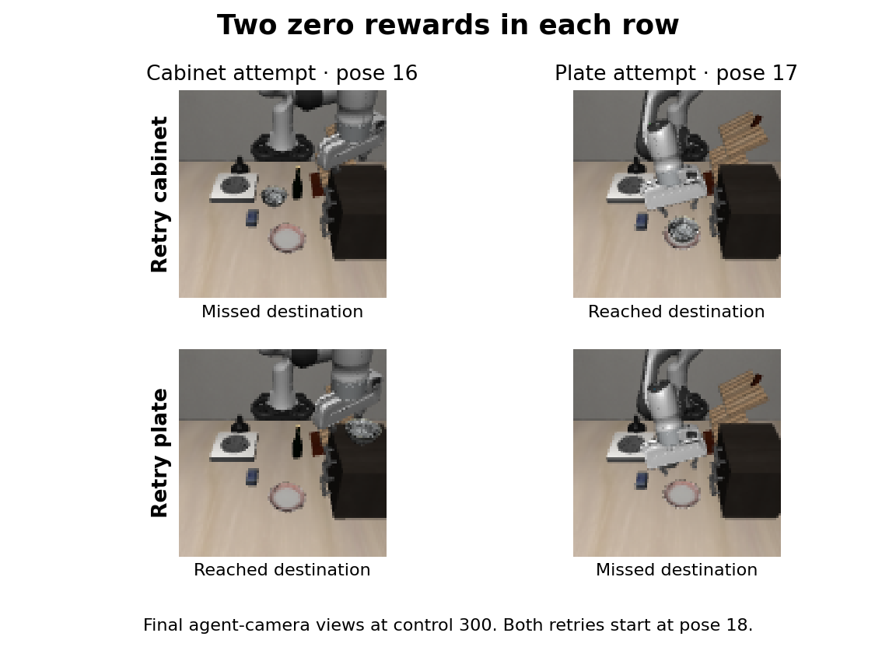

# Identical commands and two zero rewards called for opposite bowl corrections

The physical reversal recurred on two of four prespecified development triples. On both, scoring two fixed π0.5 practice attempts against the hidden goal produced zero twice. Which attempt actually placed the bowl determined whether the successful retry was cabinet or plate. Both corrective actions were executed from the same query reset. Pooled camera histories found all four correct choices. Swapping the camera histories between the matched cases reversed every choice. [Physical branch records](branches.jsonl) · [All decisions and checks](score.json)

The pictured practices used poses 16 and 17. When the bowl missed the cabinet and reached the plate, two zeros ruled out the plate. Swapping the placement outcomes ruled out the cabinet. Both histories used exactly the same two issued 300-control command sequences. Both quiz branches began on pose 18 with the same physics, images and robot state. This inference uses the assumption that the hidden destination is one of the two available options.

## Development readouts

| Evidence and training | Correct retries on the two qualifying cyclic triples | Correct retries over all qualifying ordered triples |
| --- | ---: | ---: |
| RGB differences, averages in 8 × 8 cells per camera, fitted on poses 12–15 | 4/4 | 24/24 |
| Same reader, histories swapped at both practice starts | 0/4 | 0/24 |
| Wrist and jaw trajectory, fitted on poses 12–15 | 2/4 | 12/24 |
| Issued commands alone | 2/4 | 12/24 |
| Six motion features trained on the earlier forced-opening fault | 2/4 | 13/24 |
| Earlier jaw threshold, or independently fitted jaw-narrowing feature | 2/4 | 12/24 |

The four primary choices reuse two physical reset triples. Both the fitting and the development split contain four reset IDs, each with two command tapes and two physical variants. All 4/4 fitting and 2/4 development cyclic triples qualified. Across every ordering, 24/24 fitting and 12/24 development triples qualified. Pose 19's nominal cabinet tape missed. This disqualified the development triples that used it for cabinet practice or as the common query. Across all sixteen development practices, RGB differences classified completion on 11/16, the raw motion reader on 9/16 and commands on 8/16. Correct relative rankings were easier than classifying every placement. [Source-trained motion reader](transfer.json) · [Exploratory jaw analysis](jaw.json)

## Does the reward or the sequence matter?

We then crossed all four sham/drop combinations with both hidden destinations on each of the four cyclic development triples. This includes unreachable and ambiguous queries. The 13-frame RGB reader with native rewards scored 22/32. Ignoring the reward bits with the same visual rule yielded 14/32. A readout fitted only on the final dual-camera view scored 23/32 with rewards and 13/32 when it ignored them. It also chose 4/4 correct retries on the strict cases. Even a hindsight policy allowed to specialize to the exact poses, issued commands and observed rewards could reach only 22/32. Knowing the hidden goal could reach 28/32 because one cabinet continuation was unavailable. These exploratory controls show that terminal visual evidence plus reward can solve the strict contrast. They leave learning to update from a longer trajectory open. [Crossed decisions](feedback.json)

## Execution and scope

The official Goal 4 D18 rule displaced the bowl on all 16 perturbed practice branches, at controls 47–142. None reached either goal. Nominal replay reproduced the archive's 300-control predicates and public robot states exactly for all 16 tapes. Every paired start and pre-event robot state matched, including both cameras at reset. The archived π0.5 actions were generated with five-control replanning on nominal scenes. We replayed them open loop under D18 to prevent post-drop commands from revealing what the robot saw. Each BASE tape can serve as practice or query in different assignments. The four development poses came from earlier motor studies and were disjoint from the prior bowl reversal panel. This custom two-goal development protocol yields no official suite score.

Baige CPU executed 32 physical branches in 93 seconds at revision `3a3994de`, using Mesa llvmpipe. An earlier attempt exited before any branch when robosuite parsed an empty CUDA device string as an EGL index. The successful attempt pinned the qualified software EGL device. Readouts ran at `3163ba79`, `35e642c5` and `94b66507`. No accelerator was allocated. Full 96 × 96 RGB, commands, states and predicate arrays are retained under the project Baige output directory in `cpu02/`. [Plan](PLAN.md) · [Native execution receipt](cpu-launch.txt) · [Archive inventory](INVENTORY.md) · [Independent review of the earlier bottle evidence](REVIEW.md)
