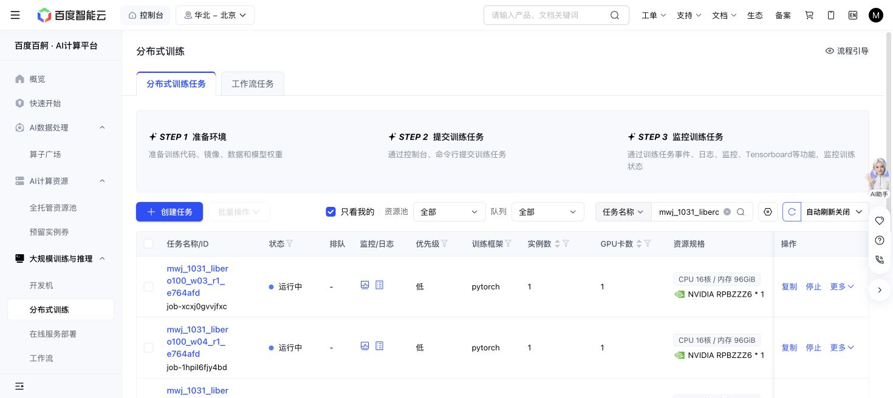

# Fixed100 LIBERO90 readout launched

All six Baige jobs submitted exactly once on 2026-10-31, under root grant
`7616561` and the verified standing human GPU authorization. This is the
previously prepared independent 4.5-GPU-hour readout, not a fraction of the
pending 25-hour source-collection proposal.

| Worker | Baige job | Created Shanghai |
| ---: | --- | --- |
| 0 | job-zt7xex96p71j | 11:57:38 |
| 1 | job-404blkw0lib5 | 12:00:04 |
| 2 | job-sg46ctfm4b2j | 12:00:04 |
| 3 | job-xcxj0gvvjfxc | 12:00:04 |
| 4 | job-1hpil6fjy4bd | 12:00:04 |
| 5 | job-mwscjuukmh9t | 12:00:04 |

Each has one GPU, 16 CPUs, 96 GiB RAM, 8 GiB shared memory, a 45-minute
scheduler limit and automatic retries disabled. The cumulative worker clocks
reserve 2,700 seconds each, including setup/failure/cleanup; six workers total
16,200 seconds. Actions are capped at 220,000 jointly (219,420 assigned),
including settling/uncertain charges. No source data, fit or target SGD is added.

Driver/simulator source remains qualified `e764afdd…`, with exact fixed100
matrix `dc9ebd…` and official OpenPI40 motor receipt `ec064c…`. Six clean
detached worktrees were prepared without modifying existing runs. Launch
artifacts were deployed via Git bundles (`07aa2db`, `c411be3`). The derivative
launcher removes only the redundant previously qualified pytest block; all
clock/admission/GPU-probe/driver/cleanup logic is retained. Static shell syntax
and exact removal were checked; no new Mac/dev tests or model computation ran.

PFS admission left 471,631,149,056 bytes beyond the concurrent 128-GiB RoboTwin
reserve, 20-GB target reserve and 500-GiB free floor. The shared mount write
probe passed. Original storage, motor/student recoveries and other worktrees
were preserved.

At initial admission all six allocation GPU/CUDA probes passed on six distinct
UUIDs, and every worker completed a real simulator episode. All motor parameter
signatures are `c565dd3f…`. Exact timestamped counts/costs and probe hashes are
saved in `initial-advancement.json`. These initial episodes are progress, not
a method result. Current-wave native scores will remain separate from earlier
31/30/29-of90 native waves.

The grid is all90 K0 goals × native/AD/DPT full/static, plus the fixed9 K1
panel with AD/DPT full and same-weight reset. One-shot uses a real support
episode and separate query with frozen parameters. Report support/query
interactions separately. Next normal monitoring is around 12:22 Shanghai;
`finish_assembly` retains sole launch/recovery ownership and the exact caps.

