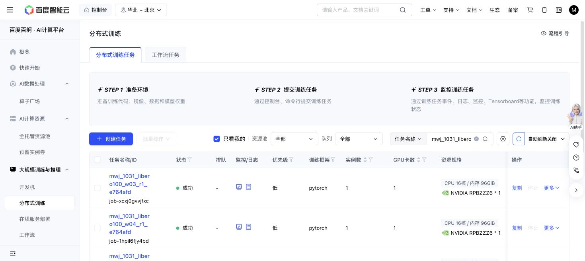

# Fixed100 LIBERO90 readout — 2026-10-31

All six Baige allocations succeeded. The complete predeclared grid contains 486 method/case groups and 522 physical episodes: 486 queries and 36 actual support episodes. All 90 tasks use initial-state ID 0, scene seed 123, horizon 400 and 10 settling actions. These are single-case-per-goal transfer results from the immutable 100-update interim snapshot, not a completed 1M/500 experiment.

| K0 query policy | Successes /90 |
| --- | ---: |
| Fresh native pi0.5 | 28 |
| AD full | 29 |
| AD trained static | 29 |
| DPT full | 28 |
| DPT trained static | 28 |

The fixed nine-task K1 panel is IDs 0,10,…80. AD full and the same-weight episode-reset control both score 6/9, with identical successful task IDs 10,20,30,50,60,70. DPT full scores 5/9 and its same-weight episode-reset control 6/9; task 60 is the only discordant outcome, favoring reset. Native K0 scores 6/9 on this panel. K1 runs execute an actual support and a separate fresh-reset query; support success is reported separately in the joined receipt.

Episode reset erases the support history at query start while retaining the full policy's parameters and within-query context. The separately trained static policies have their own weights. The 36 support episodes cost 8,242 primitive and 360 settling actions; the 486 queries cost 158,583 primitive and 4,860 settling actions.

These results show no reliable memory benefit or clear topline advantage. The one-success K0 AD difference is a small, mixed paired difference on one state/seed bank. Earlier native 31/30/29 waves remain separate controls. Ordinary DSRL, PPO, Plus and Pro are outside this fixed100 wave.

The exact input is the source-only fixed100 matrix `dc9ebd1274170e021906c1f66623a98713405e227229bc022e03eb4c1c92a623`, producer `2bc15da3028ab6a3cbaed4b813f3f761a680f1d9`, admitted by the unchanged `e764afdd04c9ea4dcbb7ac3e3e25d245c186dd42` driver. The four exported policies and their full training recoveries are fixed before target evaluation. The motor parameter digest is `c565dd3f0c4005be728cf7597698cba937c4011cd5bd813700a89b789f9d69e9` before and after every worker. Each worker uses one shared motor process for all its comparators; target optimizer updates are zero.

The joined audit independently checks exact planned groups, episode roles, all 522 raw trace lengths and terminal boundaries, matching actual initial RGB/wrist/proprio arrays, paired query seeds, model/recovery/trace/context bytes and support/query action totals. All 18 full/reset support-trajectory pairs are identical. There are 3,541 rehashed referenced files, including all 522 episode context/RNG archives and 486 group recoveries. Full sampler/global/motor RNG archives are rehashed, not restored in this read-only audit. Journal totals are reconciled against complete actual episode traces without replaying the entire RPC intent forest. Raw RPC files and original full recoveries remain on Baige.

Actual charged cost is 172,045 actions and 7,126 conservative GPU-seconds, including setup/cleanup allowance, versus approved 220,000 actions and 16,200 seconds. The scheduler reports 6,846 seconds across the same six one-GPU allocations; allocations are counted once. Outputs occupy 8,610,391,683 bytes, within 20GB; current PFS free space is 1,156,851,957,760 bytes. Detailed support/query/storage costs, per-case outcomes, hashes and proof scope are in `terminal-audit.json`; compact views are in `joined-metrics.json` and `cost-receipt.json`. No retry or new allocation was needed. Unused ceiling is not a fresh run allowance.

