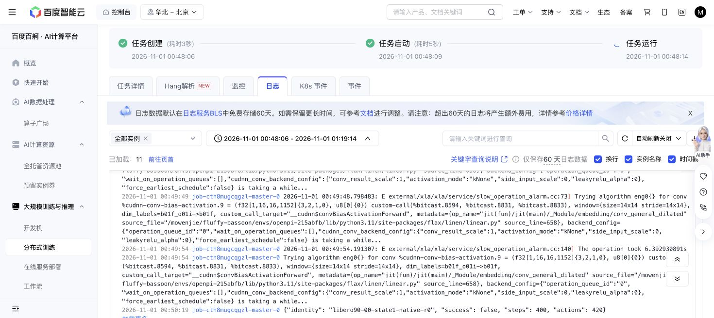

# Stage A is running on Baige

Submitted **2026-11-01 00:48:06 Asia/Shanghai**, job **job-cth8mugcqgzl**, name `mwj_1101_libero90_headroom_g1_r1_4ec35eb`. One NVIDIA RPBZZZ6, 16 CPU cores, 96 GiB RAM, 8 GiB shared memory, 180-minute scheduler limit, automatic retries disabled. This uses the existing [grant](GRANT.json), unchanged at 10,800 cumulative GPU-seconds, 170,000 all-in simulator actions and 20 GiB. Exact source is `4ec35eb9f563813e43293f797e8141a12fb0c4be`; grant SHA-256 is `893c368f8285bf18eed28d414bacfa2a45ea1ee6d4b459db49ff744823e987d3`.

The actual allocation probe passed at **00:48:28** on `job-cth8mugcqgzl-master-0`. The worker then reached the first completed physical episode at **00:50:19**: task0/state1/native/repeat0, 400 primitive steps, failure, 420 charged actions including qualification/settling. Reaching that record confirms the driver's motor-signature and same-noise admission checks passed. This is startup/progress evidence; no task-selection result or final unchanged-parameter claim is available yet.

The detached runtime is `/mowenjie/fluffy-bassoon-2/worktrees/libero90-pi05-headroom-screen-20261101-s0-r1`; outputs use the same run ID under `/mowenjie/fluffy-bassoon-2/outputs/`. The 384-episode plan and reserved query-state exclusions remain unchanged. The driver has no learner or optimizer.

Deployment used a verified Git bundle because the canonical Baige `origin` points to an old local bundle. CPU-only preparation job `job-ljovz1pyz72a` failed with exit128 before any model/simulator work when the source was absent; it used31 scheduler seconds, zero GPUs and zero robot actions. The bundle was uploaded through the existing authenticated mwj-clean Notebook, SHA-256 `beb0b9e7c9aee602634800d4547038d254928f98fee6c6f3ecab3ffd7f6567d1`, then imported with Git. Exact clean source, motor READY receipt, runtime paths, storage write probe and about1.1TB available space passed. Existing origin, checkouts and active runs were preserved.

The screen driver, launcher and tests are byte-identical to the qualified `5e90a29` code (thu2job49931,43/43). Tests were not repeated on GPU time. A single 20-minute heartbeat, `continue-libero90-headroom-and-gated-steering-experiments`, follows this chat's run; next check is about01:10Shanghai. It stays quiet on healthy progress and reports meaningful outcomes. Stage B still requires an eligible task, reviewed parameterization, allocated Linux qualification and its own bounded grant; NEXT-INTERFACES comparisons remain gated on the replication result.

The pre-pull local coordination edit is preserved in stash `codex-preserve-coordination-before-screen-pull-20261101`; it was not restored over newer main. An unpublished preparatory grant with a different run identity was superseded by the planner's canonical handoff before any remote submission and is preserved only on local branch `codex/libero90-launch-prehandoff-records`. There is one Stage A GPU submission.

[Structured receipt](LAUNCH-RECEIPT.json).

