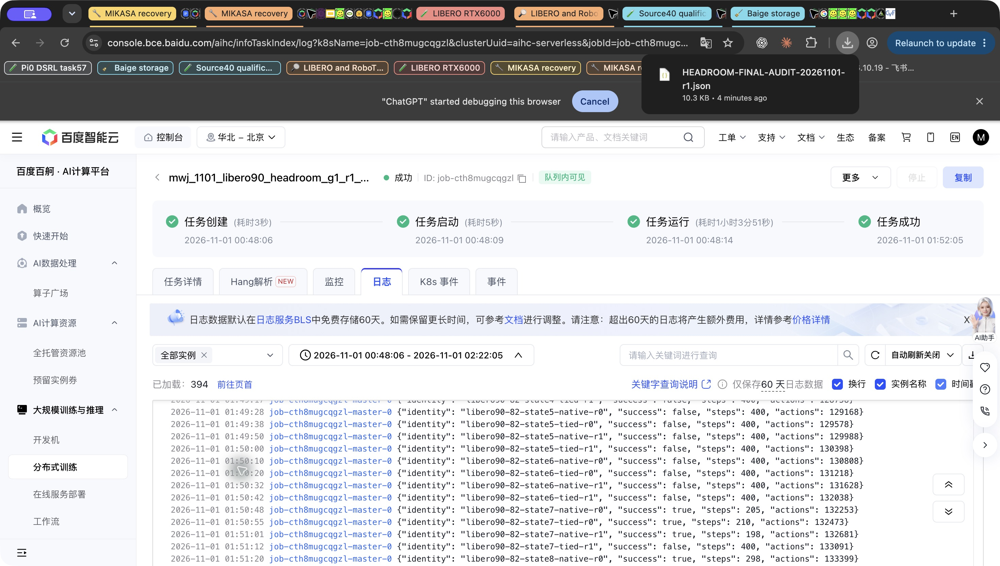

# LIBERO90 native/tied headroom screen: complete

**2026-11-01, Baige job `job-cth8mugcqgzl`, exit0.** All384 planned episodes completed. The fixed rule selects **task59** (native3/16, untrained tied9/16), with **task64** as runner-up (4/16,3/16). This establishes development headroom and warmup-compatible successes on the chosen task. No controller learned, and there is no DSRL learning, ICRL or memory result in this screen.

Source `4ec35eb9f563813e43293f797e8141a12fb0c4be`, runtime `libero90-pi05-headroom-screen-20261101-s0-r1`, original grant SHA-256 `893c368f8285bf18eed28d414bacfa2a45ea1ee6d4b459db49ff744823e987d3`. The entire official OpenPI `pi05_libero` motor stays frozen; parameter signature before/after is equal at `c565dd3f0c4005be728cf7597698cba937c4011cd5bd813700a89b789f9d69e9`. Same-noise replay delta is0. H10/execute10,10 flow steps,400-primitive horizon and10 settling actions remain unchanged.

## Full fixed table

| LIBERO90 task | Native | Untrained tied noise |
| --- | ---: | ---: |
| 0 | 1/16 | 2/16 |
| 29 | 7/16 | 7/16 |
| 33 | 13/16 | 12/16 |
| 38 | 8/16 | 6/16 |
| 44 | 1/16 | 10/16 |
| 53 | 0/16 | 0/16 |
| 59 | 3/16 | 9/16 |
| 64 | 4/16 | 3/16 |
| 70 | 13/16 | 12/16 |
| 77 | 1/16 | 4/16 |
| 79 | 9/16 | 7/16 |
| 82 | 7/16 | 3/16 |

Each arm is8 physical state IDs ×2 noise draws. The tied arm draws a fresh32D Gaussian **per chunk**, tiled over H10; it does not hold one draw for the entire episode. Native draws independent H10×32 noise. All records have role `target-headroom-screen`, zero optimizer updates, and stay outside source40/meta-pretraining. [Wilson intervals](rates.csv) are descriptive; task selection and correlated episodes limit generalization. The two arms also use different noise draws, so the table is not a trained-policy gain.

## Terminal audit and cost

The independently executed JSON audit verifies384 unique planned identities, exact task/state/arm/repeat/noise seeds, states1–8, role tags, zero optimizer updates, recomputed ranking, complete index, last-record action-counter agreement, full motor before/after equality, original grant hash, exit0 and a closed worker clock with no overrun. [Audit packet](FINAL-AUDIT.json), SHA-256 `5211ea1fdc4f8afcaf02380735b9ea4570eb84aac5df378c1bcd41d4071742a2`.

The worker clock closes at **01:52:01.889 Asia/Shanghai**, charging **3,890 GPU-seconds (1.081 GPU-hours)** including its60-second scheduler allowance. Total charged simulator actions are **134,629**, including qualification and settling. Both are within3h/170k caps. CPU-only failed deployment consumed31 scheduler seconds and zero robot/GPU actions; it is separate from GPU time. Unused allowance is released, not borrowed for another phase.

Final storage bytes were not independently remeasured. Runtime storage admission uses the20GiB ceiling with a1GiB reservation. The earlier development-host scan was non-atomic and is not a final storage receipt. Raw trace hashes and every physical intent have not been independently replayed; full raw traces remain on Baige. This audit is stronger than trusting exit0 alone, but does not claim those omitted checks.

## Protocol and next gate

This immutable384 native+tied run follows [PLAN-AT-LAUNCH.md](PLAN-AT-LAUNCH.md). Main was concurrently amended to a separate240-native screen/weak-query confirmation campaign; [MONITOR.md](MONITOR.md) records the dispatch timing and distinct grants. The results must not be pooled, nor should query cases be described as globally unseen across the overlapping development campaigns.

The other campaign already owns ordinary DSRL continuation. A saved coordinator snapshot confirms it has reached pre-learning native/tied controls; this chat did not query its scheduler or submit duplicate training. Publish this task59 result and consult its reviewed continuation before any separate Stage B dispatch. A positive control must improve over untrained tied noise and initialized-SAC controls, not only native. NEXT-INTERFACES search remains gated on a qualified replication result, with any task/case-bank reconciliation explicit before new actions. No extra seeds, motor changes, broad interface sweep or source collection are launched here.

