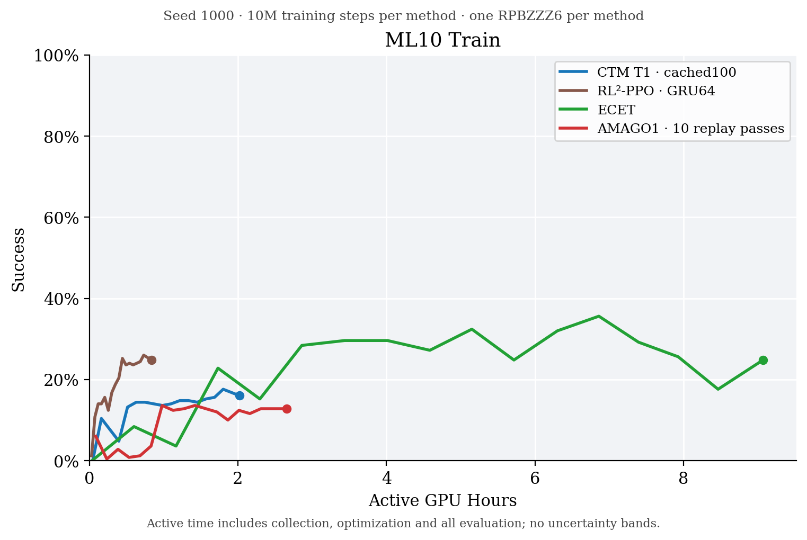
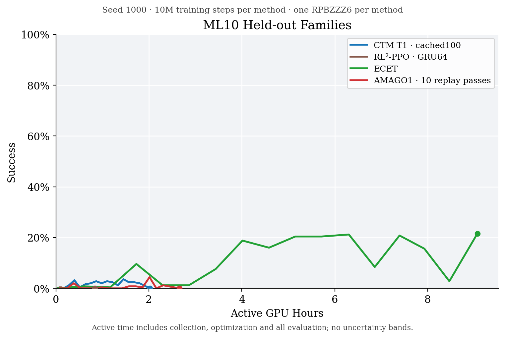

# Final ML10 results

[Full results and limitations](RESULTS.md) ·
[Curve data (CSV)](figures/ml10-final-curves-20261029-0835.csv) ·
[Completion audit](checks/20261029-0835/completion-audit.json)

CTM, RL²-PPO, ECET and AMAGO1 each completed 10M training transitions with
seed 1000. The source commit is
[`cd0128f03a060aff2d538a91f35058aa822df845`](https://github.com/tonyzhu163/fluffy-bassoon-2/tree/cd0128f03a060aff2d538a91f35058aa822df845);
the [comparison contract](https://github.com/tonyzhu163/fluffy-bassoon-2/blob/cd0128f03a060aff2d538a91f35058aa822df845/docs/metaworld-comparison.md)
contains the training and evaluation protocol. This bundle preserves the
original report and artifacts byte-for-byte. It contains no checkpoints.

## Success versus active GPU-hours

Active time includes collection, optimization and all evaluation. These are
observed single-seed curves without uncertainty bands. The methods differ in
model size and optimization; the comparison does not establish a CTM advantage.

## All plots

| Horizontal axis | Training families | Held-out families |
| --- | --- | --- |
| Active GPU-hours | [PNG](figures/ml10-train_eval-gpu-hours-20261029-0835.png) / [PDF](figures/ml10-train_eval-gpu-hours-20261029-0835.pdf) | [PNG](figures/ml10-test-gpu-hours-20261029-0835.png) / [PDF](figures/ml10-test-gpu-hours-20261029-0835.pdf) |
| Training-only GPU-hours | [PNG](figures/ml10-train_eval-training-gpu-hours-20261029-0835.png) / [PDF](figures/ml10-train_eval-training-gpu-hours-20261029-0835.pdf) | [PNG](figures/ml10-test-training-gpu-hours-20261029-0835.png) / [PDF](figures/ml10-test-training-gpu-hours-20261029-0835.pdf) |
| Training transitions | [PNG](figures/ml10-train_eval-steps-20261029-0835.png) / [PDF](figures/ml10-train_eval-steps-20261029-0835.pdf) | [PNG](figures/ml10-test-steps-20261029-0835.png) / [PDF](figures/ml10-test-steps-20261029-0835.pdf) |

The [first-K5 companion PNG](figures/ml10-first5-gpu-hours-20261029-0835.png)
([PDF](figures/ml10-first5-gpu-hours-20261029-0835.pdf)) reports the first five
episodes within the original K25 evaluations while charging full evaluation
time. It exposes the training-clock range limitation and does not replace
the prespecified K25 headline.

## Evidence and reproduction

The final check directory contains original metrics with binary outcomes,
native returns, family identities and per-episode curves:
[CTM](checks/20261029-0835/ctm-metrics.jsonl),
[RL²-PPO](checks/20261029-0835/rl2-metrics.jsonl),
[ECET](checks/20261029-0835/ecet-metrics.jsonl), and
[AMAGO1](checks/20261029-0835/amago-metrics.jsonl).

[plot_final.py](checks/20261029-0835/plot_final.py) recreates the figures from
these metrics with Matplotlib; it performs no model execution.
[artifact-manifest.json](checks/20261029-0835/artifact-manifest.json) contains
the original SHA256 hashes. The original
[audit script](checks/20261029-0835/audit_saved_artifacts.py) additionally
requires the archived Baige run directories and full recovery checkpoints
at its recorded host and paths. Its saved findings are in the completion audit.
