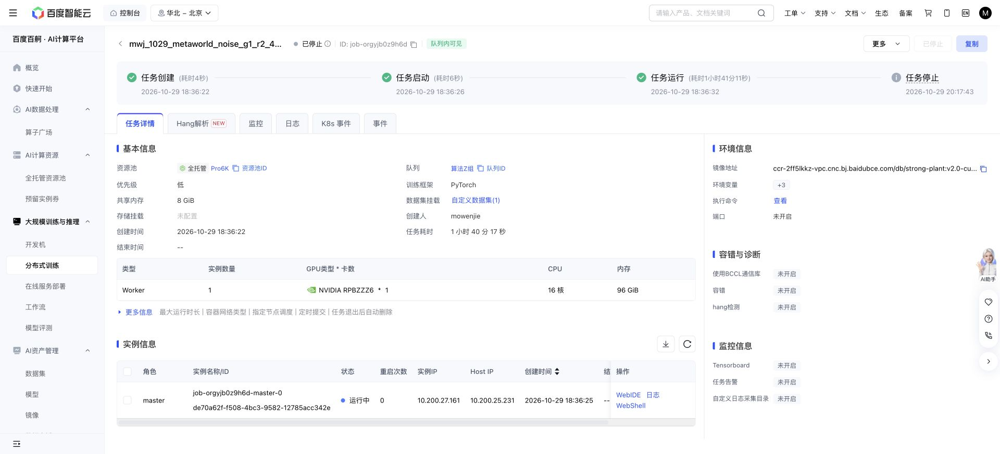

# Paused by the user

2026-10-29 Asia/Shanghai. The user paused Meta-World and redirected work to
LIBERO and RoboTwin after clarifying that the intended method is learned noise
steering. The fixed 16-arm screen does not test that method.

The authenticated Baige console confirmed `job-orgyjb0z9h6d` stopped at
**20:17:43**, after **1h41m11s** running. The exact job name and identity were
verified before stopping. No other allocation was altered. The monitor
`monitor-metaworld-pi05-noise-screen` is **PAUSED**; no retry is scheduled.

Three conditions closed before the stop: reach visible, reach hidden and
push visible, **544 rows each (1,632 total)**. Their original outputs remain
on Baige; the closed push-visible directory was additionally mirrored under
`checks/user-pause-20261029-2017/` before stopping. The two reach audits were
already mirrored and hash-verified. Push-hidden had no flushed outcome rows
and is incomplete. No final summary, exit-code receipt or end-of-run motor
fingerprint was produced. Do not classify this as a completed screen or a
scientific failure of DSRL.

This was evaluation only: no learner or optimizer state existed. The original
model, runtime, immutable source and completed artifacts remain protected.
The interrupted in-memory rollout is not exactly resumable. Any future
continuation needs an explicit resume decision and a fresh output identity.

