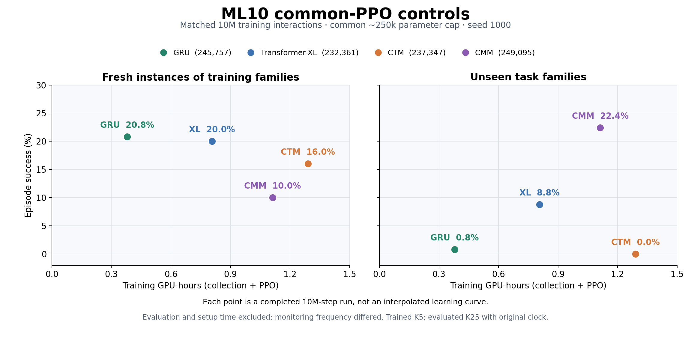
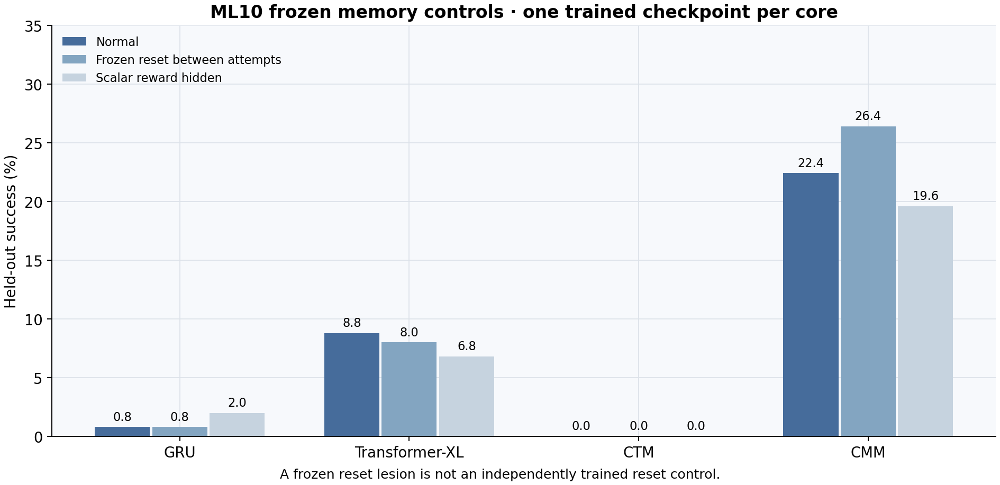

# ML10 common-PPO core controls

This is the approximately parameter-matched GRU / Transformer-XL / CTM / CMM
comparison. All four runs completed 10M training interactions and 4,000 PPO
optimizer steps with seed 1000. They share the PPO contract and a 250k policy
parameter cap; the exact parameter counts differ slightly.

| Core | Parameters | Train success | Held-out success | Training GPU h |
| --- | ---: | ---: | ---: | ---: |
| GRU | 245,757 | 20.8% | 0.8% | 0.3792 |
| Transformer-XL | 232,361 | 20.0% | 8.8% | 0.8073 |
| CTM | 237,347 | 16.0% | 0.0% | 1.2897 |
| CMM | 249,095 | 10.0% | 22.4% | 1.1125 |

## Why these are endpoint dots

GRU and XL were evaluated at initialization and at the final 10M checkpoint.
There are no saved intermediate evaluations for those two runs. CTM and CMM
have intermediate evaluations, but the shared comparison uses only final
endpoints. No intermediate learning trajectory is inferred for GRU or XL.

[Endpoint PDF](common-ppo-ml10-endpoints.pdf) · [Endpoint CSV](endpoints.csv)

The horizontal axis is training GPU-hours (collection plus PPO); every dot
represents 10M training interactions. Evaluation/setup time is excluded because
GRU/XL used 1.25M evaluation interactions while CTM/CMM used 5M. End-to-end
timing would therefore confound training cost with monitoring frequency.

## Memory controls and limits

[Memory-control PDF](common-ppo-ml10-memory-controls.pdf)

All headline scores use deterministic K25 evaluation with the original clock,
following K5 training. CMM held-out normal/reset/reward-blind success is
22.4/26.4/19.6%; its lead does not demonstrate a cross-attempt memory benefit.
These are single-seed observations without seed uncertainty estimates.

## Relationship to the other ML10 set

The [native-method comparison](../metaworld-ml10-matched-baige-20261028-r1/README.md)
uses CTM, RL²-PPO, ECET and AMAGO1 with different model sizes and learners.
Its GRU-based RL²-PPO has 21,960 parameters and a different critic and action
distribution; it is distinct from the 245,757-parameter common-PPO GRU above.
The CTM checkpoint is shared across both comparisons, not independently trained.

## Source and evidence

The [saved audit](audit.json) records sources, matching task-pool hashes,
terminal counters, recomputed evaluation summaries and checkpoint identities.
[endpoints.csv](endpoints.csv) records exact timings and paired control scores.

| Core | Source commit | Checkpoint SHA256 |
| --- | --- | --- |
| GRU | `32843d1624f9325c1c77cab07b55d0240931cbcf` | `18d492d4641b14563287ff41fef1ebfe7cf2ebae192e91ba7a8e1c742431c34e` |
| Transformer-XL | `32843d1624f9325c1c77cab07b55d0240931cbcf` | `6875e390a4818e87a2e036fe59d393690db02a87aee12a33c062e9e644bce358` |
| CTM | `cd0128f03a060aff2d538a91f35058aa822df845` | `a34dff8decfef013bde1f74310c67709b5ae0689a2b1f89ed49848db51a58b18` |
| CMM | `bcf3d98242b309e52391cee4c1f783adebcf2d1b` | `930b788e400b60b5c41299eba48b6a553eae7aaaab71fdb2029c82ee1a6e3287` |

The original [chart script](make_chart.py) and exact
[saved-array reader](report_memory_benchmarks.py) are preserved. Recreating
the full source audit requires the archived run directories and checkpoints;
those large artifacts are excluded from Git. The reader and chart-script
hashes match the saved audit. [artifact-manifest.json](artifact-manifest.json)
records SHA256 hashes of the published original files.
