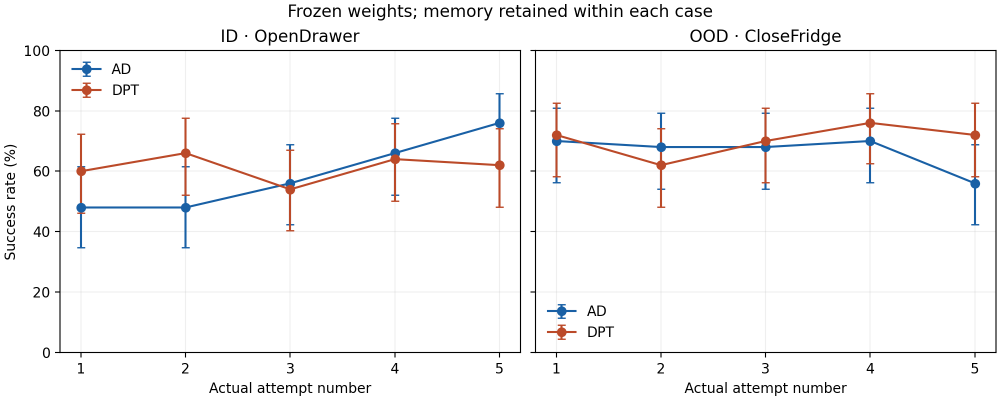

# Actual attempts1–5: completed comparison

Each cell is true native successes/50, with the same fixed50 ID and50 OOD cases per model. Weights frozen; memory carries actual attempts within a case and clears between cases. The environment resets to the same case before each attempt. This is per-attempt success, not ever-success by that attempt.

| Model/task | Attempt1 | Attempt2 | Attempt3 | Attempt4 | Attempt5 |
| --- | ---: | ---: | ---: | ---: | ---: |
| AD / ID |24|24|28|33|38|
| AD / OOD |35|34|34|35|28|
| DPT / ID |30|33|27|32|31|
| DPT / OOD |36|31|35|38|36|

AD has an ID-specific rise (attempt5vs1:16wins/2losses,p=.0013123, unadjusted). It does not extend to OOD. DPT's endpoints are roughly flat. Different fixed motor streams across attempts prevent attributing this trend specifically to memory without a matched same-weight memory-reset control. Original PPO/static p0 outcomes remain a separate one-shot comparison. Later histories exceed64 training tokens; capacity128, total75ID/90OOD. One source task and fit seed; OOD means held out from student training, not necessarily foundation pretraining. Original pixels and qualified≤1uint8 render roundoff retained.

All500 actual episodes/model passed independent CPU physical/camera/source/hash/native-truth checks and every worker's frozen-weight check. Both allocations closed with4 successful node clocks and8 worker receipts each. The final accounting includes retained/failed/partial/obsolete query/recovery costs once, with source lineage and queue-inclusive bounds distinct from measured clocks.

[Combined result and paired tests](COMBINED-RESULT.json), [CSV](figures/attempt-success.csv), [SVG](figures/attempt-success.svg), [final accounting](FINAL-ACCOUNTING.json), [all recent results](../opendrawer-results-rollup-20261102-r1/RESULTS.md).
