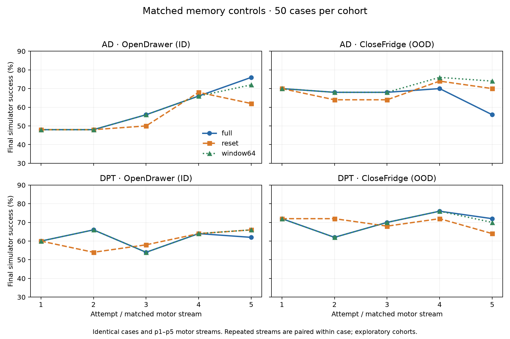

# Matched memory controls

True final simulator success per50 cases; frozen checkpoints and original p1..p5 motor streams.

| Model / cohort / arm | p1 | p2 | p3 | p4 | p5 |
| --- | ---: | ---: | ---: | ---: | ---: |
| ad / ID / full | 24 | 24 | 28 | 33 | 38 |
| ad / ID / reset | 24 | 24 | 25 | 34 | 31 |
| ad / ID / window64 | 24 | 24 | 28 | 33 | 36 |
| ad / OOD / full | 35 | 34 | 34 | 35 | 28 |
| ad / OOD / reset | 35 | 32 | 32 | 37 | 35 |
| ad / OOD / window64 | 35 | 34 | 34 | 38 | 37 |
| dpt / ID / full | 30 | 33 | 27 | 32 | 31 |
| dpt / ID / reset | 30 | 27 | 29 | 32 | 33 |
| dpt / ID / window64 | 30 | 33 | 27 | 32 | 33 |
| dpt / OOD / full | 36 | 31 | 35 | 38 | 36 |
| dpt / OOD / reset | 36 | 36 | 34 | 36 | 32 |
| dpt / OOD / window64 | 36 | 31 | 35 | 38 | 35 |

Per-attempt exact paired tests, Holm adjustment over40 comparisons, case-bootstrap intervals and the attempt5-minus1 difference in differences are in [RESULT.json](RESULT.json). Reused endpoints add no new episodes. These50-case controls remain exploratory; no broad head-to-head or ICRL claim follows from a small count difference.

## Interpretation

The matched reset comparison does not establish a memory gain in these50-case
cohorts. Across all five streams, full-minus-reset mean success differences in
percentage points, with paired case-bootstrap95% intervals, are:

| Model / cohort | Difference | 95% interval |
| --- | ---: | ---: |
| AD / ID | +3.6 | −1.2 to +8.4 |
| AD / OOD | −2.0 | −7.6 to +3.6 |
| DPT / ID | +0.8 | −2.8 to +4.4 |
| DPT / OOD | +0.8 | −5.2 to +6.8 |

AD ID attempt5 full38 versus reset31 has10 paired wins/3 losses,
raw exact p=.0923, Holm p=1. DPT has no clear matched memory advantage.

AD OOD attempt5 improves28→37 under window64:10 window wins/1 loss,
+18percentage points (case-bootstrap95% interval +6 to +30), raw exact
p=.01171875, Holm p=.46875 across40 comparisons. No per-attempt comparison
survives that correction. This is a reason to investigate long/older-history
harm, with a larger confirmatory cohort; truncation also removes older feedback
and does not isolate positional extrapolation. Single source task/fit seed,
50 case clusters and correlated repeated streams limit these results.

## Verification and resources

All1100 collected control episodes (267r1+785r2+48r4),900 reused control
endpoints and1000 distinct original full-history episodes passed saved-record,
checkpoint/source, case/noise, simulator truth and native pairing checks.
The200 original K1/support records predate the cache-entry field; their pinned
writer constructs a fresh controller for each case. Later cache entries and
exact GPU prefix replay checks are retained. No original record was changed.

Baige Pro6K/算法Z组 job `job-oizm929rf0oo` succeeded at12:28:22Shanghai;
its sole instance ended12:27:46. All eight logical workers completed with
unchanged weights and exactly36000 new policy controls. R4 measured2544GPU-s,
conservatively charged2589 from job creation to terminal. Whole-campaign
conservative charge is65556/86400GPU-s (18.21/24GPU-h), with20844 unused.

The original committed SUMMARIZE.py produces the paired result. Independent
reference checks and figure generation ran on allocated Linux CPUs with CUDA
hidden; plotting dependencies were installed in separate analysis directories,
without changing the production runtime. Analysis source and result hashes,
legacy-schema qualification, all worker/charge checks and selected paired
statistics are in [FINAL-AUDIT.json](FINAL-AUDIT.json). Prior diagnostic logs
remain beside the final successful READOUT.log. No extra episodes or GPU job
were used for analysis.
