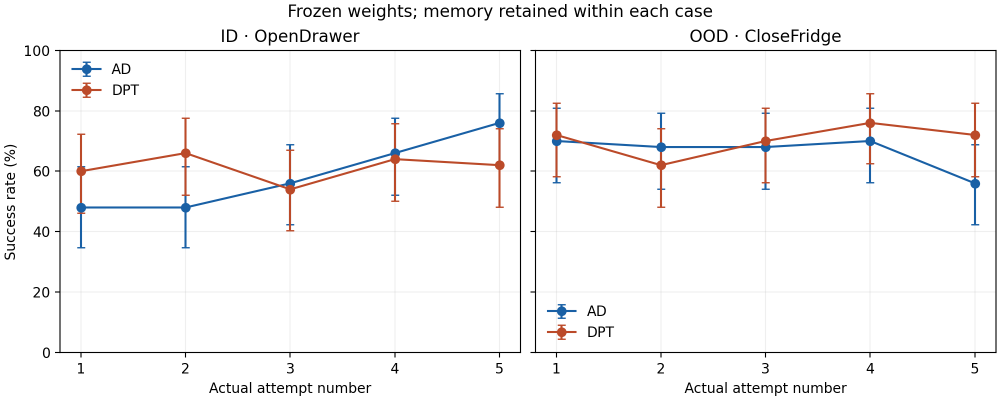

# OpenDrawer development results — November 2, 2026

The completed evidence supports an ID-specific AD attempt trend. General in-context adaptation, reliable OOD gains, and an overall student advantage over PPO remain unestablished. The next comparison should keep PPO as an anchor and isolate carried memory with the same weights, cases and attempt-specific motor draws. The already-running interface screen and Flow SDE PPO should finish before another scale-up decision.

## 1. PPO and learned reward

The earlier original/simulator-PPO/Flora-PPO panel completed50 OpenDrawer ID and50 CloseFridge OOD cases:

| Policy | ID successes /50 | OOD successes /50 |
| --- | ---: | ---: |
| Untouched original pi0.5 |28|28|
| Simulator-reward residual PPO |34|32|
| Flora-reward residual PPO |31|28|

None of the relevant paired comparisons establishes a reliable gain on this one-source-seed panel. The retained source training records also show no clear learning progress: simulator PPO successes per64 source episodes are35,37,26,32,34,33; Flora PPO36,35,30,29,37,34. Longer or more diverse histories are useful for AD only if the source algorithm demonstrably improves. These runs had360 Adam steps per reward arm; this evidence does not establish that additional PPO optimization would fail.

Flora's TRAIN reward AUROC is0.925, yet it emitted full Score5 on58 of183 simulator failures. Replaying the proposed rubric revision on634 existing videos corrected20 original false full-success grades, introduced5 new ones and removed full-success grades from35 true successes; TRAIN AUROC fell0.9269→0.9191. Do not adopt that revision on these results. This establishes reward/metric mismatch, not the cause of a reliable PPO performance gap.

Evidence: [original/S/F terminal comparison](../robocasa-original-pi05-eval50-20261102-r1/TERMINAL-REVIEW.json), [PPO retained-data checks](../robocasa-ppo-free-checks-20261102-r1/RESULT.md), [reward-gap investigation](../robocasa-ppo-reward-gap-investigation-20261102-r1/RESULT.md), [rubric replay](../robocasa-flora-rubric-replay-20261102-r1/RUBRIC.md).

## 2. Converged students against both PPO checkpoints

All four fits reached the original validation plateau: AD/full1900, AD/static1900, DPT/full23800, DPT/static24100 updates. Best-validation selected checkpoints were frozen before evaluation. A fresh shared canonical bank verifies native scene/XML/state/cameras/public state, checkpoint and record hashes, original motor streams and true simulator success. All1000 one-shot endpoints passed independent and combined CPU verification.

| Policy | ID successes /50 | OOD successes /50 |
| --- | ---: | ---: |
| Initial PPO |33|28|
| Final PPO |32|30|
| AD/full K0 |34|33|
| AD/full separate query after one support |34|33|
| AD/static |29|33|
| DPT/full K0 |29|32|
| DPT/full separate query after one support |35|27|
| DPT/static |30|26|

Support success is24/35 for AD and30/36 for DPT (ID/OOD). Support is charged and reported separately from the scored query. No student establishes a paired improvement over either PPO checkpoint here. AD K1−K0 is0 in both tasks; DPT is+6 ID and−5 OOD cases. All exact paired wins/losses, ties and exploratory unadjusted tests are retained in [the combined result](../opendrawer-pairing-recovery-20261102-r1/COMBINED-RESULT.json).

This fresh native pairing protocol and the earlier original/S/F panel are separate evaluations. Do not pool them or interpret the two initial-policy counts as a learning effect. Pixel inputs remain unmodified; only independently qualified≤1uint8 render arithmetic is permitted.

## 3. Success on actual attempts1–5

The user selected actual attempts only,50 cases per task and model. Each case resets physically between attempts; frozen controller memory carries previous actual controls and terminal simulator feedback. A new case clears memory. No extra scored query enters these curves, and prior isolated queries were never replayed into practice memory. GPU recovery checks and per-worker weight/buffer checks passed. All500 actual attempts per model passed final native/truth/hash summaries independently.

| Controller / task | Attempt1 | Attempt2 | Attempt3 | Attempt4 | Attempt5 |
| --- | ---: | ---: | ---: | ---: | ---: |
| AD / ID |24|24|28|33|38|
| AD / OOD |35|34|34|35|28|
| DPT / ID |30|33|27|32|31|
| DPT / OOD |36|31|35|38|36|

All cells are successes/50 on that actual attempt, not cumulative ever-success. AD ID rises48%→76%; attempt5 versus1 has16 paired wins,2 losses,32 ties, unadjusted exact p=.0013123. AD OOD falls70%→56% (9 wins/16 losses,p=.2295). DPT is roughly flat at the endpoints:60%→62% ID and72%→72% OOD. At attempt5, AD versus DPT has12/5 ID wins/losses(p=.1435) and6/14 OOD(p=.1153), so these endpoint between-model comparisons are also inconclusive.

The curve alone does not isolate a causal memory benefit: motor noise changes across attempts, although each stream is fixed and matched between AD/DPT. Original PPO/static controls use p0 and cannot substitute for a matched repeated-attempt control. Histories reach75 ID/90 OOD tokens, within128 capacity but beyond the64-token training window. Source histories span different scenes across PPO versions; one training task and fit seed and these fixed development cases do not establish general adaptation. OOD is held out from student training, not necessarily foundation pretraining.

Evidence: [combined curves and paired tests](../opendrawer-attempts50-20261102-r1/COMBINED-RESULT.json), [AD independent result](../opendrawer-ad-attempts50-20261102-r1/RESULT.json), [DPT independent result](../opendrawer-dpt-attempts50-20261102-r1/RESULT.json), [CSV](../opendrawer-attempts50-20261102-r1/figures/attempt-success.csv), [SVG](../opendrawer-attempts50-20261102-r1/figures/attempt-success.svg).

## 4. What is ready, and what still needs an endpoint

Standalone native rollout capacity reached86.93 controls/s at8 lanes/GPU,5.51× the measured one-lane rate. Mixed native/Flora execution at the newer600-control protocol qualified4 lanes with the full8GiB reserve;8 lanes still did not pass that colocation guard. These are execution qualifications, not policy improvements. The older AD/DPT comparison keeps its pinned750/900 horizons. [Native capacity](../robocasa-rollout-batch-capacity-20261102-r3/PARENT-REVIEW.json), [600-control colocation](../robocasa-joint-lane-qualification-20261102-r5/PARENT-REVIEW.json).

At the latest other-owner receipts read for this rollup, the six-interface Stage0 screen is still collecting interventions and the Flow SDE PPO has1 of18 iterations verified, with its matched after-panel pending. The initial128 TRAIN episodes in that run are a baseline, not improvement evidence. Neither experiment is included as a completed policy result. Their existing owner jobs should continue; this rollup launches no duplicate work. [Interface-screen progress](../robocasa-interface-screen-20261102-r3/MONITOR-20261102-1825.json), [Flow SDE iteration-one verification](../robocasa-opendrawer-rlinf-sim-ppo-20261102-r1/attempt-r3/ITERATION1-VERIFIED.json).

## 5. Recommended next decision

1. Keep initial/final PPO as anchors. Compare the current full AD checkpoint with its memory reset between attempts and PPO on exactly the same cases and p1..p5 noise streams. That distinguishes a memory contribution from noise-stream or episode-sequence effects. This recommendation is not a new run authorization.
2. Finish the already-running steering headroom screen and PPO experiment. Use their paired held-out endpoints and actual source learning curves to decide whether optimization length or interface headroom is the current bottleneck.
3. Scale source PPO histories only after measured learning progress. If a useful steering interface emerges, collect improving and more diverse source histories before expecting OOD adaptation. More of the current flat one-task history is not yet justified by these results.

## 6. Closure and cost

Both actual-only allocations succeeded and released independently: DPT18:43:37 and AD18:46:01 Shanghai. Each has8 successful worker receipts,4 exit-zero node clocks and no unresolved calls in the fresh attempts. The1000 curve episodes reuse546 complete practices and add454 new ones, charging351600 conservative controls and25106 measured process GPU-seconds for the fresh continuations.

The [final accounting](../opendrawer-attempts50-20261102-r1/FINAL-ACCOUNTING.json) retains source receipts, converged fit costs, original readouts, all startup/pairing failures, diagnostics, partial calls, obsolete separate query probes and recoveries. Its source-receipts-plus-all-incremental creation-to-terminal upper is249845 GPU-seconds; this deliberately includes queue time on requested GPUs and is not measured execution or a monetary bill. Process clocks and their corresponding bounds are never added together. Other reports share source costs, so do not sum report-level totals across this rollup. Original checkpoints and pinned worktrees remain preserved.
