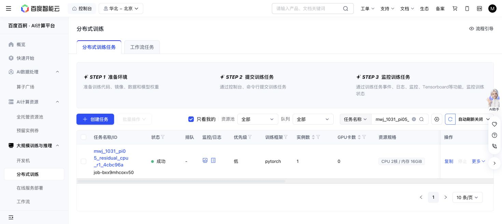

# Residual hooks: independent synthetic CPU qualification

**PASS: 41 tests** at source `4cbc96aff63c61797c19dd421b6da97556bc40fc`: 19 residual cases and 22 existing backend regressions, no skips/errors, 1.61s. Baige job `job-bxx9mhcoxv50` is terminal Succeeded, exit0.

The actual allocation exposed **0 GPUs before masking**, with CUDA uninitialized and cgroups exactly **2 CPU cores / 16GiB**. It used retained Python3.11.17/Torch2.11.0+cu128 directly, without `uv sync`, package installation or environment mutation. The exact two test files were run. Synthetic zero identity, mask/layout/padding, gradient isolation, bounded ALOHA commands/clipping and backend duration/accounting passed.

The single attempt charged **80 conservative CPU-worker-seconds of the600 ceiling** (30 scheduler UI seconds); 520 remain unused. GPU time, real robot actions and optimizer training are0. The code worktree was clean at the exact source before and after. Git bundle deployment, capacity/write probe and literal command readback are recorded; quota CLI was unavailable. No active DSRL container, code, weights, data, contract or budget changed.

This establishes synthetic API/gradient/accounting behavior only. It does **not** establish compatibility or zero-delta parity on actual VLA weights/cache, live simulator behavior, teacher competence, a steering benefit or any GPU screen authorization. Those remain unqualified; existing GPU holds remain.

The executed one-off command and terminal JSON/JUnit/log bytes are preserved with SHA256 in `receipt.json`. No further CPU allocation or retry is planned.

