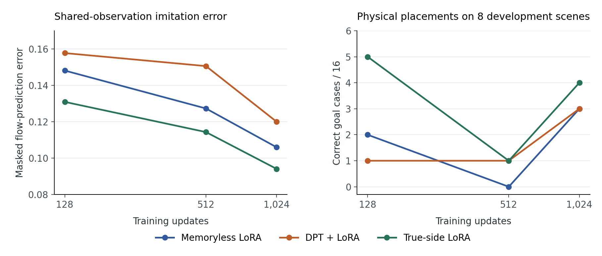

# Matching history did not improve the learned bowl carry

On 16 fresh confirmation scenes crossed with both hidden rewarded bowls, DPT made three correct placements with matching support and five with an opposite-goal donor. Memoryless LoRA made five and frozen π0.5 made four. Each policy continued from the same verified frozen-policy grasp. The scripted controller could release into either bowl on every confirmation scene. [Recomputed paired results](confirmation.json)

## Data and fitting

The constant instruction asks for a fruit in a bowl. A hidden left or right reward remains fixed across support and query, with different scenes for the two attempts. The support controller's chosen side is independent of that reward. Completed motion, actions and terminal reward form the public support. Simulator object poses guide the scripted teacher and remain evaluator-only. The custom success predicate requires a fruit in the rewarded receptacle and the gripper moved away.

| Split | Query scenes | Scenes with both teacher releases | Successful target trajectories | Masked target chunks |
| --- | ---: | ---: | ---: | ---: |
| Training | 24 | 19 | 38 | 956 |
| Development | 8 | 7 | 15 | 374 |
| Confirmation | 16 | 16 | 32 | 810 |

Geometry determined split admission before policy outcomes. Failed pickups and unsuccessful carries stayed in support and evaluation counts. The original eight qualification scenes were separate. Each H50 target contains the commands actually delivered after the recorded public observation, with an execution mask. Training used only the training split for target sampling and normalization. [Corpus and input audit](corpus-evidence.json)

Both students adapt the frozen π0.5 action expert through rank-eight LoRA on its last four query/value attention projections. The memoryless adapter has 139,264 trainable parameters. DPT adds a two-layer, four-head causal history transformer and projection, bringing its total to 696,448. Both use the same batch of six targets and flow-noise draws at each update. Of 6,144 training draws, 3,117 occur at the final observation shared by the two teacher actions.

Native development placements selected duration independently for the two students.

| Updates | Memoryless / 16 | Matching-history DPT / 16 |
| --- | ---: | ---: |
| 128 | 2 | 1 |
| 512 | 0 | 1 |
| 1,024 | 3 | 3 |

Both 1,024-update checkpoints were locked before confirmation scene collection. All 72 physical development rollouts are recorded, along with checkpoint hashes and masked validation errors. [Development evidence](development.json)

## Locked confirmation

| Condition | Correct goals / 32 |
| --- | ---: |
| DPT, matching support | 3 |
| DPT, different-scene support with opposing goal | 5 |
| DPT, same support with counterfactual reward | 4 |
| DPT, reward masked | 5 |
| Memoryless LoRA | 5 |
| Frozen π0.5 | 4 |
| Scripted carry given the goal | 32 |
| Best fixed scripted side | 16 |

Matching DPT gained zero and lost two paired outcomes against its donor, with 30 ties. The difference was −6.25 percentage points. The descriptive interval from resampling four complete four-scene blocks was [−12.5, 0] points. Against counterfactual reward, matching DPT gained one and lost two outcomes. Frozen and memoryless rollouts each ran once per scene and were scored against both hidden goals. Reusing the opposite-goal DPT rollout gives the counterfactual-reward comparison with identical public support and motor noise. The confirmation audit verified 112 physical episodes and 53,198 delivered controls, including each replayed pickup. [Per-case outcomes and all paired contrasts](confirmation.json)

## Reading the support representation

A fixed ridge decoder trained on the 24 training scenes identified 32/32 confirmation goals from public motion and reward. It reached 16/32 with reward masked and zero with counterfactual reward. The same decoder procedure applied to the selected DPT encoder's terminal features reached 17/32, 16/32 and 15/32, respectively. This measures linear accessibility of the goal in the fitted representation. A numerical check reproduced the exact conditioning features used by the original student. The diagnostic had no role in checkpoint selection. [Held-out representation probe](representation-confirmation.json)

Changing only support reward at each identical query decision produced a mean action-separation projection of −0.00135 along the teachers' left-minus-right commands. A value of one would reproduce the teacher separation, and zero would give no separation along that direction. The median was −0.000248, with seven of 16 scene means positive. Each scene used four common native noise draws over the first 50 translation commands shared by the two successful labels. [Action-level reward intervention](direction.json)

## Property-given motor

The negative primary result triggered the predeclared control that gives a separately trained LoRA policy the correct bowl in its instruction. Its 128-, 512- and 1,024-update checkpoints scored 5, 1 and 4 of 16 development goals. Native placements selected 128 updates. Imitation error declined across all three durations. [Selection and physical development outcomes](oracle-development.json)

The locked property-given policy reached 7/32 confirmation goals, with six correct left placements and one right placement. No scene succeeded under both instructions. It gained six and lost four paired goals against memoryless LoRA, giving a net gain of two. The instructed learner still reproduced a small fraction of the 32 demonstrated successful carries. The eight-case training-placement diagnostic is running. [Property-given confirmation](oracle-confirmation.json)

Each curve comes from one fit. The left panel measures masked flow-prediction error at the common teacher decision. The right panel counts correct physical placements across the same eight development scenes and both hidden goals. [Plot source](learning_curves.py)

## Scope and execution

This is a binary, custom one-fruit task with scripted supports and an evaluator-selected first-grasp handoff. The evidence covers one learner fit and 16 confirmation query scenes. The released RoboCasa task contains a broader goal. Generalization across tasks, continuous hidden properties and student-generated support sequences remains to be tested.

Baige's allocated RTX 4090 ran the experiment. Collection used 78adcc26 and the learned motor used bf64c1ef. The first fit stopped before an optimizer update because its 16-dimensional public state needed packing into RLinf's 25-slot input layout. The corrected bridge reproduced all selected state coordinates and camera arrays on 1,539 saved observations. A transient utilization reading also stopped the final development panel before an episode, and a fresh probe passed for its replacement. Both failed attempts and all completed artifacts were retained.

A weak property-given confirmation result also triggers the prespecified eight-case check on training demonstrations if time remains. [Protocol and decision rule](PLAN.md)
