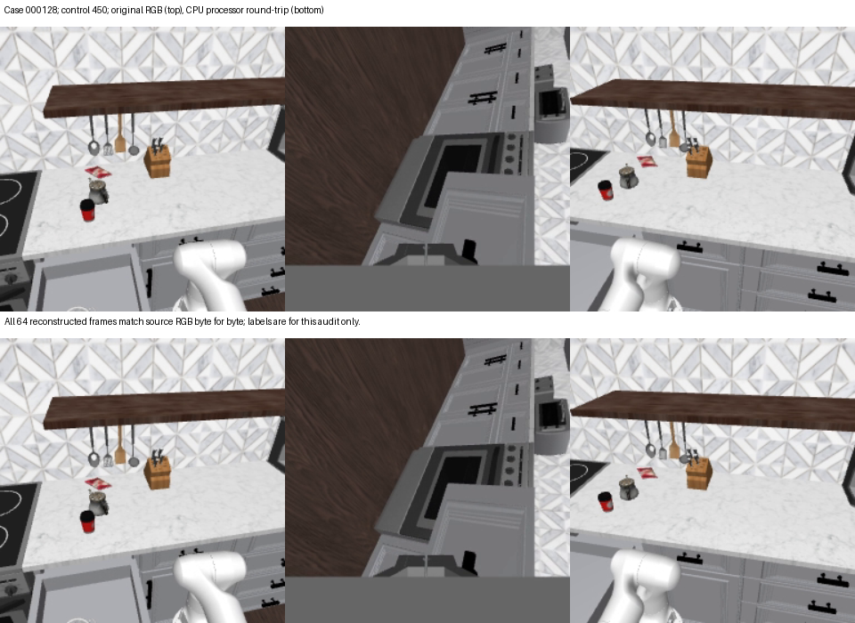

# CPU reconstruction preserves the selected drawer evidence

The passing run is **processor-audit r3**, source
`d565865a0c15db29010f7dd5d84373a1686bdb6f`, on allocated Baige development
CPU. All 256 reconstructed frames match the source RGB byte for byte, both
from float32 processor features and after the bfloat16 input conversion.
The four source sequences also match the earlier actual scoring reads and
the full sampled-frame visual audit. Six exported artifact hashes and all
256 recorded frame hashes verify independently after download.

This rules out loss of the sampled 8-bit pixels in this reconstructed
preprocessing stage as an explanation for the selected 128 miss. It does
**not** establish retention through learned visual embeddings, the model's
target interpretation, or equality to earlier GPU tensors that were not saved.
No reward is qualified or promoted by this audit.

## What ran

The pinned Qwen3.5 implementation registers the Qwen3VL multimodal processor.
Its video branch calls the HF processor with nested pre-sampled video and
frame-clock metadata. The audit calls that HF path with the same disabled
second sampling and official size override, and compares it with the direct
video processor. Features and grids match for every input. All four rendered
native-boundary prompts reproduce their previous actual renderer hashes.

| Case and prefix | Input frames | Video grid | Feature matrix | RGB byte differences, float32 / bfloat16 reconstruction |
| --- | --- | --- | --- | ---: |
| 112@350, wrong lower drawer | 64×320×960×3 | 32×20×60 | 38,400×1,536 | 0 / 0 |
| 256@750, insufficient opening | 64×320×960×3 | 32×20×60 | 38,400×1,536 | 0 / 0 |
| 376@750, wrong lower drawer | 64×320×960×3 | 32×20×60 | 38,400×1,536 | 0 / 0 |
| 128@450, missed success | 64×320×960×3 | 32×20×60 | 38,400×1,536 | 0 / 0 |

The grid preserves 320×960 spatial resolution and packs two original frames
per temporal patch. Inverting the patch permutation recovers all 64 frames;
it does not average each frame pair. The grid represents 9,600 merged spatial
positions before learned encoding. This audit computes no visual embeddings.
Maximum inverse RGB error before rounding is 0.000015259 for float32 and
0.246098 after bfloat16 conversion, both below half an 8-bit channel value;
rounding recovers every source byte.

The normalizer is correctly mean=std=(0.5,0.5,0.5), represented as tuples.
There is no normalization mismatch with the saved model config. The r2
failure was an audit guard comparing tuples directly with a Python list;
r3 records the actual values and uses them without modifying the processor.
The effective request override is shortest_edge=4096 and
longest_edge=29,360,128; second frame sampling is disabled. Installed versions
are Transformers 5.8.1, Torch 2.11.0, torchvision 0.26.0, vLLM 0.24.0 and
NumPy 2.3.5. Twelve predeclared source/config hashes are unchanged.

## What the images do and do not show

All four original/round-trip comparison sheets were inspected. They are
identical and preserve the three-view order. In 128@450 the opening is near
the lower edge of the left external view, while its front is partly or fully
outside the frame. The preceding full sampled-frame audit contains ten
post-native-success source frames at controls 386–450. Cropping is a concrete
observation; it is not proof that Flora equates an absent front with closure.

Wrong-drawer 112/376 retain evidence of a near-closed upper target alongside
lower-drawer motion. Case 256's late still lacks a useful full-depth reference
for distinguishing its native 50.22% opening from the required 52.25%.
Neither intact pixels nor visible interior alone proves that a model can
estimate that boundary reliably. Do not describe these sheets as saved GPU
inputs or a qualification of the visual encoder.

## Attempts and scope

| Attempt | Authoritative outcome | CPU wall time or bound |
| --- | --- | ---: |
| r1, source 03b51bff | Stopped before output creation; import startup exceeded deadline | 240 s ceiling |
| Processor-only startup diagnostic | Python 3.12.15 repeatedly stats RECORD entries during Transformers import | 90 s ceiling |
| Same diagnostic with scoring's user-site isolation | Same metadata scan; did not finish within bound | 120 s ceiling |
| r2, source 9f96a80b | Processor loaded, then the pre-frame tuple/list guard failed | 367.272 s observed through processor readiness; 900 s process ceiling |
| **r3, source d565865a** | **All four inputs and 256 frame reconstructions passed** | **381.064 s audit / 402.652 s process wall time** |

These are CPU timings or explicitly labelled ceilings, not GPU charges.
The process exited 0, and its PID is verified gone. Checkout and separate
source-inspection time are not included. Failed r1/r2
contracts and evidence remain under their distinct identities
([r1 failure](../robocasa-flora-drawer-processor-audit-20261103-r1/FAILURE.json),
[r2 failure](../robocasa-flora-drawer-processor-audit-20261103-r2/FAILURE.json)); r2's
FAILURE.json must not be mistaken for this passing receipt. Its raw log is
retained on Baige at `/root/workspace/drawer-processor-audit-r2.log`, SHA-256
`d258899dafb348cb67441f923532888b3725eaeb1161665b69a28eb47f38e77d`.
Chrome's organization policy blocked downloading that .log; it was not
renamed or transferred through an alternative mechanism to bypass the block.

Zero model weights loaded, model inference calls, simulator calls, policy
controls, motor calls, optimizer steps, or new GPU seconds. Shared runtime,
model cache and completed scoring worktrees remain unchanged. The previously
reported 7,350 worker GPU-seconds is the prefix/chunk/clause/wording subtotal,
not a whole-project cost or a newly available budget.

## Decision

[The consolidated rubric review](RUBRIC-REVIEW.md) separates the controlled
wording results and their different terminal/first-success label definitions.
No tested rubric, binary output change, chunk window, or lowered score cutoff
has established a reliable first-success reward on these selected examples.

Recommend at most one new framing comparison, specified in
[NEXT.md](NEXT.md) and [the exact frozen text/panel](NEXT-COMPARISON.json).
It retains explicit first-success target/extent criteria and tests only the
additional claim that a drawer front may move out of frame. Prior generic
view clarification failed, so this is a hypothesis to falsify, not an expected
fix. There is no additional GPU launch or reserved GPU budget in this audit.
The next small trial remains within the retained human authorization for
failure-focused rubric iterations: at most 900 GPU-seconds for that allocation,
with zero spent or allocated to the proposal so far. Local records establish
no pooled campaign balance, and none is borrowed from closed allocations or
another experiment. A larger trial or scope would require separate authority.

Evidence: [passing CPU receipt](RECEIPT.json), [process exit](PROCESS-EXIT.json), [effective processor config](PROCESSOR.json),
[independent artifact checks](COPIED-HASHES.json), [source hashes](SOURCE-SURVEY.json),
[visual review](VISUAL-REVIEW.json), [comparison 112](case-000112-prefix-350-roundtrip.png),
[comparison 256](case-000256-prefix-750-roundtrip.png),
[comparison 376](case-000376-prefix-750-roundtrip.png).
