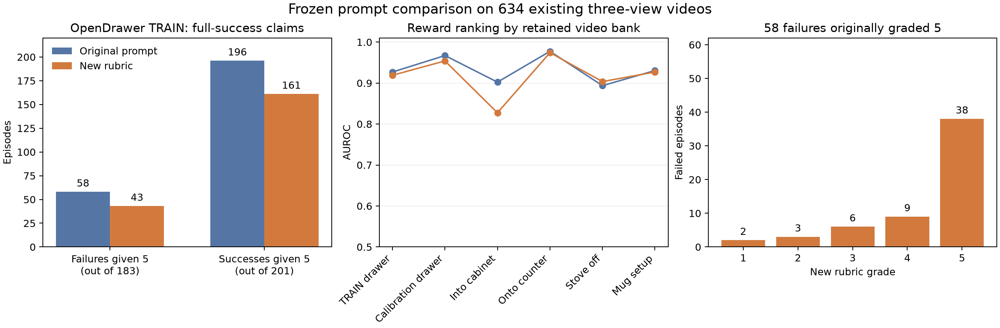

# Flora reward rubric and replay results

The first generalized completion rubric is **not recommended for adoption**.
It corrects some full-success claims on failed videos, but downgrades many true
successes and does not improve the reward ranking overall. Keep the original
production prompt while developing the next version.

This document records the original prompt, the frozen tested revision, its
paired results, and a proposed next revision. All measurements below are from
existing videos; no new robot episodes or PPO updates were used.

## Original prompt

The original is the official Flora terminal-success prompt. It has no
task-specific completion rubric and gives no separate definitions for grades
2, 3, and 4.

Exact system text:

```text
You are a terminal-success reward model for robot trajectories.
Given the task instruction and the complete trajectory video, predict a score from 1 to 5.
A complete failure is 1. A complete success is 5.
Judge only what is visible in the trajectory and follow the requested output format exactly.
Do not provide a rationale. Return exactly:
Score: <1-5>
```

Exact user-message template:

```text
Task: <native task instruction>

Complete trajectory video:
<video>

Evaluate the terminal success of the task.
```

For example, the task instruction can be `Open the left drawer.` The video is
the synchronized left, wrist, and right camera collage. The official sampler
includes the first and final frames. These retained clips use 64 sampled frames.

The pinned official code is `129a2ada74c526ee4692f3d1b111bea6ca19d5b7`.
The exact model receipt and input identities are in [the manifest](MANIFEST.json)
and [qualification receipt](QUALIFICATION.json).

### Reward calculation

The greedy text grade and the PPO reward are different quantities:

```text
greedy grade = the generated integer from 1 to 5
expected grade = sum(grade * probability_of_grade), for grades 1 through 5
PPO reward = (expected grade - 1) / 4
```

The reward is not the probability of complete success. Lowering a greedy grade
from 5 to 4 can still leave substantial positive reward on a failed episode.
This replay preserves the original probability extraction and reward mapping.

## Tested revision 1

Revision 1 keeps the original system message and native instruction, then
appends the following shared text and only the current task's completion text
to the task description. Exact simulator measurements remain outside the
scorer input.

### Shared completion text

```text
Use the native task instruction to identify the requested object and target.
Follow the same target throughout the video, even when camera viewpoints change.
Use the synchronized views together. Judge whether the requested outcome is
achieved at the end of the trajectory. Earlier progress that is later undone
does not establish terminal success.

Reserve complete success for an outcome satisfying all of the task's completion
conditions. Reaching, touching, grasping, moving toward the goal or nearly
finishing are partial progress. Use visible evidence; occlusion alone is neither
proof of failure nor proof of success. Do not add requirements absent from the
task's completion conditions. Keep the official one-to-five output format.
```

### Task completion text

| Task | Text appended for revision 1 |
| --- | --- |
| OpenDrawer | The requested drawer is fully open at the end, near the end of its travel. A partly pulled drawer is not complete success. Judge the drawer identified by the instruction and initial scene, rather than switching targets as the camera moves. |
| PickPlaceCounterToCabinet | The requested object has been placed fully inside the intended cabinet, and the acting hand has released it and withdrawn clearly away. Holding it in the doorway or leaving it protruding is incomplete. Closing the cabinet door afterward is not required. |
| PickPlaceDrawerToCounter | The requested object has been taken out of the drawer and placed in contact with a counter surface. The acting hand has released it and withdrawn clearly away. Keeping it held above the counter is incomplete. Closing the drawer afterward is not required. |
| TurnOffStove | The burner named in the instruction is off at the end. Follow the named burner and its control; cookware may be on a different burner. Other burners do not have to be turned off. Moving a knob without reaching the requested off state is incomplete. |
| CoffeeSetupMug | The requested mug is positioned directly under the coffee dispenser at the receiving position. The acting hand has released it and withdrawn clearly away. Leaving it beside the machine or holding it under the dispenser is incomplete. Brewing coffee or turning the machine on is not required. |

The [frozen candidate JSON](candidate.json) is the authoritative revision 1
text. Its SHA256 is
`815137b5d50c8313d493a8440bd0df9deb77c4288190632a11b503967a220586`.
The five additional OOD task descriptions in the earlier draft were not tested
in this replay and are not additions to PPO's training tasks.

## Paired replay

Both prompts scored all 634 retained videos: 384 OpenDrawer Flora-PPO training
episodes and 250 earlier calibration episodes, 50 for each of five tasks.
Model weights, video bytes, camera order, native instructions, frame sampling,
temperature, seed, output parsing, and reward aggregation were held fixed.
The two requests for each video ran through the same persistent engine and
inference batch. Simulator truth and old grades were excluded from model inputs.

Comparisons below use the fresh original-prompt replay. Saved historical grades
are also retained: 17 of 634 greedy grades changed in the original replay, but
all 58 flagged full-score failures again received grade 5. Historical and fresh
original scores are reported separately in [the full results](RESULT.md).

### OpenDrawer training videos

There are 201 native successes and 183 native failures.

| Measurement | Original prompt replay | Revision 1 |
| --- | ---: | ---: |
| Failed episodes given grade 5 | 58 / 183 | 43 / 183 |
| Successful episodes given grade 5 | 196 / 201 | 161 / 201 |
| Grade 5 false-positive rate | 31.7% | 23.5% |
| Grade 5 precision | 77.2% | 78.9% |
| Grade 5 recall | 97.5% | 80.1% |
| Reward AUROC | 0.9269 | 0.9191 |

Revision 1 corrects 20 false full-success grades, introduces five new ones, and
downgrades 35 true successes from grade 5. The paired false-positive correction
test gives p = 0.0041 on these development videos; it does not account for the
lost true-success grades or establish better reward ranking.

### The 58 original full-score failures

All 58 are native failures that originally received grade 5, and all 58 again
receive grade 5 under the fresh original prompt.

| Revision 1 grade | Number of these failed episodes |
| --- | ---: |
| 1 | 2 |
| 2 | 3 |
| 3 | 6 |
| 4 | 9 |
| 5 | 38 |

Only 20 of 58 lose the full-success grade. More importantly for PPO, their mean
reward does **not** fall: **0.7145 → 0.7182**. Their mean probability of grade 5
falls from 0.4966 to 0.4311, but the expected-grade reward can remain high as
probability moves among the other grades.

The two highest-reward failures examined earlier both remain grade 5:

| Episode | Instruction | Original replay reward | Revision 1 reward |
| --- | --- | ---: | ---: |
| `flora-single-case-000112-rank-06-episode-000001` | Open the left drawer. | 0.9678 | 0.9772 |
| `flora-single-case-000064-rank-00-episode-000001` | Open the left drawer. | 0.9664 | 0.9725 |

Every flagged case, including its original and revised grade, probabilities,
reward, instruction, and video references, is preserved in
[the 58-case JSON](FOCUS-58.json) and [CSV](FOCUS-58.csv).

### Earlier calibration videos

Each row contains 50 videos. False grade 5 counts are over native failures;
the denominator differs by task.

| Task | Original AUROC | Revision 1 AUROC | False grade 5 original → revision 1 | True grade 5 original → revision 1 |
| --- | ---: | ---: | ---: | ---: |
| OpenDrawer | 0.9672 | 0.9540 | 3 → 1 | 29 → 23 |
| PickPlaceCounterToCabinet | 0.9023 | 0.8274 | 0 → 0 | 8 → 4 |
| PickPlaceDrawerToCounter | 0.9775 | 0.9742 | 3 → 2 | 23 → 22 |
| TurnOffStove | 0.8937 | 0.9037 | 6 → 17 | 6 → 6 |
| CoffeeSetupMug | 0.9305 | 0.9269 | 8 → 8 | 16 → 17 |

The stove result shows why greedy grades and reward ranking need separate
checks: AUROC rises slightly while false full-success claims increase sharply.
The cabinet-placement ranking also becomes substantially worse on this bank.



## Next iteration draft

Revision 2 is **untested**. Keep the official system message and native task
instruction. Replace the long shared and task-specific additions with one short,
task-general addition:

```text
Evaluate the object and target requested by the instruction, using the camera
views together. Base terminal success on the state at the end of the trajectory.
Earlier progress that is later undone does not establish completion. Reaching,
touching or grasping alone is partial progress when the requested task requires
an achieved outcome.
```

This is a proposed ablation of revision 1's added detail, not a claim that short
wording will work better. The replay does not identify which added sentence
caused each regression. Preserve revision 1 and its results unchanged.

For the next paired test:

1. Freeze the exact revision 2 text and give it a new prompt and output identity.
2. Keep the original prompt as the control and retain the same video and
   inference conditions. Evaluate true successes and every failed case, not
   only the 58 selected errors.
3. Treat expected-grade reward alignment as the primary check: AUROC and the
   reward distributions on successes and failures. Report greedy-grade
   corrections, new false successes, and lost true successes alongside it.
4. Do not accept a revision merely because it emits fewer grade 5 answers.
   A lower false-full-success count with unchanged failed-episode rewards or
   a large true-success loss is insufficient.
5. Use these existing videos for development. After wording is frozen, test
   it on separate videos before qualifying a production PPO reward protocol.

Changing the reward mapping to the probability of success or to binary grades
would be a separate experiment. It is not part of the rubric replay above.

## Reproducibility and evidence

Baige job `job-ubluihp2bg07` succeeded on 2026-11-02 at 16:04:22 Asia/Shanghai.
Both nodes exited 0. Four engines produced all 1,268 labels, with one model
load per engine. The run charged 6,218 GPU-seconds against its 13,200-second
ceiling, with zero new robot controls and zero optimizer updates.

- [Paired results and all 58 flagged cases](RESULT.md)
- [All 634 paired records](PAIRED-EPISODES.json) and [CSV](PAIRED-EPISODES.csv)
- [Machine-readable metrics](RESULT.json)
- [Input manifest](MANIFEST.json) and [Linux qualification](QUALIFICATION.json)
- [Terminal review and resource charges](TERMINAL-REVIEW.json)
- [Scorer implementation](REPLAY.py) and [frozen replay plan](PLAN.md)

These results cover retained development videos at their original horizons.
They do not qualify a new 600-control calibration or establish improved robot
performance from PPO.
