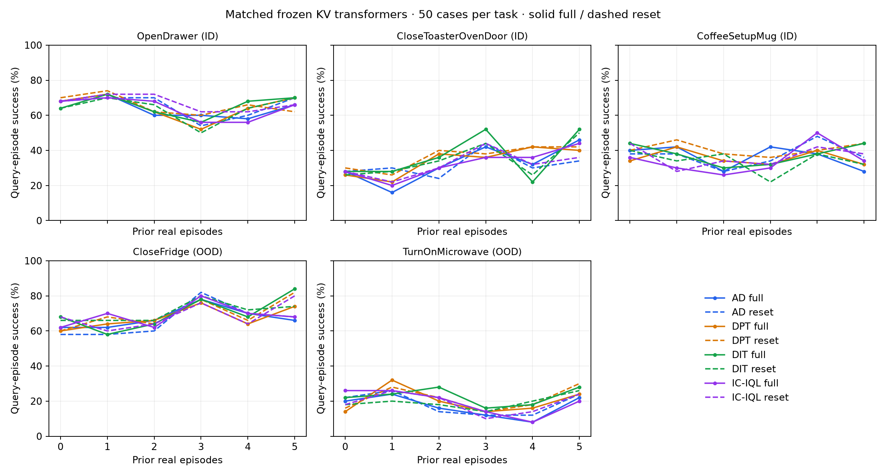
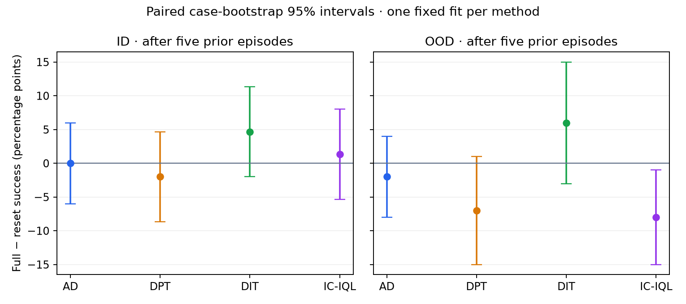

# Four frozen KV transformers: matched ID/OOD readout

All four saved models now have complete audited panels: 12,000 episodes, including the existing 3,000-episode AD reference.

Success below is during the sixth real episode, after five preceding attempts. It is not cumulative best-of-six success.

| Method | Split | Full success | Reset success | Full − reset (pp) | Paired 95% interval (pp) |
| --- | --- | ---: | ---: | ---: | --- |
| AD | ID | 46.7% | 46.7% | +0.0 | [-6.0, 6.0] |
| AD | OOD | 44.0% | 46.0% | -2.0 | [-8.0, 4.0] |
| DPT | ID | 47.3% | 49.3% | -2.0 | [-8.7, 4.7] |
| DPT | OOD | 49.0% | 56.0% | -7.0 | [-15.0, 1.0] |
| DIT | ID | 55.3% | 50.7% | +4.7 | [-2.0, 11.3] |
| DIT | OOD | 56.0% | 50.0% | +6.0 | [-3.0, 15.0] |
| IC-IQL | ID | 48.0% | 46.7% | +1.3 | [-5.3, 8.0] |
| IC-IQL | OOD | 44.0% | 52.0% | -8.0 | [-15.0, -1.0] |

The intervals reflect case sampling for one fixed fit per algorithm. They do not include variation across training seeds or new task families. First-query discordance is reported in RESULT.json; small paired differences alone do not prove causal adaptation.

ID: Drawer, Toaster, Coffee. OOD: Fridge, Microwave, held out of this meta-training corpus. All use the original frozen VLA, canonical scenes, seeds, horizons and zero deployment SGD.

## Interpretation and decision

DIT has the highest full-history endpoint in this panel: 55.3% ID and 56.0% OOD. Relative to AD, its paired difference is +8.7 percentage points on ID (marginal 95% interval +0.7 to +16.7) and +12.0 on OOD (+4.0 to +21.0). These intervals condition on the four particular saved fits; they do not establish a training-seed-robust algorithm ranking, and no multiplicity correction was applied.

The history-specific comparison is weaker. DIT gains +4.7 points over clearing its own history on ID (−2.0 to +11.3) and +6.0 on OOD (−3.0 to +15.0). Both intervals include zero. Coffee accounts for six of the seven additional ID successes; Fridge accounts for five of the six OOD successes. Drawer has no final-query gain. The per-query curves are not a consistent monotonic improvement with more history. IC-IQL's OOD history effect is negative in this panel (−8.0 points, marginal interval −15.0 to −1.0).

There are also first-query full/reset disagreements, when neither condition has prior episodes: DIT has 0/50 on Drawer, 1/50 Toaster, 4/50 Coffee, 5/50 Fridge and 4/50 Microwave. The audits verify canonical initial physical/public states and recorded commands/draws, but do not establish bit-identical cross-run trajectories. The cause of these discrepancies was not identified by this comparison. They further limit a causal interpretation of small history effects and should be resolved before a stronger memory claim.

Recommendation: preserve DIT as the leading candidate and stop automatic scaling of this recipe. A focused diagnostic is justified; these results do not justify killing all in-context RL or claiming that DIT reliably adapts from history. The current comparison is complete. No additional diagnostic training was launched.

## Why DIT might be stronger

The implementation provides a plausible hypothesis, not an identified cause. AD gives recorded executed actions uniform weight. DIT uses independently fitted, frozen Q/V estimates to weight the same executed-action flow-matching targets by clipped exp(Q−V). Its Q/V objectives use observed discounted returns with TD regularization. That can favor useful actions within mixed-quality histories. IC-IQL also uses advantage weighting, but learns its values with TD Q targets and an expectile V objective. DPT instead uses the fixed-130 teacher's query actions. The quality of these different weights and action targets has not been isolated by the evaluation.

The policy fits also received different training durations under the same validation stopping rule:

| Method | Selected policy update |
| --- | ---: |
| AD | 2,900 |
| DPT | 4,900 |
| DIT | 9,684 |
| IC-IQL | 2,900 |

All use the same three-task corpus, six-layer/256-wide history transformer, KV adapter configuration, logical batch and frozen base VLA. Checkpoints were selected by held-out flow loss, not simulator success. However, DIT received about 3.3 times AD's policy updates, so the present comparison cannot isolate the objective from training duration. Differences among weighted losses and label targets also prevent directly ranking methods by their validation-loss values.

A follow-up should first diagnose first-query replay differences, then compare equal policy-training budgets, inspect DIT/IQL value-weight calibration, and repeat across training seeds. A uniform-weight ablation would directly test whether DIT's weighting helps. These are proposed diagnostics, not results or authorized new launches.

[Training contract](../robocasa-three-task-kv-velocity-meta-20261105-r1/CONTRACT.json) · [Saved checkpoint index](../robocasa-three-task-kv-velocity-meta-20261105-r1/finalized-fits-20261106-r1/INDEX.json) · [Machine-readable comparison and source hashes](comparison/RESULT.json).

## Completion and limits

All 210 new banks and the 70 AD reference banks passed the original comparison assertions: 12,000 episodes, 7,560,000 native physical controls and 36,000 decoded camera videos. The scientific checkpoint, base VLA, normalization, horizons, cases and zero-deployment-SGD contract are unchanged. Incomplete group receipts were reconstructed separately from unchanged audited banks; all predeclared banks were included irrespective of outcome. [Completion receipt](comparison/COMPLETE.json) · [Recovery provenance](evidence-final/recovery).

This finishes the four KV transformer panels. The previously saved velocity fits remain preserved; this readout does not complete the three non-AD velocity evaluations. OOD denotes tasks excluded from this meta-training corpus, not necessarily from base-VLA pretraining. There is only one fit per algorithm, three ID tasks and two OOD tasks, so no claim of broad task-family generalization is supported.

The additional Cabinet, Rack and CounterToStove PPO pilots also completed ten updates each, with no clear evidence of improved endpoint performance. [Teacher results](../robocasa-six-source-decision-20261112-r1/RESULT.md).

Conservative upper bounds, retaining the full previous continuation reservations despite earlier completion, are 21.171/22.5 GPU-hours for this readout, 162.130/170 for the historical campaign, and 48.835/50 for all new work including teachers. These bounds are not exact billed usage. Queued time is not allocated GPU time. No further GPU work is planned. [Accounting](BUDGET-RECONCILED.json).
